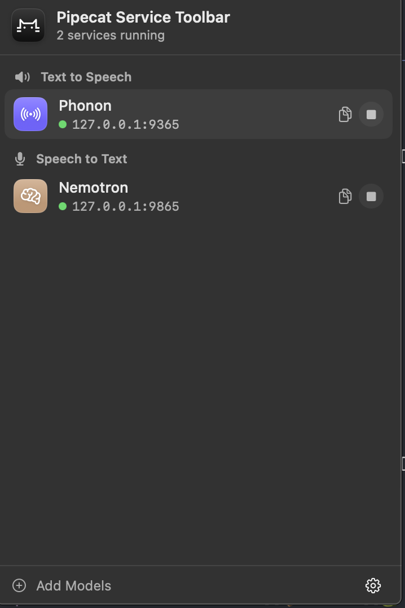

# Pipecat Service Toolbar

**Local speech services for Pipecat, from the menu bar.**

A native macOS menu bar app that downloads text-to-speech and speech-to-text
models and serves them on fixed loopback ports. Point your Pipecat app at a port
to use a local model with no cloud API. There is no Dock icon.

Services started by the toolbar stop when it quits; external servers stay running.

## Quickstart

Requires **Apple Silicon and macOS 15+**; Apple Speech needs **macOS 26+**.
To build from source, install **Xcode 26+** (including the macOS 26 SDK),
[uv](https://docs.astral.sh/uv/), and `just`.

```bash
git clone https://github.com/pipecat-ai/pipecat-service-toolbar.git
cd pipecat-service-toolbar
uv sync --locked
just app-open
```

Click the cat in the menu bar, open **Add Models**, click **Get**, then **Start**.
Python and model weights download on first use. **Try it** plays generated speech
or tests transcription with a sample clip or microphone.

`just app-open` builds and launches the app. To install into `~/Applications`, use
`just app-install`; it requires the `Code Signing` identity or an explicit
`SIGN_IDENTITY`. Both commands quit a running copy first.
See [build and signing details](docs/development.md#build-and-test).



## Services

The defaults are **Kokoro TTS** on port **8765** and **Apple Speech STT** on
port **9465**. The catalog also includes Phonon, Pocket TTS, Qwen3, Voxtral, Dia,
Fish S2 Pro, Whisper, Kyutai STT, Parakeet, Nemotron, Moonshine, and a test tone.
Model variants have separate ports and can run side by side.

See [services and models](docs/services.md) for the full port map, model IDs,
licences and runtime requirements. Each running service offers **Copy URL**,
**Copy Pipecat Service**, and **Copy Environment Variables** in its right-click menu.

The toolbar adopts compatible servers already running on its catalog ports and
shows them as **External**. It remembers services it started and restores them on
launch by default. See [using the toolbar](docs/usage.md) for external servers,
restore, quit confirmation, model deletion, logs and settings.

## Use a service from Pipecat

These are service-construction snippets, not complete bots. For TTS, use the
[pipecat-local-tts-server checkout](https://github.com/vr000m/pipecat-local-tts-server)
after running `uv sync --extra examples` there, or copy its reference adapter into
your bot project and adjust the import. See
[Client integration](https://github.com/vr000m/pipecat-local-tts-server/blob/78823eeabf1f36c464243af1bd41b879d058c028/docs/clients.md#use-the-pipecat-adapter) for a pipeline
sketch and the packaged Python client's WAV example.

```python
# TTS: examples/pipecat_tts_service.py in pipecat-local-tts-server
from examples.pipecat_tts_service import LocalTTSService

tts = LocalTTSService(host="127.0.0.1", port=8765)

# STT: pip install pipecat-ai "pipecat-local-stt-server[client]"
#      (the server package does not declare pipecat-ai)
from stt_server.examples.pipecat_stt_service import LocalWebSocketSTTService
stt = LocalWebSocketSTTService(host="127.0.0.1", port=9465)
```

The TTS adapter takes explicit endpoint arguments; environment variables alone
do not configure it. To use `TTS_WS_HOST`/`TTS_WS_PORT`, resolve and pass them as
shown in [Endpoints and authentication](https://github.com/vr000m/pipecat-local-tts-server/blob/78823eeabf1f36c464243af1bd41b879d058c028/docs/clients.md#endpoints-and-authentication).
For STT setup, consult the
[STT client and Pipecat integration guide](https://github.com/vr000m/pipecat-local-stt-server/blob/v0.6.0/docs/integration.md#pipecat-integration).

## Documentation

| Guide | Contents |
|---|---|
| [Using the toolbar](docs/usage.md) | Menu controls, external servers, restore, quit, caches and logs |
| [Services and models](docs/services.md) | Ports, model IDs, variants, licences and runtimes |
| [Development](docs/development.md) | Build, signing, tests, smoke checks and server artifacts |
| [Architecture](docs/architecture.md) | Components, lifecycle, protocols, packaging and security |
| [Migration and compatibility](docs/migration.md) | Existing installations, versioning and server-pin checklist |

[All documentation](docs/README.md) · [Release history](CHANGELOG.md)

## License

[BSD-2-Clause](LICENSE). Model weights carry their own
[licences](docs/services.md#services).
