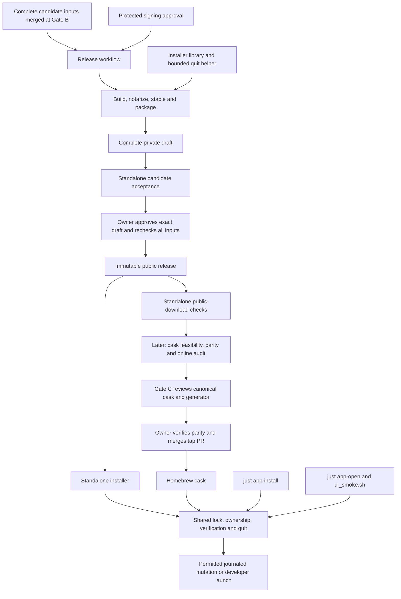
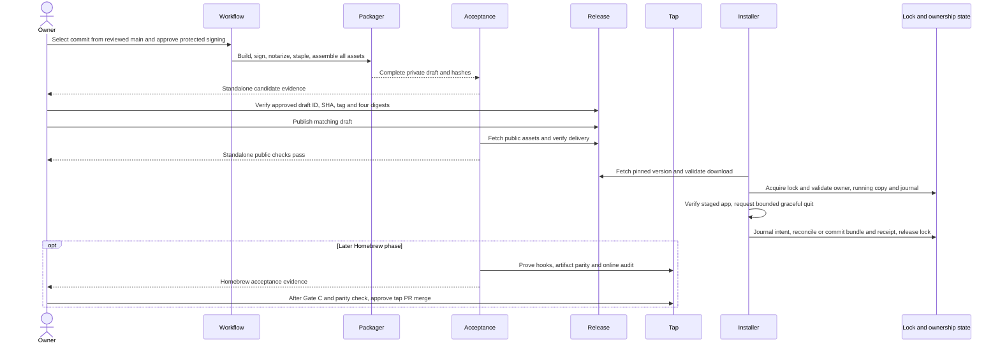

# Task: Ship standalone installation and updates, then add Homebrew

**Status**: Planned — final review findings addressed in this revision
**Component**: distribution
**Assigned to**: Varun Singh
**Priority**: Medium
**Branch**: `docs/app-distribution-plan` (planning); implementation on focused `feature/app-distribution-*` branches cut from reviewed `main`
**Created**: 2026-11-17
**Review Gates**: full

## Objective

Publish one signed, notarized Apple-silicon app archive. Deliver the standalone
command-line installer and manual updates first. Add a Homebrew cask later,
consuming the same archive and checksum.
End users need neither a source checkout nor Xcode, uv, Python or just installed.
The standalone release requires neither a Homebrew tap nor a cask delivery. It does require the Homebrew-facing
contracts that published installers freeze: cask token, lock primitive and versioned state (see "Frozen contracts").

This updates the Homebrew plan from `docs/distribution-plans` at `a5a371d`.
Its scope now includes standalone installation; the retained
[App Store decision record](20261117-design-app-store-distribution.md) explains the excluded route.

## Context

Verified against the current checkout on 2026-11-17:

- `scripts/build_app.sh` signs nested uv and the app with hardened runtime, but uses
  `--timestamp=none`. Release signing needs a separate secure-timestamp mode.
  It also rewrites `CFBundleIdentifier` when `BUNDLE_ID` is set (documented in `docs/development.md`).
- `just app-install` builds locally, quits the running app, stages and verifies a
  copy, then replaces the bundle. It defaults to the self-signed `Code Signing` identity and writes no receipt,
  so every existing developer install, including the known baseline build 474, is receipt-less.
  Retain local builds, with ownership guards added before replacement; the new installer downloads a finished release.
- `just app-open` can request quit by bundle ID before launching the local build.
  `scripts/ui_smoke.sh` refuses a preexisting running copy and quits the smoke copy it launches.
- `scripts/quit_app.sh` has a bounded quit protocol and treats refusal, timeout or
  unknown running state as failure. It must never be replaced with a force-kill shortcut.
  It is a standalone program with top-level EXIT/INT/TERM traps and `exit` calls, so it cannot be sourced.
- `scripts/fetch_uv.sh` bundles arm64 uv; `Package.swift` targets macOS 15+.
  Apple Speech still needs macOS 26+. Python and models download on demand.
- `app-version.json` is currently version `0.4.1`, build `474`; app versions remain
  independent of `artifacts/tts.json` and `ServiceCatalog.sttServerRequirement`.
- `.github/workflows/test.yml` is the test workflow. Its ubuntu job runs the full pytest suite; its `macos-app` job
  runs only `python_tests/test_app_recipes.py`. There is no release workflow or standalone app installer in this checkout.
- Bundle identity, AppPaths, cache precedence, preferences and environment
  fingerprints are compatibility invariants. Inspect the migration tests before changing packaging.

## Prerequisites and decisions

- Confirm the release owner, Apple Developer membership, Developer ID Application
  certificate, expected Team ID and notarytool API-key access. No credentials belong in this plan.
  Their availability is unverified. Reviewed mock implementation may proceed without credentials;
  real signing requires verified credentials, a protected environment and approved version/build metadata.
- Proposed tap: `pipecat-ai/homebrew-tap`, pending owner approval and repository/access checks.
  Tap provisioning is a phase 7 dependency only. The cask token is fixed now as `pipecat-service-toolbar`
  because the standalone installer detects Brew ownership by it. Use a project-owned tap initially;
  submission to Homebrew's main cask repository is separate work.
- Use a ZIP archive with a stapled app inside, built with `ditto -c -k --keepParent`.
  Distribution channels never re-sign, modify the signed bundle or rebuild the app.
- Standalone destination: `~/Applications`, with `--app-dir` for an existing directory exclusive to the invoking user.
  No sudo, privilege escalation or automatic app launch. Homebrew keeps its configured app directory.
- First standalone interface: `install.sh --version X.Y.Z [--app-dir PATH]` plus `--help`.
  `install.sh` is bound to its own release: it embeds its version and rejects any other `--version` value.
  The flag stays required as an explicit confirmation. The same command installs when absent and updates a
  verified standalone installation when present. An explicit stable version is required; automatic
  latest-version discovery, downgrades, and an in-app updater are outside this increment. An explicit local maintenance command handles
  verified removal and backup cleanup for channel switching.
- Normal uninstall retains app data. Cask zap may remove only preferences and logs;
  never Application Support, model weights, Hugging Face or Moonshine shared caches.

## Requirements

### Review and merge gates

- Each gate runs `/code-review xhigh --fix` and `review-gauntlet`, resolves findings and merges normally to `main`.
  Gate A lands the reviewed release workflow and approved dry-run version/build. Gate B lands every first-release
  input, including complete asset assembly, final version metadata, changelog and documentation. Gate C lands the cask
  and its generator after standalone publication and before the external tap merge.
- Phase 3 runs live checks from the Gate A workflow. Phase 4 mock work may start after Gate A while signing is pending.
  Phase 5 starts after Gate B and the phase 3 live checks pass. It selects an existing reviewed `main` commit and records
  candidate evidence. Changes to candidate inputs go back through Gate B and require fresh evidence.
- Phase 6 starts with owner approval bound to phase 5 evidence. Phase 6 publishes and verifies public delivery.
  Phase 7 starts after public verification. The tap PR can be prepared before Gate C and merged after it.

### Shared release contract

- Release mode requires Developer ID Application, secure timestamps, hardened runtime and valid nested signatures.
  Verify bundle ID `ai.pipecat.ServiceToolbar`, version/build, Team ID and absence of `get-task-allow`. Preserve quarantine.
  Validate the exact uv and server-wheel layout with a real submission. Record whether the wheel contains native code.
- Submit a temporary ZIP with `xcrun notarytool submit`, persist the returned submission ID, and poll to a terminal
  status with a bounded deadline. On timeout keep the ID for follow-up and withhold publishable output.
  Archive the log once available and review warnings even on Accepted. Record submission errors separately when
  Apple returns no ID. On acceptance staple and validate the app, then ZIP and hash the final bytes.
- Publish exactly four assets: `Pipecat-Service-Toolbar-X.Y.Z-arm64.zip`, `SHA256SUMS`, `install.sh` and a
  plain-text release manifest. Use an exact schema for schema version, app version/build, bundle ID, Team ID,
  architecture, minimum macOS, filename and SHA-256. Reject duplicate, missing or unknown keys and invalid values.
  Require checksum and manifest agreement. Parse both as data. Verify the bundle's signature and Gatekeeper status.
- The tag `vX.Y.Z` matches `app-version.json`. Public candidates exceed build 474, the private predecessor, and the
  maximum known published build. Inventory legacy builds without manifests from trusted release records and stop real
  release preparation if the maximum is uncertain. Require GitHub immutable releases and a workflow overwrite guard.
- Run the credentialed workflow using its reviewed definition on protected `main`. Use manual dispatch with a full
  approved commit SHA reachable from protected `main`. Validate the selected commit and its version before executing
  build scripts or importing credentials. Version tags are release identifiers, and any existing tag must resolve to the
  approved commit. Verify tag-present and tag-absent cases in a sandbox. Check the final association again publicly.
- Use a GitHub-hosted ephemeral runner and protected environment restricted to the reviewed workflow ref. Require
  reviewers, disable administrative bypass, and verify denial before real signing. Inject the confirmed Team ID and
  reject placeholders. Mask secrets and use an ephemeral keychain and private key files. Clean up on normal exits,
  errors and catchable cancellation. Forced termination relies on disposal of the ephemeral runner. Restrict write
  permission to draft upload. Keep test jobs and tap inputs free of signing credentials.
- Dry runs upload a ZIP-only workflow artifact. Complete runs create a private draft with the full commit SHA as
  `target_commitish`. Both modes end before publication. The owner approves the draft ID, SHA, tag and four digests.
  Serialize draft writes and publication via one release owner and freeze draft writers at handoff. Immediately before
  publishing, recheck the draft ID, target, tag and all four digests against approval under that control. Abort on drift
  and obtain fresh acceptance and approval. Record approvals and evidence in the draft notes and release evidence file.
- A public check verifies all four asset digests and the tag commit. Exercise Gatekeeper on the browser-downloaded
  ZIP and install/update using the public URLs. A failure blocks the tap and requires a new approved release for
  corrections. Publication, tag creation and credential configuration require the release owner's authorization.

[Apple notarization workflow](https://developer.apple.com/documentation/security/customizing-the-notarization-workflow)
and [GitHub release API](https://docs.github.com/en/rest/releases/releases) define the external operations.

### Frozen contracts

Published installers are immutable and old versions stay downloadable, so the first release freezes these.
They are fixed before phase 4 and may change only through a new installer release:

- Cask token `pipecat-service-toolbar`.
- Lock primitive (see "Installer state and removal"): a kernel advisory lock on `operation.lock`.
- A schema version on the receipt, lock record and recovery journal, and a protocol version file in the installer
  state directory. Every later installer must honour version-1 state. An installer that reads a newer version
  stops without recovery or mutation and reports it.
- If phase 7 proves cask hooks cannot hold the lock or honour quit refusal, phase 7 may force a new installer
  release. No cask hook spike runs before the first publication; Homebrew work stays after standalone delivery.

### Installation and upgrade contract

- The standalone installer pins repository, tag, expected Team ID and bundle ID. It verifies the manifest, checksum,
  archive layout and extracted bundle before requesting quit. Use stock Bash 3.2 and only commands qualified in phase 1.
  Verify an explicit Developer ID requirement, Team ID, version/build and the qualified Gatekeeper pass rule.
- Start at `https://github.com/<fixed-repo>/releases/download/vX.Y.Z/<asset>`. Require HTTPS with bounded requests,
  downloads and redirect count. Validate each redirect host against the embedded
  allowlist before issuing the request. Reject unapproved hosts, HTTP and redirects with credentials or ambiguous URLs.
  Download the installer to a file before executing it. Never treat network metadata as executable code.
- Use a qualified archive inspector that reports path and type unambiguously. Reject symlinks, traversal, absolute paths,
  ambiguous names, duplicate entries and content outside the expected app root before extraction.
- Acquire the per-user bundle-ID lock before ownership and duplicate checks. Hold it from the first state read through
  quit, replacement, receipt changes and recovery. Require an exclusive user destination with no symlinked or
  other-user-writable path components for first delivery. Phase 7 may support a shared destination only after proving
  a common destination lock across all writers, acquired after the bundle-ID lock. Otherwise require an exclusive app dir.
- Probe standard application directories, recorded paths, Brew targets and registered running instances. A single
  running instance at the verified target gets a bounded graceful quit. Other copies or unresolved identities stop the
  operation. Document that inactive receipt-less copies in arbitrary custom folders cannot be discovered reliably.
  Ask users to identify and remove known copies before switching channels.
- Check Brew ownership using documented commands and the cask token and resolved path, covering native and Rosetta
  prefixes. Phase 1 qualifies any necessary Caskroom fallback. Unresolved ownership stops the operation.
- A standalone receipt allows standalone upgrades. Verify a same-version rerun before treating it as a no-op.
  Reject downgrades, same version with a different build and receipt/bundle disagreement. Developer builds may
  replace the same version/build after verifying developer ownership. The cask upgrades only its own verified copy.
- `just app-install` uses the lock and ownership guard before build or quit. Receipt-less developer adoption requires
  an explicit request, a matching bundle ID and designated requirement, and independent local provenance from a
  trusted retained build record with a matching code hash. A signing identity shared with public releases is insufficient.
  Record an adoption notice and a developer receipt. Refuse when provenance is absent, invalid or ambiguous.
- Alternate `BUNDLE_ID` builds have separate build outputs, install basenames, locks and state. Reject an override
  targeting the protected default bundle path or any state/path alias. Check the built and existing identities before
  replacing anything. The default bundle lock still protects every operation that can target the default app.
- `just app-open` checks ownership under the lock before requesting quit. The smoke script acquires the lock before its
  preexisting-process check and holds it through its own launch and quit. It continues to refuse a preexisting copy.
  Ignore inactive repository outputs in duplicate scans and check their running instances.
- Stage and verify beside the destination, then quit only the verified target. Refusal, timeout or unknown running
  state preserves the installed bundle, receipt and app data. Use the existing quit helper as a bounded child process.
  Journal replacement intent before each mutation and recover under the same authority and quit rules.
- Channel switching uses verified removal by the current owner and then a separate locked install. Retain preferences,
  app environments, model weights, shared caches and server pins. Installation starts no services. Validate readiness
  by observing first start for refresh and download attempts, as well as checking fingerprints and cache contents.
- Test Microphone permission and launch-at-login after signer/path changes on macOS 15 and 26. Test the Apple Speech
  permission prompt and working recognition on macOS 26. Record each tested user action in `docs/migration.md`.

### Homebrew contract — deferred to phase 7

- Declare arm64 and macOS 15+ support, the pinned version/checksum/URL, and the app artifact. Include `name`, `desc`
  and `homepage` stanzas and record a `livecheck` decision. Leave `auto_updates` unset.
  Document the fully qualified tap/cask install command.
- Prove the selected Homebrew lifecycle hooks can hold the shared lock, detect ownership and honour quit refusal
  before any destructive upgrade/uninstall step. Do not assume `uninstall quit:` alone does this.
  If the supported cask API cannot uphold the contract, stop that delivery phase and obtain
  a revised channel design, which may be a new installer release; do not weaken the invariant or patch Homebrew internals.
- Audit/style validation and tests use the same Homebrew version whose upgrade semantics
  were exercised. Record it with release evidence and recheck on supported-version changes.

## Review Focus

Release trust and secret boundaries; notarization and packaging order; exact artifact parity;
Bash 3.2 and no-build-tools bootstrap; Homebrew quit/upgrade behaviour; shared locking and ownership
across all three installers; crash recovery; signing migration; state preservation and release approval boundaries;
frozen-contract compatibility across published installers; review and merge ordering around publication.

## Implementation Checklist

### Phase 1: Qualify standalone tools and release prerequisites

**Impl files:** `docs/development.md`, this plan
**Test files:** none (isolated feasibility checks)
**Test command:** `uv run pytest python_tests/test_migration_contract.py python_tests/test_server_pins.py -q`
**Goal:** Resolve platform choices before the first installer freezes them.

- Record signer/release owner, Team ID, credential availability and protection settings as verified or pending.
  Inspect credential metadata only. Confirm immutable releases, reviewers, admin-bypass denial and protected refs.
- On clean macOS 15 and 26 without Command Line Tools, qualify the archive inspector, persistent lock and state format.
  Test archive type/path framing against malformed fixtures. Verify exclusion between shell and Ruby consumers,
  wrapper death and stable inode semantics. Record the exact commands and format before phase 4.
- Qualify the signature/Gatekeeper pass rule with a generic notarized bundle. Confirm the real asset redirect hosts
  and documented Brew ownership lookup. Use disposable state. Homebrew hook validation and tap access belong to phase 7.
- Qualify a disposable VM or dedicated test Mac for macOS 15/26, MLX, microphone, Apple Speech where available,
  and the isolated HTTPS harness described below. Record the hardware fallback and its verification steps.
  Platform-contract uncertainty blocks freezing the installer. Pending signing credentials allow stub work.

### Phase 2: Build and review the protected packager

**Impl files:** `scripts/build_app.sh`, new `scripts/package_release.sh`, new `.github/workflows/release.yml`, `.github/workflows/test.yml`, `app-version.json`, `CHANGELOG.md`
**Test files:** `python_tests/test_app_recipes.py`, new `python_tests/test_release_packaging.py`
**Test command:** `uv run pytest python_tests/test_app_recipes.py python_tests/test_release_packaging.py -q`
**Goal:** Land the packager and reproducible private dry-run inputs on reviewed main.

- Implement release signing, notarization and ZIP-only dry-run mode with stubs. Keep complete-draft mode closed
  until assembly exists. Run the packager tests in macOS CI and skip only platform-dependent cases on Ubuntu.
- Test wrong ID, version/build, signer, Team ID, architecture, invalid nested signature, missing timestamp or
  hardened runtime and debugger entitlement. Each failure yields no publishable ZIP and a useful diagnostic.
- Test non-Accepted results, timeout with a retained ID, absent ID, terminal logs, Accepted warnings,
  stapler/ticket failure and post-staple hashing. Test wrong refs, approvals, token scope and existing releases.
- With the release owner, choose a private predecessor version/build above baseline 474 and known published builds.
  Include its metadata and an Unreleased changelog note at Gate A. Reserve a higher version/build for Gate B.
  Gate A reviews and merges workflow, packager and predecessor metadata together.

### Phase 3: Validate release tooling live

**Impl files:** `docs/development.md`, this plan
**Test files:** none (live checks and evidence)
**Test command:** `uv run pytest python_tests/test_app_recipes.py python_tests/test_release_packaging.py -q`
**Goal:** Qualify real signing and produce an older private upgrade fixture.

- Dispatch the Gate A workflow from protected `main`, using the approved Gate A SHA. Test denial, cancellation and
  incomplete-draft refusal. Test existing and absent tags in a sandbox, including a wrong existing tag.
- Once credentials and approval gates are verified, run the ZIP-only dry run. Record codesign, Gatekeeper, staple
  and notary log evidence. Preserve this older notarized ZIP/hash and approved SHA as a private test fixture.
  Use isolated disposable state and no public tag or draft. Record a post-import cancellation and controlled
  packaging failure with cleanup evidence, runner disposal on forced termination, and log/artifact secret scans.
- Verify draft-only success later with the complete phase 5 asset set. Record the qualified bundle layout and any
  warnings. Phase 4 stub work may proceed after Gate A while live credentials are pending.

### Phase 4: Implement and review standalone installation and updates

**Impl files:** new `scripts/install.sh`, new `scripts/lib/install_app.sh`, `scripts/build_app.sh`, `scripts/package_release.sh`, `.github/workflows/release.yml`, `.github/workflows/test.yml`, `justfile`, `scripts/ui_smoke.sh`, `app-version.json`, `CHANGELOG.md`, `README.md`, `docs/development.md`, `docs/migration.md`, `AGENTS.md`
**Test files:** new `python_tests/test_app_installer.py`, new `python_tests/test_distribution_contract.py`, `python_tests/test_release_packaging.py`, `python_tests/test_app_recipes.py`, `python_tests/test_docs.py`
**Test command:** `uv run pytest python_tests/test_app_installer.py python_tests/test_distribution_contract.py python_tests/test_release_packaging.py python_tests/test_app_recipes.py python_tests/test_docs.py -q`
**Goal:** Gate B lands a complete, testable standalone candidate source tree.

- Create `scripts/lib/`. Implement the qualified installer and local maintenance operations using the same lock,
  ownership and transaction library. Embed it and the byte-identical quit helper in the versioned script.
  Test the bundled installer. Document standalone maintenance, legacy migration and limitations.
- Update developer recipes and smoke tests, including distinct alternate-ID outputs, paths and state.
  Document adopted provenance and smoke behavior in the development guide. Include the platform and recovery matrix below.
- Complete draft assembly for all four assets. Use the approved final version/build above the phase 3 fixture and
  applicable published baseline. Finish changelog and candidate documentation here. Phase 3 must confirm the actual
  predecessor before Gate B closes. Gate B reviews and merges every required source, test and release input.

### Phase 5: Build the reviewed candidate and collect evidence

**Impl files:** `docs/development.md`, `docs/migration.md`, this plan (evidence only)
**Test files:** none (run the reviewed contract tests)
**Test command:** `uv run pytest python_tests/test_distribution_contract.py python_tests/test_app_installer.py python_tests/test_docs.py -q`
**Goal:** Exercise one reviewed commit and return the exact draft payload for owner approval.

- Select the reviewed Gate B commit on `main` after phase 3 live checks. Run the protected workflow and record
  draft ID, tag, SHA and all four asset hashes. Prove the complete workflow stops at draft and refuses replacement
  of a published version. Resolve input changes through Gate B and rebuild/retest.
- Test the exact installer and ZIP via a fixed-host HTTPS harness in a disposable VM or dedicated isolated test Mac.
  Use a local server, isolated routing and a test CA trusted only on the disposable host. Verify hashes before each
  test. When a VM lacks required hardware, repeat affected acceptance checks on the dedicated Mac with the same
  harness and bytes. Keep production URLs and signature checks intact. Remove test CA and routing when finished.
  Phase 6 covers actual GitHub delivery.
- Seed an older standalone installation using the private signed fixture with a matching lower version/build,
  canonical receipt and protocol state in disposable state. Verify the predecessor before installing the candidate.
  Test fresh install, in-place upgrade, ownership/quit behavior, recovery, Gatekeeper and state preservation.
  Run standalone/developer lock parity here. Record permission and launch-at-login steps as evidence.
- Hand the exact draft payload and standalone evidence to the owner. Homebrew operation tests start in phase 7.

### Phase 6: Publish the approved standalone candidate and verify it

**Impl files:** new `docs/release-evidence/X.Y.Z.md`
**Test files:** none (execute reviewed tests and public smoke)
**Test command:** `uv run pytest python_tests/test_distribution_contract.py python_tests/test_docs.py -q`
**Goal:** Verify the approved bytes through the public install and update path.

- Start after owner approval of the exact draft payload. While draft writers are excluded, recheck all four digests,
  draft identity and commit, and resolve any existing tag. Publish only the matching draft.
- Check the public tag and all four downloads against approval. Check browser quarantine and Gatekeeper on the ZIP.
  Repeat fresh install and upgrade from the phase 3 fixture in disposable state. Confirm preserved app data.
- Create `docs/release-evidence/` and record approval, the prepublication check and public verification. Stop tap work
  on discrepancies. Use a new reviewed release to correct a published candidate.

### Phase 7: Validate and add Homebrew

**Impl files:** new `packaging/homebrew/pipecat-service-toolbar.rb`, new `scripts/render_homebrew_cask.py`, `README.md`, `docs/development.md`, `docs/migration.md`, `AGENTS.md`, `CHANGELOG.md`, this plan
**Test files:** `python_tests/test_distribution_contract.py`, `python_tests/test_app_installer.py`, `python_tests/test_docs.py`
**Test command:** `uv run pytest python_tests/test_distribution_contract.py python_tests/test_app_installer.py python_tests/test_docs.py -q`
**Goal:** Deliver a cask whose guard interoperates with published installers before merging the tap PR.

- Confirm the tap owner/access and qualify hooks on disposable hosts. Show the mutation worker holds the lock
  across install, update and uninstall, including refusal and cancellation. Record Brew versions and stop if hooks
  cannot enforce the contract, including for shared destinations.
- Create `packaging/homebrew/`. Implement and test `uv run python scripts/render_homebrew_cask.py --release-commit SHA --manifest FILE --output FILE`.
  Read the guard source from the approved commit's `scripts/lib/install_app.sh` and resolve the canonical template
  using the verified manifest. Render reproducibly. Record the source SHA and output hash.
- Prove interoperability with every published installer and supported protocol state. A replacement installer release
  alone cannot establish compatibility with older downloads. Keep the tap blocked until the matrix passes.
- Prepare the tap PR, test cask ownership, quit and data preservation, and run `brew audit --cask --strict --online`
  and `brew style`. At Gate C review and merge the generator, cask and docs to `main`. Verify the tap PR matches the
  reviewed output and verified public ZIP. Obtain separate owner approval before tap merge.

## Technical Specifications

Existing files to modify and new files are listed in each phase; every `new` path is proposed,
not an assertion that it exists. Keep app/server version authorities in their current files.
The protected GitHub environment gates standalone signing. The external tap gates only phase 7.

The shared manifest binds release metadata and artifact bytes. Consumers validate it, then
validate the signed bundle independently. Installer receipts describe installation ownership;
they are not cryptographic proof and never override bundle verification or Brew metadata.
No source build, package-manager dependency installation or cache migration belongs in either installer.

### Installer state and removal

- Use `~/Library/Application Support/Pipecat Service Toolbar Installer/` for the default bundle ID. Require private,
  user-owned directories and safe regular files. Keep `protocol`, `operation.lock`, `receipt.plist` (or the phase 1
  qualified line-based format), one active transaction and separate completed removal records. Use distinct,
  validated paths for alternate developer IDs.
- Hold a kernel advisory lock on the persistent `operation.lock` inode and never unlink or replace it.
  The mutation worker must retain the lock descriptor until its last mutation, including when a wrapper dies.
  Qualify persistent `/usr/bin/lockf` mode and descriptor ownership on both supported OS versions. Reject the tool
  if wrapper death can release the lock first. Keep diagnostic metadata separate. A held lock times out without
  mutation. PID and age do not grant recovery authority.
- Qualify an archive inspector with a reliable type and path boundary. A name-only listing is insufficient.
  Prove the inspector and extraction tool agree about entries with ambiguous names and metadata before shipping.
- Freeze version-1 fixtures for the protocol file, lock diagnostic, receipt, active journal and completed removal
  record. Each record has a schema version. Later releases read version 1. The first and later installers stop
  on newer, corrupt or unsafe state before recovering it. Run the compatibility matrix below before release.
- The receipt binds version, build, bundle ID, canonical path and channel (`standalone` or `developer`).
  Verify the bundle and receipt against each other and refuse unresolved Brew ownership. Only the owning route
  writes or clears its receipt under the lock. Keep the receipt's verified previous value in the journal.
- The active journal contains operation ID and version, owning channel, path, original/target verified identities,
  stage and backup paths, and old/new receipt snapshots. Restrict paths to their expected canonical destination or
  explicitly named sibling. Validate snapshot schema and expected identity before using it. Commit the full intent
  atomically before each rename or receipt change.
- On retry, reacquire the same lock, validate the journal and inspect the actual paths and receipt. Validate ownership
  of the transaction and live destination first. If an applicable recovery action would move a running target,
  apply the same bounded quit checks. On refusal, foreign ownership, unknown identity or ambiguous files, preserve
  the journal and bundles and direct the user to the owning route. Recovery has no cross-channel write authority.

| Journal intent | Reconcile on retry |
|---|---|
| Stage ready or backup rename intended | Inspect stage, original and backup. Keep the verified old bundle in place or restore it if the rename happened. On a fresh install the old bundle and receipt must both be absent. |
| New bundle rename intended | Compare stage and destination against the verified target identity. Finish when the verified new bundle is in place. Otherwise restore the verified old pair, or return to the verified empty state on a fresh install. |
| Receipt replacement intended | Compare the live receipt to both snapshots. Commit or verify the new receipt after checking the new bundle. Keep the verified backup until the pair is consistent. |
| Final cleanup intended | Verify the installed pair, then remove only the journal-owned stage/backup and clear the active record. |

- For user-invoked removal, expose documented local-only `install.sh --maintenance remove` and `cleanup` operations
  and corresponding developer recipes using the same library. The exact owning release script must remain available.
  Verify ownership and quit before moving the app. Document explicit recovery for receipt-less legacy copies using
  independently verified identity/provenance, and stop on unknown ownership. Do not offer a force/delete option.
- Removal writes backup-move intent, then renames the bundle to a journal-owned non-`.app` sibling. Write receipt-removal
  intent before clearing the live receipt. If the receipt is still present require it to match the snapshot.
  If removal already deleted it, validate the backup against the saved receipt and require the live receipt to be absent.
- Write the completed removal record before clearing the active record. Recovery of that transition is idempotent and
  leaves the completed record intact. A new transaction may then run. Exclude only the verified retained backup
  from duplicate scans and always check the original path for a new owner. Explicit cleanup revalidates the backup,
  deletes only that backup and retires its completed record. Make cleanup retryable if the backup has already gone
  after recorded cleanup intent. Preserve unrelated files and all app data.

Qualify Homebrew's supported lifecycle hooks in phase 7. Apply the current
[Homebrew Cask Cookbook](https://docs.brew.sh/Cask-Cookbook) and
[Apple notarization troubleshooting](https://developer.apple.com/documentation/security/resolving-common-notarization-issues).

### Integration Seams

| Producer | Consumer | Contract |
|---|---|---|
| Approved commit and signing environment | Release workflow and packager | Version/build authority, injected Team ID, ephemeral secrets; draft-only output |
| Packager | Standalone installer and cask | Identical final ZIP/hash, manifest and bundled installer from one commit |
| Packager | Standalone installer | `install.sh` embeds `scripts/lib/install_app.sh` and `scripts/quit_app.sh` (child-process payload) from the same commit |
| Installer library at the selected release commit | Cask | A generator renders the cask guard logic from the library; the signed bundle carries no helper |
| Ownership/lock logic and quit helper | Standalone, developer recipes (`app-install`, `app-open`, `ui_smoke.sh`) and cask | One lock protocol; verify ownership before quit/mutation; abort on uncertainty |
| Frozen contracts (token, lock primitive, versioned state) | Every published installer and the cask | Version-1 state honoured by later installers; newer state stops without recovery |
| Candidate acceptance | Release owner | Approval binds draft ID, commit, tag and four digests. Recheck immediately before publishing. |

## Architecture & Call Flow

| Step | Trigger | Enters context | Cleared/persisted | Turn boundary |
|---|---|---|---|---|
| Build and package | Reviewed manual dispatch and signing approval | Approved SHA, version/build, temporary credentials | Cleanup or runner disposal. Retain signed assets and hashes. | CI job |
| Candidate acceptance | Complete draft available | Exact standalone assets and isolated app state | Evidence tied to commit/hashes; test state discarded | Disposable test session |
| Publish and verify | Owner accepts standalone evidence | Tested bytes and approved metadata | Immutable release, public-check evidence and `docs/release-evidence/X.Y.Z.md` | Owner approval, then public test session |
| Homebrew delivery | Phase 6 complete and phase 7 prerequisites verified | Published ZIP, matching guard logic and cask template | Cask acceptance/audit evidence; separately approved tap PR | Later test session and owner approval |
| Install/upgrade | User invokes standalone or Brew | Verified artifact, receipt/Brew metadata, common lock | Bundle/receipt or recoverable backup persisted; lock released | Local process |
| Developer install | User invokes local recipe | Common lock, ownership, local source and signing identity | Verified developer bundle and receipt only; managed destinations refused | Local process |
| Developer open/smoke | User invokes `just app-open` or `scripts/ui_smoke.sh` | Common lock, ownership and bundle ID | Open checks owner before quit. Smoke refuses an existing running copy and quits only its own launch. | Local process |

The release installer embeds its library and bounded quit helper from the selected commit;
it fetches no executable helper from the main branch. The cask receives guard logic generated from the same library.
Credentials exist only in protected signing jobs; neither installers nor the tap receive signing secrets.

## Testing Notes

- Run the bundled installer under stock macOS Bash 3.2. Exercise real tools for archive, state and checksum parsing.
  Stub network, signing, Gatekeeper, Apple events and Brew for deterministic failure cases. Repeat trust and quit
  acceptance with real tools on disposable hosts. Assert every refusal preserves unrelated files and skips quit,
  mutation and launch as applicable.
- Cover unsupported OS/CPU, malformed and mismatched version, invalid manifest, checksum or signer, unsafe ZIP names,
  types and symlinks, redirect rejection, partial/oversized body, disk full and unsafe or shared destinations.
  Test alternate developer IDs against the protected path, path aliases, shared-signer receipt-less apps without
  independent provenance, and inactive legacy custom copies discovered by the documented migration procedure.
- Use version-1 valid and invalid state fixtures. Run future versions on version 1. Run the first installer against
  separate newer protocol, lock diagnostic, receipt, active journal and completed record cases. Reject malformed,
  duplicate, wrong-channel and mismatched identity records. Assert no quit or mutation on invalid evidence.
- Interrupt install, upgrade, removal, recovery and cleanup immediately before/after each mutation and journal
  transition. Retry recovery repeatedly. Verify convergence to exactly one verified installed bundle and receipt,
  or preserved evidence where authority or identity is uncertain. Exercise a retained removal backup across a new
  installation, validate original-path checks and prove cleanup is limited to the recorded backup.
- Race standalone and developer operations across destinations, including wrapper death during mutation. Verify the
  lock inode persists and a second writer cannot enter. Test exclusive path rejection under another user. Phase 7
  adds real Brew races and cross-release cask compatibility. Test wrapper or hook cancellation on every route.

| Existing state | Standalone installer | Developer install | Cask in phase 7 |
|---|---|---|---|
| Absent | Install | Install | Install |
| Verified own target, running | Request bounded quit, then update if allowed | Request bounded quit, then replace if allowed | Request bounded quit, then upgrade if allowed |
| Verified own target, stopped | Apply version rules | Replace, including same build | Upgrade |
| Verified foreign ownership | Refuse | Refuse | Refuse |
| Receipt-less with independent developer provenance | Refuse | Adopt only on explicit request | Refuse |
| Unknown ownership or additional/unresolved running copy | Refuse | Refuse | Refuse |

- Developer smoke tests cover refusal of preexisting running processes and launch/quit under the lock. Developer
  open tests cover bounded quit of a verified developer copy and refusal of standalone/Brew copies.
- Phase 5 tests install and real upgrade with the private signed predecessor on macOS 15 and 26, including no Brew
  or Command Line Tools. Test Terminal and SSH entry, blocked Apple events, quit refusal and timeout. Exercise
  Microphone and launch-at-login on both versions and Apple Speech on 26. Record prompts or manual resets per OS.
  Resolve any missing host capability using the qualified hardware fallback.
- Observe the first app/service start with a ready environment. Capture child-command and download traces, environment
  fingerprints and cache sentinels. Use an isolated positive control that attempts a refresh to prove the trace
  would detect `uv sync` and downloads. Confirm that candidates preserve server pins.
- Phase 3 tests live approval, failure/cleanup and tag cases. Phase 5 tests successful draft-only creation, security
  of a complete asset set and two-route lock parity. Phase 6 compares all four public assets plus tag to approval.
  Test both candidate and public Gatekeeper. Run compile, lint and test gates per `AGENTS.md` before a PR.
- Phase 7 tests Brew-owned quit refusal and timeout for supported upgrade, reinstall and uninstall paths, including
  `--force`, `--adopt` and `upgrade --greedy` as applicable. Test foreign-owner refusal separately. Verify unchanged
  bundle and Brew metadata on refusal. Exercise Homebrew first-run quit, channel switching, normal uninstall and
  zap on a disposable host. Zap may remove only the app's documented preferences and logs.

## Acceptance Criteria

### First delivery — standalone installation and manual updates

- A version-specific script installs and updates the verified app on macOS 15 and 26. It verifies same-version
  reruns, rejects downgrades and preserves existing state on failure or quit refusal.
- Installation and recovery follow the ownership, lock and journal rules, including alternate IDs and user-invoked
  removal. Removal retains app data. A subsequent install proceeds while the verified backup remains available.
- First-run traces show no refresh or model download for a ready environment. Fingerprints, server pins and shared
  caches are preserved. The documented migration restores Microphone and launch-at-login on both systems and
  Speech permission and recognition on macOS 26.
- Gate A passes the trust checks and provides the private predecessor. Gate B lands every candidate input.
  The protected workflow produces a complete draft from the reviewed commit. Phase 5 passes standalone acceptance.
- The prepublication check confirms the approved draft ID, SHA, tag and four digests. Phase 6 verifies all published
  assets and tag plus quarantine/Gatekeeper, installs and upgrades from the public release, and records approval evidence.
- Negative signing, denial, cancellation and secret checks pass. Homebrew operation tests belong to phase 7.

### Later delivery — Homebrew

- Both routes use the same ZIP/hash on macOS 15 and 26. Supported hooks hold the common lock and respect
  the ownership and quit rules, including across all published standalone installers. A failed proof stops delivery.
- Verified channel switching, uninstall and zap preserve everything outside the documented removal scope.
- Cask audit/style and parity checks pass, Gate C merges the canonical generator/cask and the owner separately
  approves the matching tap PR.

<!-- reviewed: YYYY-MM-DD @ <hash> -->

## Progress

Planning only. Renamed and expanded from the original Homebrew plan; no installer or release code implemented.

## Findings

Review fixes accepted on 2026-11-17. The latest eight findings are addressed in the contract:
separate prerequisite and publication gates; explicit call flow; shared locking; developer ownership guards;
complete-release assembly after installer implementation; workflow policy tests; successful uninstall/zap tests.
Earlier review findings also add version/build preparation, receipt removal and macOS 15/26 acceptance.
Release credentials, protected-environment configuration, tap ownership and cask feasibility remain external gates, not verified facts.

Delivery sequence revised on 2026-11-18 at the user's request: standalone installation and manual updates first;
Homebrew feasibility, cask acceptance and tap setup move to phase 7. Signing prerequisites still gate real distribution.
The earlier review marker is invalidated by this contract change; review the revised sequence before implementation.

Review run 20261117T190017 (2026-11-17; 49 findings: 0 Critical, 34 Important, 15 Minor; 7 contradictions) applied.
Phases were renumbered 1–7 (old 2 became phases 2–3, old 3 became 4, old 4 became 5–6, old 5 became 7).
Decisions (grilled), all accepted as recommended: (1) cask token, lock primitive and versioned state are frozen before
phase 4, Homebrew delivery stays in phase 7, phase 7 may force a new installer release; (2) `just app-install` adopts
receipt-less developer bundles under an evidence gate, standalone and cask refuse them; (3) three review-then-merge
gates (A after phase 2, B after phase 4, C after phase 7) and phases split at external gates; (4) HTTPS-only redirect
allowlist recorded in phase 1; (5) removal backup is a non-`.app` sibling with journal states through `removal_complete`;
(6) candidate acceptance serves exact bytes from a VM-local HTTPS server with a VM-only test CA; (7) permission
migration passes on working access after the documented user step, recorded per macOS version.
Review run 20261118T065801Z-final-distribution (57 reconciled findings) addressed in the next revision.
Gate B now includes every candidate input. The approval record binds publication to an exact draft payload.
Installer fixes cover lock lifetime, destination exclusivity, ownership and all mutation/recovery boundaries.
Phase-scoped evidence covers the signed upgrade fixture, credential cleanup, first-start behavior and later cask compatibility.
This revision supersedes the previous review hash. Platform probes and live release evidence remain implementation tasks.

## Issues & Solutions

The earlier plan assumed a simple cask upgrade respected quit confirmation. Phase 7 requires evidence before Homebrew delivery.

## Final Results

Not implemented. Distribution and release acceptance remain pending.
