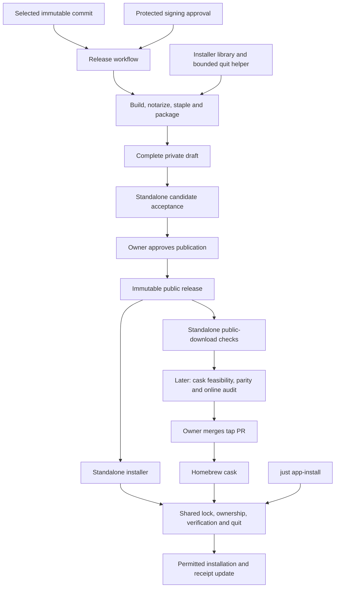

# Task: Ship standalone installation and updates, then add Homebrew

**Status**: Planned — standalone-first delivery; revised sequencing awaits review
**Component**: distribution
**Assigned to**: Varun Singh
**Priority**: Medium
**Branch**: `docs/app-distribution-plan` (planning); implementation on `feature/app-distribution`
**Created**: 2026-11-17
**Review Gates**: full

## Objective

Publish one signed, notarized Apple-silicon app archive. Deliver the standalone
command-line installer and manual updates first. Add a Homebrew cask later,
consuming the same archive and checksum.
End users need neither a source checkout nor Xcode, uv, Python or just installed.
The standalone release requires neither a Homebrew tap nor proof of cask lifecycle hooks.

This updates the Homebrew plan from `docs/distribution-plans` at `a5a371d`.
Its scope now includes standalone installation; the retained
[App Store decision record](20261117-design-app-store-distribution.md) explains the excluded route.

## Context

Verified against the current checkout on 2026-11-17:

- `scripts/build_app.sh` signs nested uv and the app with hardened runtime, but uses
  `--timestamp=none`. Release signing needs a separate secure-timestamp mode.
- `just app-install` builds locally, quits the running app, stages and verifies a
  copy, then replaces the bundle. It defaults to the self-signed `Code Signing` identity.
  Retain local builds, with ownership guards added before replacement; the new installer downloads a finished release.
- `scripts/quit_app.sh` has a bounded quit protocol and treats refusal, timeout or
  unknown running state as failure. It must never be replaced with a force-kill shortcut.
- `scripts/fetch_uv.sh` bundles arm64 uv; `Package.swift` targets macOS 15+.
  Apple Speech still needs macOS 26+. Python and models download on demand.
- `app-version.json` is currently version `0.4.1`, build `474`; app versions remain
  independent of `artifacts/tts.json` and `ServiceCatalog.sttServerRequirement`.
- `.github/workflows/test.yml` is the test workflow. There is no release workflow
  or standalone app installer in this checkout.
- Bundle identity, AppPaths, cache precedence, preferences and environment
  fingerprints are compatibility invariants. Inspect the migration tests before changing packaging.

## Prerequisites and decisions

- Confirm the release owner, Apple Developer membership, Developer ID Application
  certificate, expected Team ID and notarytool API-key access. No credentials belong in this plan.
  Their availability is unverified. Reviewed mock implementation may proceed without credentials;
  real signing requires verified credentials, a protected environment and approved version/build metadata.
- Proposed tap: `pipecat-ai/homebrew-tap`, pending owner approval and repository/access checks.
  This is a phase 5 dependency only. Use a project-owned tap initially;
  submission to Homebrew's main cask repository is separate work.
- Use a ZIP archive with a stapled app inside, built with `ditto -c -k --keepParent`.
  Distribution channels never re-sign, modify the signed bundle or rebuild the app.
- Standalone destination: `~/Applications`, with `--app-dir` for an existing writable directory.
  No sudo, privilege escalation or automatic app launch. Homebrew keeps its configured app directory.
- First standalone interface: `install.sh --version X.Y.Z [--app-dir PATH]` plus `--help`.
  The same command installs when absent and updates a verified standalone installation when present.
  An explicit stable version is required; automatic latest-version discovery, downgrades,
  an automated standalone uninstall command and an in-app updater are outside this increment.
  A documented manual bundle-and-receipt removal procedure is required for channel switching.
- Normal uninstall retains app data. Cask zap may remove only preferences and logs;
  never Application Support, model weights, Hugging Face or Moonshine shared caches.

## Requirements

### Shared release contract

- Release mode requires the configured Developer ID Application identity and secure timestamp;
  development builds keep their current identity resolution and timestamp behaviour.
  Validate bundle id `ai.pipecat.ServiceToolbar`, version/build, Team ID, hardened runtime,
  nested executable signatures and notarization. Never strip quarantine to make a check pass.
- Create a temporary upload ZIP, submit using `xcrun notarytool submit --wait`, require Accepted,
  staple the app, validate the ticket, then create the final ZIP and compute its SHA-256.
  Only the final, post-stapling bytes become the shared download.
- Publish `Pipecat-Service-Toolbar-X.Y.Z-arm64.zip`, `SHA256SUMS`, versioned `install.sh`
  and a plain-text release manifest. The manifest records schema version, app version/build,
  bundle id, Team ID, architecture, minimum macOS version, filename and SHA-256.
  Parse an exact allowlist of keys; reject duplicates, unknown keys and invalid values.
  Never source or eval metadata. A checksum detects corruption; the pinned signing identity
  and Gatekeeper assessment authenticate the downloaded app.
- Release assets are immutable: refuse replacement under an existing published version.
  The `vX.Y.Z` tag must match `app-version.json`; the build must exceed published builds
  and the known installed baseline of 474. Select the next version/build before a release;
  do not publish the existing 0.4.1/474 as a new build or use mismatched prerelease tags.
- A separate release workflow accepts version tags or manual dispatch at an explicitly
  selected commit. Both triggers prepare private drafts; neither publishes or updates the tap.
  Manual dry runs use the same intended version. Public installer URLs resolve only published assets.
- Privileged jobs require a protected GitHub environment with human approval. Test jobs
  never receive signing secrets. Pin third-party actions by immutable commit; import the
  certificate into an ephemeral keychain, clean it and key files on every exit, and mask secrets.
  Scope write permission to release upload jobs; tap changes use a separate reviewed PR.
  Test static workflow policy and an isolated denied-approval run; repository settings need live evidence.
- Standalone candidate acceptance uses private staged assets. After it passes, the owner may approve publication
  of those exact bytes. Public-download checks and online cask audit then gate the separate tap merge.
  The first standalone release does not wait for cask implementation, audit or tap provisioning.
  A failed public check blocks tap merge; never repair a published release by replacing its assets.
  This plan does not authorise certificate changes, tags or publication.

### Installation and upgrade contract

- Both routes install the same final ZIP, with the same pinned version and SHA-256.
  The standalone script is versioned with the release and embeds the expected Team ID and
  fixed repository. It uses only macOS-supplied Bash 3.2, curl, shasum, ditto, codesign,
  spctl, osascript and plist tools; no Xcode-only tool is required on the user's Mac.
- Reject unsupported OS/architecture, malformed version, unexpected URL origin, incomplete
  download, invalid manifest, checksum mismatch, unsafe archive entries and invalid signatures
  before requesting quit or changing an existing install. HTTPS only, bounded downloads,
  private temporary directories, no unquoted path expansion, no network response executed as code.
  Document downloading the versioned installer to a file before running it.
- Check the extracted bundle's exact id, version/build and Team ID against validated metadata;
  require a valid Developer ID signature and Gatekeeper acceptance. An installer must not
  accept any signed app merely because its checksum matches a manifest.
- All participating installers acquire the same per-user bundle-identity lock before ownership
  and duplicate checks, and hold it through replacement, receipt updates and recovery.
  Destination locks alone are insufficient. Recheck ownership under the lock; fail closed on contention,
  unsafe lock state or an unverified stale owner. Phase 5 must prove cask lock lifetime and cleanup
  before Homebrew delivery; standalone/developer locking is implemented and tested in phase 3.
  Refuse symlinked destinations and ambiguous ownership. Store standalone/developer ownership in the receipt
  specified below, outside the signed app; never alter the app's environment layout marker.
- Stage on the destination filesystem and verify the staged copy. Request graceful quit
  using the existing bounded semantics. Cancel, timeout, unknown state or a still-running
  process aborts without replacement; never kill the app or external servers to upgrade.
- Replace with a recoverable backup-and-rename transaction. Keep the old bundle and receipt
  until the new bundle passes verification. Roll back on errors; recover an interrupted
  transaction on the next invocation before accepting another install. A failed operation
  must leave the previous installation recoverable and report the recovery path.
- Same-version reruns are no-ops only after identity/integrity verification. Refuse lower
  versions/builds and receipts inconsistent with the installed bundle.
- Detect Homebrew ownership using its installed cask metadata and resolved target when Brew
  is available, including standard native/Rosetta prefixes; unresolved ownership fails closed.
  A standalone installer refuses a Brew-managed app. The cask refuses an existing standalone/developer
  receipt or unmanaged bundle. Channel switching is explicit removal of the old bundle through
  its owner, preserving data, followed by the other route; no force/adopt overwrite flags.
- `just app-install` participates in the same lock and ownership checks before building or quitting.
  Refuse standalone/Brew ownership, conflicting receipts and unknown identity; retain ordinary verified
  developer upgrades. Include `justfile` and its recipe tests in phase 3; there is no force-overwrite escape.
- Probe both standard application directories, receipt-recorded paths, Brew targets and registered running copies to detect
  duplicate bundle IDs. Refuse a second installation until the user resolves the conflict.
  A development/self-signed installation requires an explicit migration procedure, not silent adoption.
- Changing from a self-signed build to Developer ID changes its designated requirement.
  Document and test permission re-authorisation; do not promise Microphone/Speech grants survive.
  Existing environments, model caches and preferences must survive the migration unchanged.
- App upgrades do not move server pins, refresh working environments or download models.
  Installation itself does not start services. Validate preserved readiness in isolated test state.

### Homebrew contract — deferred to phase 5

- Declare arm64 and macOS 15+ support, the pinned version/checksum/URL, and the app artifact.
  Leave `auto_updates` unset. Document the fully qualified tap/cask install command.
- Prove the selected Homebrew lifecycle hooks can hold the shared lock, detect ownership and honour quit refusal
  before any destructive upgrade/uninstall step. Do not assume `uninstall quit:` alone does this.
  If the supported cask API cannot uphold the contract, stop that delivery phase and obtain
  a revised channel design; do not weaken the invariant or patch Homebrew internals.
- Audit/style validation and tests use the same Homebrew version whose upgrade semantics
  were exercised. Record it with release evidence and recheck on supported-version changes.

## Review Focus

Release trust and secret boundaries; notarization and packaging order; exact artifact parity;
Bash 3.2 and no-build-tools bootstrap; Homebrew quit/upgrade behaviour; shared locking and ownership
across all three installers; crash recovery; signing migration; state preservation and release approval boundaries.

## Implementation Checklist

### Phase 1: Validate standalone release prerequisites

**Impl files:** `docs/development.md`, this plan
**Test files:** none (isolated feasibility checks)
**Test command:** `uv run pytest python_tests/test_migration_contract.py python_tests/test_server_pins.py -q`
**Goal:** Record signing prerequisites without blocking standalone work on Homebrew.

- Record signer ownership as verified or pending; inspect credentials by metadata only.
  Record the verified Team ID and protected-environment configuration for release tooling.
- Mock work in phases 2–3 may proceed with pending credentials.
  Real signing waits for verified signing prerequisites. Tap ownership and cask feasibility belong to phase 5.
  Neither mock completion nor a signed ZIP alone authorises delivery. Never replace the user's installed toolbar.

### Phase 2: Build and validate the shared release artifact

**Impl files:** `scripts/build_app.sh`, new `scripts/package_release.sh`, new `.github/workflows/release.yml`, `app-version.json`, `CHANGELOG.md`
**Test files:** `python_tests/test_app_recipes.py`, new `python_tests/test_release_packaging.py`
**Test command:** `uv run pytest python_tests/test_app_recipes.py python_tests/test_release_packaging.py -q`
**Goal:** Only a verified, notarized, stapled bundle can produce publishable final bytes.

- Add explicit release mode, packaging/manifest generation, version/build guards and protected
  workflow. Test commands and secret cleanup with stubs before a real signing dry run.
- Before real signing, have the release owner choose the next app version and a build above
  published builds and 474. Update `app-version.json` and matching app changelog in a focused commit;
  keep server pins unchanged. Record that immutable candidate commit.
- Add negative checks for action pins, job permissions, secret separation, approval gates, draft-only
  triggers and published-asset overwrite refusal. Validate protected-environment settings independently.
- Once signing prerequisites pass, validate a ZIP with codesign, spctl and stapler.
  Phase 2 may produce a ZIP-only internal artifact; the release workflow must reject incomplete asset sets.
  Complete release assembly and candidate acceptance occur in phase 4 after the installer exists.

### Phase 3: Implement standalone installation and manual updates

**Impl files:** new `scripts/install.sh`, new `scripts/lib/install_app.sh`, `justfile`
**Test files:** new `python_tests/test_app_installer.py`, `python_tests/test_app_recipes.py`
**Test command:** `uv run pytest python_tests/test_app_installer.py python_tests/test_app_recipes.py -q`
**Goal:** Every rejection preserves the existing app and all user state.

- Share verification/transaction logic within the installer, package its required code into a
  single release `install.sh`, and reuse the quit protocol without fetching scripts from main.
- Add the common lock and ownership guard to `just app-install` before build/quit; retain its
  local signing and launch behaviour only for permitted developer installations.
- Define and test receipt creation, rollback, interrupted removal and the manual channel-switch procedure.
- Cover the input, trust, ownership, locking, interrupted-install and rollback matrices below.
- Exercise mock assets here; real staged-candidate acceptance belongs to phase 4.

### Phase 4: Ship standalone installation and updates

**Impl files:** `scripts/package_release.sh`, `.github/workflows/release.yml`, `README.md`, `docs/development.md`, `docs/migration.md`, `AGENTS.md`, `CHANGELOG.md`
**Test files:** new `python_tests/test_distribution_contract.py`
**Test command:** `uv run pytest python_tests/test_distribution_contract.py -q`
**Goal:** Users can install and manually update the app without Homebrew or a source build.

- After phases 2–3, select one immutable commit containing all standalone release inputs.
  Build/sign the app and assemble ZIP, manifest, checksum and bundled installer from that commit;
  produce the complete private draft. Invalidate earlier candidate evidence when source or bytes change.
- Run standalone candidate acceptance using an authenticated staging harness in isolated state.
  Supply exact candidate bytes without adding a production URL override or weakening signature checks.
- Document installation, migration, channel switching, uninstall preservation and recovery.
- Run repository gates, standalone macOS acceptance, manual removal preservation and negative
  workflow checks. Hand candidate evidence to the owner; publication remains a separate approved action.
- After approved publication, install and update through the public URLs; verify hashes, quarantine/Gatekeeper
  and state preservation. This completes standalone delivery independently of phase 5.

### Phase 5: Add Homebrew after standalone delivery

**Impl files:** new `packaging/homebrew/pipecat-service-toolbar.rb`, `README.md`, `docs/development.md`, `docs/migration.md`, `AGENTS.md`, `CHANGELOG.md`, this plan
**Test files:** `python_tests/test_distribution_contract.py`, `python_tests/test_app_installer.py`
**Test command:** `uv run pytest python_tests/test_distribution_contract.py python_tests/test_app_installer.py -q`
**Goal:** Add Homebrew without weakening standalone ownership, quit or data-preservation guarantees.

- Confirm the tap owner and repository access. In a disposable user/VM, prove cask install/upgrade/uninstall
  hooks hold the common lock, honour quit refusal and release the lock on every exit. Record the Brew version.
  Stop this phase if supported hooks cannot uphold the contract; standalone delivery remains available.
- Keep the canonical cask template here. Use guard logic from the selected released installer's source commit;
  any incompatible guard change requires a new tested app distribution release before cask delivery.
- Test both routes against that release's exact ZIP/hash, cross-channel conflicts, races, successful uninstall
  and zap preservation. Run macOS 15/26 cask acceptance and verify parity with standalone acceptance.
- Prepare the resolved tap cask in a separate PR. Run `brew audit --cask --strict --online` and `brew style`
  against public URLs; merge only after evidence and explicit owner approval. Update user-facing Homebrew instructions then.

## Technical Specifications

Existing files to modify and new files are listed in each phase; every `new` path is proposed,
not an assertion that it exists. Keep app/server version authorities in their current files.
The protected GitHub environment gates standalone signing. The external tap gates only phase 5.

The shared manifest binds release metadata and artifact bytes. Consumers validate it, then
validate the signed bundle independently. Installer receipts describe installation ownership;
they are not cryptographic proof and never override bundle verification or Brew metadata.
No source build, package-manager dependency installation or cache migration belongs in either installer.

### Installer state and removal

Use a private, user-owned directory at `~/Library/Application Support/Pipecat Service Toolbar Installer/`
for `operation.lock`, `receipt.plist` and a recovery journal. This is separate from the app's existing AppPaths.
The fixed lock identifies `ai.pipecat.ServiceToolbar`, regardless of destination or installer channel.
All three routes use the same atomic lock protocol; the cask embeds its reviewed implementation
from the same source commit. Contract tests assert parity with the standalone and developer paths.
Use bounded acquisition; never break a lock based only on age or a reused PID. Uncertain ownership
requires explicit recovery. No supported route may change the bundle outside this lock.

The receipt uses schema version 1 with exact keys: `schema_version`, `bundle_id`,
`version`, `build`, `path` (canonical absolute bundle path), and `channel` (`standalone` or `developer`).
Reject unknown/duplicate keys, unsafe paths and invalid values. The invoking user owns the receipt;
the owning standalone/developer route writes it after verified installation, with atomic update and rollback.
Developer installs also record custom paths, so later lock holders can detect a copy even after it exits.
Homebrew ownership continues to use its cask metadata; no receipt may substitute for that metadata.
Check it against bundle identity and Brew metadata; it never grants authority to overwrite another channel.

Phase 4 documents a manual standalone removal sequence, using the same lock and bounded quit semantics:
validate receipt/bundle identity and absence of Brew ownership; quit successfully; move the exact bundle
to a recoverable backup; confirm its original path is absent; remove only the matching receipt;
release the lock. Keep the backup until the new channel succeeds. Never remove app data or shared caches.
Before moving a bundle, atomically journal the operation, original/backup paths and old receipt;
validate the journal's paths and bundle identity before any recovery action. Retain it until cleanup completes.
For interrupted removal, require the receipt and recorded backup to identify the same verified bundle
before completing cleanup or restoring it. Missing/mismatched evidence stops for operator recovery;
an orphaned receipt alone must not authorise deletion. Automated uninstall remains out of scope.
Homebrew removal uses Brew; developer removal follows the same verified bundle/receipt procedure with its local signing identity.
Switching is two separate locked operations; the new installer rechecks ownership after acquiring its lock.

Reference requirements: [Homebrew Cask Cookbook](https://docs.brew.sh/Cask-Cookbook),
[Apple notarization workflow](https://developer.apple.com/documentation/security/customizing-the-notarization-workflow),
[notarization troubleshooting](https://developer.apple.com/documentation/security/resolving-common-notarization-issues).
Recheck the supported cask APIs in phase 5; do not copy an obsolete hook spelling into implementation.

### Integration Seams

| Producer | Consumer | Contract |
|---|---|---|
| Approved commit and signing environment | Release workflow and packager | Version/build authority, fixed Team ID, ephemeral secrets; draft-only output |
| Packager | Standalone installer and cask | Identical final ZIP/hash, manifest and bundled installer from one commit |
| Ownership/lock logic and quit helper | Standalone, developer recipe and cask | One lock protocol; verify ownership before quit/mutation; abort on uncertainty |
| Candidate acceptance | Release owner | Exact-byte evidence permits publication; public checks separately gate tap merge |

## Architecture & Call Flow



```mermaid
sequenceDiagram
    actor Owner
    participant Workflow
    participant Packager
    participant Acceptance
    participant Release
    participant Tap
    participant Installer
    participant State as Lock and ownership state
    Owner->>Workflow: Select commit and approve protected signing
    Workflow->>Packager: Build, sign, notarize, staple, assemble all assets
    Packager-->>Acceptance: Complete private draft and hashes
    Acceptance-->>Owner: Standalone candidate evidence
    Owner->>Release: Approve publication of tested bytes
    Acceptance->>Release: Fetch public assets and verify delivery
    Acceptance-->>Owner: Standalone public checks pass
    Installer->>Release: Fetch pinned version and validate download
    Installer->>State: Acquire common lock and recheck ownership
    Installer->>Installer: Verify staged app, request bounded graceful quit
    Installer->>State: Commit or recover bundle and receipt; release lock
    opt Later Homebrew phase
        Acceptance->>Tap: Prove hooks, artifact parity and online audit
        Acceptance-->>Owner: Homebrew acceptance evidence
        Owner->>Tap: Approve separate tap PR merge
    end
```

| Step | Trigger | Enters context | Cleared/persisted | Turn boundary |
|---|---|---|---|---|
| Build and package | Tag/manual selected commit plus signing approval | Source, version/build, temporary credentials | Credentials cleared on every exit; final assets and hashes retained | CI job |
| Candidate acceptance | Complete draft available | Exact standalone assets and isolated app state | Evidence tied to commit/hashes; test state discarded | Disposable test session |
| Publish and verify | Owner accepts standalone evidence | Tested bytes and approved metadata | Immutable release and standalone public-check evidence | Owner approval, then public test session |
| Homebrew delivery | Phase 5 prerequisites verified | Published ZIP, matching guard logic and cask template | Cask acceptance/audit evidence; separately approved tap PR | Later test session and owner approval |
| Install/upgrade | User invokes standalone or Brew | Verified artifact, receipt/Brew metadata, common lock | Bundle/receipt or recoverable backup persisted; lock released | Local process |
| Developer install | User invokes local recipe | Common lock, ownership, local source and signing identity | Verified developer bundle only; managed destinations refused | Local process |

The release installer embeds its library and bounded quit helper from the selected commit;
it fetches no executable helper from the main branch. The cask receives matching reviewed guard logic.
Credentials exist only in protected signing jobs; neither installers nor the tap receive signing secrets.

## Testing Notes

- Stub external commands and HTTPS responses in Python tests; exercise stock `/bin/bash` 3.2.
  Assert every failure preserves old bundle bytes, receipt, preferences and cache sentinels.
- Matrix: OS/CPU rejection; bad/duplicate manifest keys; bad hash or signer; traversal/symlink
  archive; disk full; spaces/non-ASCII paths; concurrent installs; missing/stale receipt; old/current/new
  versions; cancelled quit; hanging Apple event; interruption before/after each rename; rollback failure.
- Race tests run two standalone installs into different directories, standalone against Brew, and developer
  against each release channel. Assert at most one installation commits; losers cannot quit or mutate the app.
  Cover lock cleanup, uncertain stale owners and receipt-recorded custom destinations.
  Phase 3 tests standalone/developer races and mocked foreign Brew ownership; real cask races run in phase 5.
- Channel matrix: fresh, standalone, Brew, self-signed developer, unknown owner and duplicate paths.
  Verify no destructive operation or app kill occurs on refused upgrades/uninstalls.
- Successful normal uninstall preserves app state, preferences and shared caches. Successful zap removes
  only this app's preferences/logs; assert Application Support, weights, shared caches and unrelated preferences survive.
  Test manual standalone removal and interrupted cleanup, then install through Brew without a stale receipt blocking it.
  Manual removal/recovery gates standalone delivery; successful Brew uninstall/zap and switching tests gate phase 5.
- Workflow tests reject missing environment protection, mutable action refs, broad write permissions and secrets in test jobs.
  Exercise denied approval and cancellation in an isolated environment: no signing, publication or leaked credentials.
  Assert manual/tag runs remain draft-only, incomplete assets fail, and existing published versions cannot be overwritten.
  Check actual repository environment settings as well as YAML; mocks cannot prove approval enforcement.
- Real tests run in a disposable user/VM with representative copied state, never the real installation.
  In phase 4, test standalone install/update, app startup and supported local TTS/STT on macOS 15. Repeat on macOS 26,
  including Apple Speech and Microphone/Speech permission re-authorisation after signer migration.
  Exercise standalone installation without Brew or Xcode. In phase 5, repeat route parity and OS coverage
  for the cask, without a source checkout or app build tools.
  Candidate tests apply/retain quarantine and exercise Gatekeeper on staged bytes; after publication,
  download through a browser and recheck public delivery. Compare fingerprints/cache sentinels after upgrades.
- Before a PR: `uv run ruff format .`, `uv run ruff check .`, `uv run pytest`, `swift test`,
  `just app-build`. Before standalone publication: real Developer ID/notarization checks and standalone
  candidate installation/update/migration tests. Before tap merge: cask feasibility, route parity,
  public-download checks and online cask audit/style. Mock tests cannot replace these gates.

## Acceptance Criteria

### First delivery — standalone installation and manual updates

- One versioned command installs an absent app or updates a verified standalone copy without source/build dependencies.
- Same-version reruns verify integrity and make no changes; lower versions/builds are refused.
- Failed or cancelled upgrades preserve a recoverable previous installation and all app/model data.
- Standalone/developer installers refuse foreign-channel and unknown-owner replacement; cross-directory races cannot create duplicate installs.
- Verified manual standalone removal clears its matching receipt without deleting app data.
- Existing environments remain ready; server pins and shared cache contents are unchanged.
- Standalone install/update passes macOS 15 and 26 acceptance; Apple Speech and permission migration pass on macOS 26.
- Candidate gate: complete assets from one commit pass standalone acceptance, quarantine/Gatekeeper and state-preservation checks before publication.
- Public gate: a quarantined public download matches candidate hashes and passes install/update checks after approved publication.
- Signing secrets remain outside PR CI/logs; negative approval/publication tests pass. Each owner approval follows its respective evidence gate.

### Later delivery — Homebrew

- Both routes install the same ZIP/hash and pass macOS 15/26 acceptance.
- Proven cask hooks uphold the common lock and quit/ownership guarantees across all three installers.
- Verified channel switching succeeds; successful uninstall/zap preserves everything outside its explicit removal scope.
- Cask audit/style and public-download checks pass before the separately approved tap merge.

<!-- reviewed: YYYY-MM-DD @ <hash> -->

## Progress

Planning only. Renamed and expanded from the original Homebrew plan; no installer or release code implemented.

## Findings

Review fixes accepted on 2026-11-17. The latest eight findings are addressed in the contract:
separate prerequisite and publication gates; explicit call flow; shared locking; developer ownership guards;
complete-release assembly after installer implementation; workflow policy tests; successful uninstall/zap tests.
Earlier review findings also add version/build preparation, receipt removal and macOS 15/26 acceptance.
Release credentials, protected-environment configuration, tap ownership and cask feasibility remain external gates, not verified facts.

Delivery sequence revised on 2026-11-18 at the user's request: standalone installation and manual updates first;
Homebrew feasibility, cask acceptance and tap setup move to phase 5. Signing prerequisites still gate real distribution.
The earlier review marker is invalidated by this contract change; review the revised sequence before implementation.

## Issues & Solutions

The earlier plan assumed a simple cask upgrade respected quit confirmation. Phase 5 requires evidence before Homebrew delivery.

## Final Results

Not implemented. Distribution and release acceptance remain pending.
