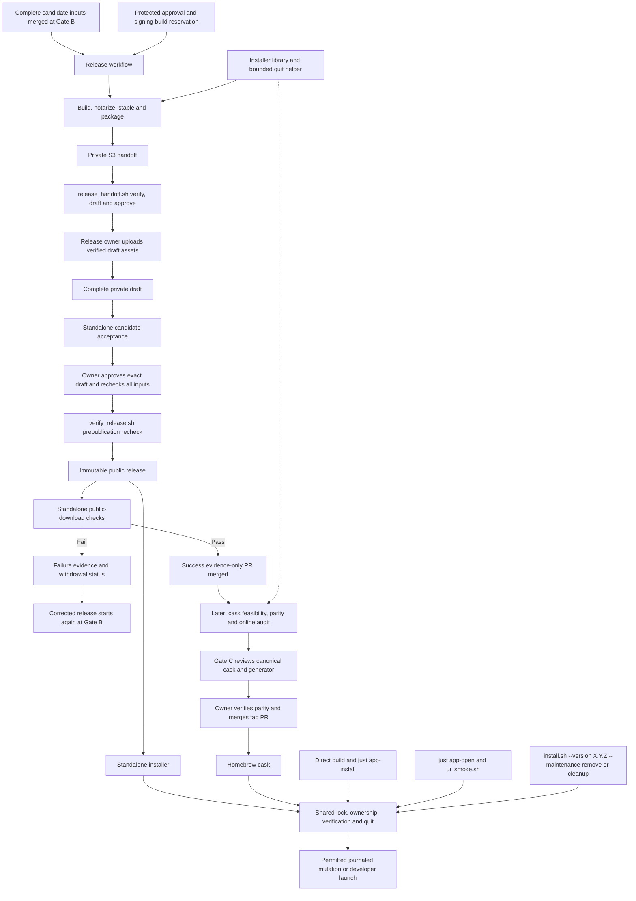
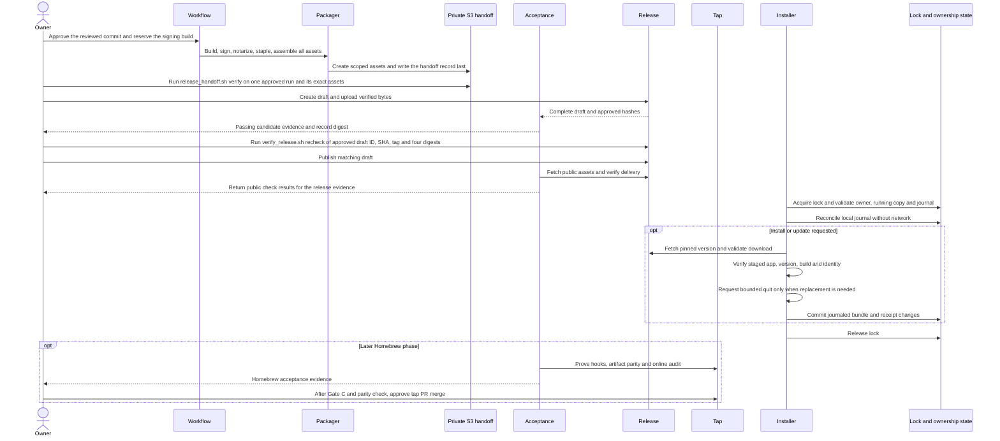

# Task: Ship standalone installation and updates, then add Homebrew

**Status**: Planned — review run 20261120T005527Z findings addressed; awaits re-review
**Component**: distribution
**Assigned to**: Varun Singh
**Priority**: Medium
**Branch**: `docs/app-distribution-plan` (planning); implementation on focused `feature/app-distribution-*` branches cut from reviewed `main`
**Created**: 2026-11-17
**Review Gates**: none

## Objective

Publish one signed, notarized Apple-silicon app archive. Deliver the standalone
command-line installer and manual updates first. Add a Homebrew cask later,
consuming the same archive and checksum.
End users need neither a source checkout nor Xcode, uv, Python or just installed.
The standalone release requires neither a Homebrew tap nor a cask delivery. It does require the Homebrew-facing
contracts that published installers freeze: cask token, lock primitive and versioned state (see "Frozen contracts").

This updates the Homebrew plan from branch `docs/distribution-plans` at commit `a5a371d`.
Its scope now includes standalone installation; the retained
[App Store decision record](20261117-design-app-store-distribution.md) explains the excluded route.

## Context

Verified against the current checkout on 2026-11-17:

- `scripts/build_app.sh` signs nested uv and the app with hardened runtime, but uses
  `--timestamp=none`. Release signing needs a separate secure-timestamp mode.
  It also rewrites `CFBundleIdentifier` when `BUNDLE_ID` is set (documented in `docs/development.md`).
- `just app-install` builds locally, quits the running app, stages and verifies a
  copy, then replaces the bundle. It defaults to the self-signed `Code Signing` identity and writes no receipt,
  so every existing developer install, including the known baseline build 474, is receipt-less.
  Retain local builds, with ownership guards added before replacement; the new installer downloads a finished release.
- `just app-open` can request quit by bundle ID before launching the local build.
  `scripts/ui_smoke.sh` refuses a preexisting running copy and currently dispatches quit by bundle ID.
  Phase 4 binds smoke's quit request to its launched process.
- `scripts/quit_app.sh` has a bounded protocol for refusal, timeout and unknown state. Its current dispatcher addresses
  a bundle ID and invokes commands through `PATH`. Phase 4 replaces it with a process-targeted mode using qualified
  absolute paths, and every caller migrates to that mode.
  The program has top-level traps and `exit` calls. Invoke it as a child process.
- `scripts/fetch_uv.sh` bundles arm64 uv; `Package.swift` targets macOS 15+.
  Apple Speech still needs macOS 26+. Python and models download on demand.
- `app-version.json` is currently version `0.4.1`, build `474`; app versions remain
  independent of `artifacts/tts.json` and `ServiceCatalog.sttServerRequirement`.
- `.github/workflows/test.yml` is the test workflow. Its ubuntu job runs the full pytest suite; its `macos-app` job
  runs only `python_tests/test_app_recipes.py`. There is no release workflow or standalone app installer in this checkout.
- Bundle identity, AppPaths, cache precedence, preferences and environment
  fingerprints are compatibility invariants. Inspect the migration tests before changing packaging.

## Prerequisites and decisions

- Confirm the release owner, Apple Developer membership, Developer ID Application
  certificate, expected Team ID and notarytool API-key access. No credentials belong in this plan.
  Their availability is unverified. Reviewed mock implementation may proceed without credentials;
  real signing requires verified credentials, a protected environment and approved version/build metadata.
- The release owner must approve and qualify an owner-controlled private S3 bucket and a GitHub OIDC
  upload role before Gate A. Phase 1 records the account, access policy, required roles and a retention period that
  outlasts phase 6 completion plus a 30-day re-entry margin. Phase 5 checks the retention date before it starts.
  The plan assumes no existing bucket or access. If the private handoff cannot be qualified, stop before Gate A.
- Proposed tap: `pipecat-ai/homebrew-tap`, pending owner approval and repository/access checks.
  Tap provisioning is a phase 7 dependency only. The cask token is fixed now as `pipecat-service-toolbar`
  because the standalone installer detects Brew ownership by it. Use a project-owned tap initially;
  submission to Homebrew's main cask repository is separate work.
- Use a ZIP archive with a stapled app inside, built with `ditto -c -k --keepParent`.
  Distribution channels never re-sign, modify the signed bundle or rebuild the app.
- Standalone destination: `~/Applications`, with `--app-dir` for an existing directory exclusive to the invoking user.
  No sudo, privilege escalation or automatic app launch. The cask applies the same exclusivity rule to its configured
  app directory and refuses one that fails it. Homebrew's default `/Applications` is admin-writable, so users install
  with `--appdir=~/Applications`; the documentation says so.
- First standalone interface: `install.sh --version X.Y.Z [--app-dir PATH]` plus `--help`.
  `install.sh` is bound to its own release: it embeds its version and rejects any other `--version` value.
  The flag stays required as an explicit confirmation. The same command installs when absent and updates a
  verified standalone installation when present. An explicit stable version is required; automatic
  latest-version discovery, downgrades, and an in-app updater are outside this increment.
  Maintenance is `install.sh --version X.Y.Z --maintenance remove|cleanup [--app-dir PATH]`. It takes no other
  arguments and no force option, and the grammar is frozen with the first installer. Maintenance authority follows
  the on-disk protocol version, not the release: any installer release that supports that protocol version may
  remove or clean up. The documentation points users to the newest published installer. Maintenance handles
  verified removal and backup cleanup for channel switching.
- Normal uninstall retains app data. Cask zap may remove only preferences and logs;
  never Application Support, model weights, Hugging Face or Moonshine shared caches.

## Requirements

### Test environments

- Develop on the existing Mac or UTM guest. Use temporary app destinations, installer state and fixtures for
  routine install, upgrade, refusal and recovery tests. Reset those paths between runs.
- Run native command and headless installer tests in CI on macOS 15 and 26. Run the packaged installer with a
  minimal environment and a stock `PATH`, and use the child-command trace to verify that the installer and its
  helpers use only the qualified stock tools. Exercise a positive control to verify that the trace would detect a
  developer-tool invocation. GitHub-hosted runners include developer tools, so record this as stock-tool execution
  coverage. If a no-tools snapshot is already available, use it for an additional bootstrap check.
- Use the existing UTM guest and login for tests that need a console session or Finder. Reuse a pre-assessment
  snapshot for Gatekeeper and use the existing Mac for hardware checks the guest cannot exercise. These checks
  are release qualification. Routine development and retries use the same account and OS installation.

### Review and merge gates

- Run implementation phases 2, 4 and 7 as separate focused tasks. Use explicit manual gates and the full
  `skein:review-gauntlet` on each implementation PR. Resolve findings and merge normally to `main`.
  Gate A lands the release workflow, packager and predecessor metadata (same version, raised build, no changelog entry).
  Gate B lands every candidate input, the evidence-only check, final version metadata, the numbered changelog entry
  and candidate documentation. Gate C lands the canonical cask, its generator and CI check before the hosted tap merge.
- The release owner runs phases 1, 3, 5 and 6. Record the reviewed commit and evidence for each external handoff under
  `## Findings` and mark that phase complete under `## Progress` after verification. The next task checks its listed
  prerequisites against those records and starts from the merged gate commit. Keep review gates manual throughout.
  Each owner-run phase records one `## Findings` block with fixed fields: phase, reviewed commit SHA, date, operator,
  host and OS build, each command with its exit status, artifact digests, pass or fail per listed check, and
  deviations. A phase is not complete while a field is empty. Keep the Phase 5 summary in `## Findings`
  and freeze a private acceptance record for approval. Phase 6 copies the public portions and record digest
  into the release evidence file.
- Phase 3 runs live checks from the Gate A workflow, and all of them finish before Gate B merges. Phase 4 mock work may
  start after Gate A while signing is pending. A defect that live signing exposes goes back through Gate A (a focused fix
  branch, review and regular merge), and the affected phase 3 checks repeat. Every signed run, including a Gate A
  re-entry, reserves a build above the published baseline and all previously reserved signing builds.
  The private predecessor stays valid as long as its version and build are lower than the candidate's.
- Phase 5 starts after Gate B and the phase 3 live checks pass. It repeats the secret-free denial checks against the
  Gate B workflow in a protected sandbox. "Equivalent" means a recorded settings diff against production (environment
  rules and branch policy, rulesets, immutable releases, Actions permissions, organisation policies, role trust and
  bucket policy) with each difference explained. On the reviewed Gate B SHA, repeat the production upload check with
  an unsigned canary. Exercise cancellation and controlled failure after signing-credential import but before app
  signing and check cleanup and secret scans. Run one signed four-asset candidate and verify its ZIP. Phase 3
  qualifies the signed ZIP-only path. Changes to candidate inputs go back through Gate B and require fresh evidence.
- Phase 6 starts with owner approval bound to phase 5 evidence, then publishes and verifies public delivery. Evidence
  and observed-behaviour documents land in one evidence-only PR after phase 6 verification, with regular review and
  merge: `docs/release-evidence/X.Y.Z.md`, the observed-steps part of `docs/migration.md`, and the README install
  command that needs the published URL. The head branch is named `release-evidence/X.Y.Z`. A required check from
  `.github/workflows/evidence_check.yml` uses `pull_request_target` so the workflow and validator come from
  `main` and execute no PR code. Validate a complete file snapshot for an exact PR, base and head. Require a
  verdict that GitHub enforces for that same PR and revision. Keep strict up-to-date branch protection and
  qualify the reporter in Phase 4. A commit-scoped pass on an ordinary PR cannot authorize an evidence PR
  that shares its head. A base-only change invalidates the earlier verdict. Inspect both sides of renames
  and all changed paths. Any change under `docs/release-evidence/`, or any `release-evidence/` head branch,
  requires a matching evidence PR. The success branch requires exactly the three paths above for the approved
  version. The `-failed` branch adds only the failure record for the Gate B version. The `-homebrew` branch
  adds only the Homebrew record for a version with passing standalone evidence on the trusted base.
  Evidence records are append-only. Reject evidence edits, renames, deletions, unknown paths and wrong
  branches. Ordinary PRs pass this check when their complete diff leaves the evidence directory untouched. GitHub may
  suppress this trigger for SHA-like branch names. A missing verdict blocks merge. Document reopening the change
  from a supported branch name (the designated name for evidence PRs) and waiting for a verdict. The check
  guards against mistakes in the owner's own PR. The owner marks it
  required after Gate B merges and the live sandbox test in phase 4 passes. Phase 7 records Homebrew evidence in
  `docs/release-evidence/X.Y.Z-homebrew.md` through a second PR on `release-evidence/X.Y.Z-homebrew`, whose only
  allowed path is that file. Record phase 6 completion under `## Progress` through a separate ordinary PR,
  because the evidence-only PR rejects the plan path.
  A failed public check follows the failure-evidence path under "Shared release contract".
  Keep Gate B's release version and corresponding evidence policy on `main` until the success evidence PR or
  the failure record merges. Other changes to `main` still require a fresh evidence verdict on the resulting base.
  After public verification, phase 7 can qualify hooks and tap access. The canonical render and interoperability
  matrix require the merged release evidence. Gate C marks the cask instructions pending until the hosted tap
  PR merges and a public install succeeds.

### Shared release contract

- Release mode requires Developer ID Application, secure timestamps, hardened runtime and valid nested signatures.
  Verify bundle ID `ai.pipecat.ServiceToolbar`, version/build, Team ID and absence of `get-task-allow`. Never strip quarantine from a test bundle to pass a check.
  `curl` downloads carry no quarantine attribute, so on the standalone route the installer's own signature and
  Gatekeeper checks are the only gate. Phase 6 tests quarantine on a browser-downloaded ZIP.
  Validate the exact uv and server-wheel layout with a real submission. Record whether the wheel contains native code.
- Submit a temporary ZIP with `xcrun notarytool submit`, persist the returned submission ID, and poll to a terminal
  status with a bounded deadline. On timeout keep the ID for follow-up and withhold publishable output.
  Archive the log once available and review warnings even on Accepted. Record submission errors separately when
  Apple returns no ID. Write the ID promptly to private, attempt-scoped diagnostics, and add a scrubbed log or
  failure record as available. Diagnostics use separate conditional S3 objects outside the release handoff.
  Phase 3 proves owner retrieval after timeout and failure. On acceptance staple and validate the app, then
  ZIP and hash the final bytes.
- The proposed bundle and plain-text Bash downloader have distinct trust paths. Phase 1 resolves whether
  Apple's network-installer notarization guidance applies to the downloaded script run through Bash.
  Freeze the format only after recording a source that covers this form or qualifying it with a sandbox
  release and the supported launch path. If separate notarization applies, revise the artifact contract
  before freezing it. See [Apple's notarization workflow](https://developer.apple.com/documentation/security/customizing-the-notarization-workflow#Export-a-package-for-notarization).
- Publish exactly four assets: `Pipecat-Service-Toolbar-X.Y.Z-arm64.zip`, `SHA256SUMS`, `install.sh` and
  the plain-text `release-manifest.txt`. Use an exact schema for schema version, app version/build, bundle ID, Team ID,
  architecture, minimum macOS, filename and SHA-256. Reject duplicate, missing or unknown keys and invalid values.
  Check the final bytes before private handoff. Every asset must be under GitHub's 2 GiB per-asset limit.
  Test below, at and above the limit. See [GitHub release limits](https://docs.github.com/en/repositories/releasing-projects-on-github/about-releases#storage-and-bandwidth-quotas).
  `SHA256SUMS` lists the ZIP, the manifest and `install.sh` (not itself) in `shasum -a 256` format: digest, two spaces,
  name, sorted by name, no other lines. The installer verifies the ZIP and manifest entries and requires the ZIP digest
  to equal the manifest's; the `install.sh` entry serves public checks, because a script cannot verify itself.
  Parse both as data. Verify the bundle's signature and Gatekeeper status.
- The tag `vX.Y.Z` matches `app-version.json`. Public candidates exceed build 474, the private predecessor, and the
  maximum known published build. Phase 1 builds the inventory from the GitHub release list and any manifests, and
  records explicitly that none exists if none does. Inventory legacy builds without manifests from trusted release
  records and stop real release preparation if the maximum is uncertain. Require GitHub immutable releases and a
  workflow overwrite guard.
- Keep a durable owner-controlled signing ledger outside the repo. Before approving a signing attempt, record its
  approved SHA, run ID and attempt with a build higher than the published baseline and all prior ledger entries.
  The owner checks the reviewed build against that maximum, records the compared values, and withholds
  deployment approval for a lower or equal build even if its reservation key is unused.
  Serialize approvals and wait for the preceding signing attempt to end before approving the next. Under the
  protected environment, each signing run conditionally creates an immutable S3 reservation keyed by repository
  and build number before importing signing credentials. Bind it to the same SHA, run ID and attempt. A retry, error or
  cancellation never frees the number. A collision stops before signing. The build number comes only from the
  reviewed `app-version.json`. Unsigned canaries and pre-signing cleanup probes cannot enter the signing path
  or consume a build number.
  Keep reservation objects under a separate prefix with no expiration or cleanup rule. Forbid deletion and
  delete markers for the reservation prefix. Phase 1 proves that reservations stay current and continue to
  reject reuse after handoff cleanup. Stop signing if the ledger or reservation history is uncertain.
- Run the credentialed workflow using its reviewed definition on protected `main`. Use manual dispatch with a full
  approved commit SHA reachable from protected `main`. Validate the selected commit and its version before executing
  build scripts or importing credentials. Bind the two code sources: the workflow records the blob hash of its own
  `release.yml` and aborts unless the approved commit's `release.yml` has the same blob, so a `main` that advanced past
  Gate B cannot pair a newer workflow with older scripts. Version tags are release identifiers. No tag exists before
  publication: the draft carries `target_commitish` and publication creates the tag, so a tag found earlier stops the
  run, and the public check confirms the tag resolves to the approved commit. Retiring a stale draft deletes only the
  draft. Verify tag-present and tag-absent cases in a sandbox.
- Use a GitHub-hosted ephemeral runner and a protected environment limited to protected `main` through its deployment
  branch policy. Environments cannot restrict by workflow file. Decision (grilled): the owner works alone, so `main`
  requires status checks, blocks force pushes and deletion and has an empty bypass list, but requires no PR review.
  The owner's local review gauntlet is the review gate for each gate PR. Record self-merge and self-approval of the
  environment deployment as accepted residual risk. The workflow-blob binding stops a changed `release.yml` from
  running against older scripts, and each signing run still needs an explicit environment approval. Disable the
  environment's administrator bypass. Create the environment and reviewer in Phase 1 with signing secrets unset.
  Load signing secrets in Phase 3 after the secret-free denial and production upload canary pass. Inject the
  confirmed Team ID and reject placeholders. Mask secrets and use
  an ephemeral keychain and private key files. Clean up on normal exits, errors and catchable cancellation. Forced
  termination relies on disposal of the ephemeral runner; that cannot be observed on a GitHub-hosted runner, so cite
  GitHub's documentation for it instead of recording evidence.
- The protected signing workflow uses GitHub `contents: read` and short-lived OIDC credentials scoped to private
  storage. Only the release owner creates drafts, uploads release assets, creates `v*` tags and publishes. Keep the
  owner credential outside CI. Enable `Restrict updates` and `Restrict deletions` for `v*` with an empty bypass
  list. Leave `Restrict creations` disabled so the owner's publish action can create the tag. GitHub gives
  principals with repository write access rights to create tags and publish releases. Phase 1 inventories users,
  teams, organisation owners, apps and deploy keys with write, maintain or admin access and records which
  principals can change repository policy or edit the environment. Hold release work if any other principal
  retains effective tag-creation or publication rights. Record the principals trusted to administer these controls.
  In the sandbox, prove that the owner can publish a draft with no tag and that the new tag points to the approved
  SHA. Separately test tag-creation denial and publication denial for the workflow token and any other operator
  identity being checked, with a missing and an owner-created tag as applicable. Test that the ruleset also
  bars moving and deleting an owner-created tag before publication.
- The signing job uploads directly to the private S3 bucket. It writes a ZIP-only handoff in dry-run mode, the
  exact four-asset set in candidate mode and an unsigned object in canary mode. Use a unique repository/run ID/run
  attempt prefix and conditional create-only writes. Write the handoff record last. Bind it to repository, run ID,
  attempt, mode, workflow blob, approved SHA, tag, exact names and digests. A canary record is rejected for drafts.
  The workflow writes a digest-only record to a dedicated step and mirrors it in the human-readable run summary.
  The owner runs `scripts/release_handoff.sh verify` to retrieve the private files and compare their digests, the
  private record digest and approved inputs to the exact attempt's log record and GitHub run metadata. Compare
  the workflow execution SHA and workflow path to GitHub metadata. Independently validate the selected source
  SHA against the approved SHA and workflow blob. Require successful completion of that same attempt.
  Verify one unsigned object in canary mode, the ZIP alone in dry-run mode, and exactly four assets in candidate
  mode. Only candidate verification rebuilds `install.sh` from the approved SHA and compares bytes. Only a
  verified candidate can enter `draft` or `approve`. Reject missing, extra, duplicate, stale and cross-attempt
  inputs. Qualify GitHub's exact-attempt logs API and retention in Phase 1. The owner archives the retrieved digest
  record and matching run metadata privately with the evidence. Keep signed bytes, private records and presigned
  URLs out of public logs and artifacts. `release.yml` uploads no Actions artifacts.
- The release owner runs `scripts/release_handoff.sh draft` to create the draft with the approved SHA as
  `target_commitish` and upload the verified assets, then `approve` to write the approval record
  `release-approval-X.Y.Z.json` on the owner workstation, outside the repository. Its fields are schema version,
  version, tag, approved SHA, draft ID, handoff run ID, attempt and mode, workflow blob, approver, time, and each
  asset's name, size and SHA-256, plus the Phase 5 acceptance record ID and SHA-256. The private Phase 5 record
  binds the draft ID, approved SHA, all four digests and pass or fail for every required test. `approve` checks
  the matching draft and requires all tests to have passed. Fixture tests validate both records and reject absent,
  changed, failed or cross-draft acceptance evidence. Immediately before publishing, the owner confirms that
  the principals with write access still match the phase 1 list and runs the reviewed `scripts/verify_release.sh`
  against the record. Recheck the acceptance digest and verdict, draft status, exact asset names and bytes,
  the target commit and any existing tag. Stop
  on drift and obtain fresh approval. The seconds between that recheck and publication are an accepted window, and
  the public check is the enforcement point. If it fails, record the release ID, approved commit and asset digests,
  observed digests or explicit unavailability, the failed checks and withdrawal status. Land that record as
  `docs/release-evidence/X.Y.Z-failed.md` through the `release-evidence/X.Y.Z-failed` evidence-only PR before
  publishing a correction.
  Keep the approved bytes privately for the compatibility audit. With owner authorization, withdraw the defective
  release if Phase 1 qualified withdrawal. If it remains public, flag it in its release notes. Publish the correction
  with a higher version and build. Only a passing release gets the success evidence and user-facing install command.
  Record the recheck and approval digests in each evidence record.
- `scripts/verify_release.sh` also runs the public check: all four asset digests, the tag commit and the real
  release-asset redirect chain against the embedded host allowlist. Exercise Gatekeeper on the browser-downloaded
  ZIP and install/update using the public URLs. A host outside the allowlist breaks the published installer and needs
  a new installer release. A failure blocks the tap until the corrected release passes and Phase 7 reconciles
  failed releases against their evidence. Publication, withdrawal, tag creation and credential configuration
  require the release owner's authorization.

[Apple notarization workflow](https://developer.apple.com/documentation/security/customizing-the-notarization-workflow)
and [GitHub release API](https://docs.github.com/en/rest/releases/releases) define the external operations.
[GitHub OIDC for AWS](https://docs.github.com/en/actions/how-tos/secure-your-work/security-harden-deployments/oidc-in-aws)
and [S3 conditional writes](https://docs.aws.amazon.com/AmazonS3/latest/userguide/conditional-writes.html) define
the private handoff primitives.

### Frozen contracts

Published installer bytes remain fixed while the release exists. Withdrawal and the private archive path follow
the shared release contract. The first release freezes the following contracts before Phase 4:

- Cask token `pipecat-service-toolbar`.
- Lock primitive (see "Installer state and removal"): a kernel advisory lock on `operation.lock`.
- A schema version on the receipt, lock record and recovery journal, and a protocol version file in the installer
  state directory. Every later installer must honour version-1 state. An installer that reads a newer version
  stops without recovery or mutation and reports it.
- The command grammar (`--version`, `--app-dir`, `--maintenance remove|cleanup`, `--help`) and the closed command
  allowlist in the installation contract, including the Brew ownership lookup by Caskroom metadata.
- A rule for unrecognized entries in the installer state directory: every installer ignores and preserves them and
  never treats them as authority.
- Phase 1 may use a disposable local-only tap in an empty Brew prefix. Revision 3 (the spike recorded under
  `## Findings`) supplies the legacy-hook baseline for simulated refusal and rollback on Homebrew 7.0.14. It counts
  toward a macOS major only after phase 1 records the guest OS build, architecture and Brew prefix state, and
  preserves its fixture and runner (committed, or recorded by digest with a durable location outside the guest).
  Before freezing the lock, reproduce cross-tool exclusion, stable inode and release after exit on both supported
  macOS majors. Demonstrate that a mutation worker keeps the lock across mutation and rollback boundaries and after
  wrapper death. Run one supported-hook fixture with the same harness to learn whether any supported hook runs before
  the first mutation. If none can run, the exit criteria restate the accepted risk. Record the command set and
  evidence used for the freeze. Phase 7 separately requires supported Brew hooks, continuous exclusion and real app
  refusal. A later failure blocks the hosted tap merge. A revised cask must interoperate with earlier published
  installers as well as new ones.

### Installation and upgrade contract

- The standalone installer pins repository, tag, expected Team ID and bundle ID. It verifies the manifest, checksum,
  archive layout and extracted bundle before requesting quit for candidate replacement. Local recovery and
  maintenance verify the recorded bundle and process identity before any required quit and use no network.
  Use stock Bash 3.2 and only a closed set of
  absolute-path commands qualified in phase 1: HTTP client, checksum tool, `codesign`, `spctl`, `ditto`, plist reader,
  lock tool, archive inspector, running-instance probe, process-table tool, CPU detector, `osascript`, Bash and needed
  file utilities (which also read Caskroom metadata).
  Freeze the exact list in one constant block and use it for the shipped installer and its children. Document
  the supported launch of the downloaded script as `/usr/bin/env -i /bin/bash --noprofile --norc ./install.sh …`
  with the frozen CLI arguments. Clear inherited startup hooks, functions and options before Bash starts.
  Launch the embedded quit helper under the same clean Bash entry. Pass only the qualified settings needed
  for each child. Derive the home directory from the effective account and ignore caller `PATH` and `HOME`.
  Verify an explicit Developer ID requirement, Team ID, version/build and the qualified Gatekeeper pass rule.
- Start at `https://github.com/<fixed-repo>/releases/download/vX.Y.Z/<asset>`. Require HTTPS with bounded requests,
  downloads and redirect count. Validate each redirect host against the embedded
  allowlist before issuing the request. Reject unapproved hosts, HTTP, URL userinfo (`user:pass@`) and ambiguous URLs.
  Start curl with `-q` as its first option to disable the default configuration. Use the qualified environment
  and system TLS trust. Exclude caller proxy, certificate and curl configuration settings.
  GitHub's asset redirects carry signed query tokens, so query strings are allowed. Phase 1 records the real URL
  shape, and the installer never logs a full redirect URL.
  Download the installer to a file before executing it. Never treat network metadata as executable code.
- Use a qualified archive inspector that reports path and type unambiguously. Reject symlinks, traversal, absolute paths,
  ambiguous names, duplicate entries and content outside the expected app root before extraction.
- Acquire the per-user bundle-ID lock before ownership and duplicate checks. Hold it from the first state read
  through quit, replacement, receipt changes and recovery. Require a user-owned destination and safe canonical
  ancestors. Allow qualified root-owned system ancestors such as `/Users` when ordinary users cannot write them.
  Reject symlinks and other-account or shared-group write access, including via ACLs. Refuse destinations on
  volumes with ownership disabled or mount types that fail Phase 1 ownership, stable-identity and rename probes.
  Apply the same path checks to installer state. Refuse shared destinations such as Brew's default `/Applications`.
- Probe standard application directories, recorded paths, Brew targets and registered running instances, resolved
  to bundle paths with the running-instance probe that phase 1 qualifies. An unavailable process view (for example an
  SSH session that cannot see the console session) yields "unknown" and stops the operation. Cross-check the probe
  against a process-table lookup by executable path. Bind the graceful quit request and exit
  observation to one verified process identity (PID, canonical bundle path and a qualified launch identity).
  Revalidate immediately before dispatch. A PID reuse, same-ID process replacement, extra copy or unresolved identity
  stops the operation. Document that inactive receipt-less copies in arbitrary custom folders are undiscoverable.
  Ask users to identify and remove known copies before switching channels.
  `just app-run` launches the same service unbundled and can share app state. Include it in the effective user's
  process-table check using the qualified executable identity. The build's identified `--render-icon` helper
  exits before runtime startup. Exclude only a verified helper invocation, and stop on unresolved process identity.
  If an unbundled app is active or its identity is
  unresolved, stop the guarded operation and ask the developer to end the run from its owning terminal.
  Never dispatch a bundle quit to it. Phase 1 proves detection of the real unbundled launch.
- Decision (grilled): check Brew ownership by reading Caskroom metadata for the cask token under the native
  (`/opt/homebrew`) and Rosetta (`/usr/local`) prefixes with allowlisted file utilities, and compare the resolved
  path. The installer never runs `brew`. Refuse when inspected paths contain evidence of an unsupported prefix
  (for example a resolved link to the cask token's Caskroom directory under a different prefix), when metadata
  for that token is unreadable, or when ownership of a discovered bundle is unresolved. The search is limited to the
  inspected paths. An inactive copy in an arbitrary app directory with metadata only in an uninspected prefix can
  escape detection. Document that users must remove known custom-prefix installs through Brew before switching.
  Phase 1 qualifies the metadata paths and both custom-prefix cases.
- A standalone receipt allows standalone upgrades. A verified exact version, build and code identity match is a no-op.
  Every upgrade needs a higher version and build. Refuse receipt/bundle disagreement. An update whose requested
  destination differs from the receipt path stops and names the recorded path. To move an install, remove it and then
  install. Developer builds may
  replace the same version/build after verifying developer ownership. The cask upgrades only its own verified copy.
- `just app-install` uses the lock and ownership guard before build or quit. Receipt-less developer adoption requires
  an explicit request, a matching bundle ID and designated requirement, and independent local provenance from a
  trusted retained build record with a matching code hash. A signing identity shared with public releases is insufficient.
  Record an adoption notice and a developer receipt. Refuse when provenance is absent, invalid or ambiguous.
  `just app-install` writes that record for every bundle it installs once this guard exists:
  `build-records/<cdhash>.plist` in a developer-only directory beside, not inside, the installer state directory
  (`Pipecat Service Toolbar Developer/` under Application Support, with validated paths for alternate IDs). It has
  owner-only permissions, a schema version and keys for bundle ID,
  version, build, code hash, signing identity and build time, retained until the matching bundle is removed. The
  standalone installer and the cask never read it. Installs
  that predate the record, including build 474, have none. They take the manual path: the user removes the old copy
  by hand (documented in `docs/development.md`), then runs `just app-install`.
- Alternate `BUNDLE_ID` builds have separate outputs, install basenames, locks and state. Use one output resolver
  in direct builds, developer recipes and smoke. At runtime derive separate app-managed support, cache and log
  roots from the validated alternate bundle ID in `AppPaths`. Reject aliases between managed roots, including
  case aliases on case-insensitive volumes. Preserve the default and unbundled paths, existing preference
  domains, shared model caches and fingerprint rules. Keep existing port ownership checks when two instances run.
  Prepare each build
  in a private per-invocation directory with its own mutable inputs, including wheel and Swift build staging.
  Decision (grilled): direct `scripts/build_app.sh` and `just app-build` hold the applicable per-user lock only
  for ownership and process checks and replacement of the shared `build/` output. A timeout names the holder.
  Direct builds refuse a running or unresolved output. `just app-install` invokes the same replacement routine
  under its already-held lock and can quit a verified running repository output before replacing it. Keep the lock
  descriptor in the mutation worker and any child still mutating state. Close it before starting the GUI app,
  log stream or other observers. There is no public skip-lock option. The release and `macos-app` CI builders
  use isolated work directories and take neither lock.
- `just app-open` prepares a private build, then acquires the lock to check ownership, request bounded quit,
  replace the repository output through the shared routine and dispatch launch. Close the descriptor in the
  launched app. Smoke prepares privately for `--build` or a missing bundle, then acquires the lock and
  checks for a preexisting copy before changing shared output. Smoke publishes the prepared bundle under its
  existing lock and holds it through launch and quit. It refuses any preexisting copy.
  Ignore inactive repository outputs in duplicate scans and check their running instances. Ownership of a running
  instance follows its resolved path. `just app-open` may quit the repository `build/` output or a verified developer
  install, which keeps the developer edit-run loop working. It refuses a standalone- or Brew-owned path and any
  unresolved path. Under the lock, `just app-install` compares the independently prepared build against the
  verified installed bundle and receipt before quitting or replacing either shared output. An exact match returns
  success without quitting, replacing or launching. For an eligible change, quit a verified running repository
  output before touching it or replacing an installed copy. Preserve launch after a successful install or
  replacement. Commit the bundle and receipt first, then retain the worker lock through bounded observation of
  the launched process identity. Close the lock descriptor in the launch child. If launch fails or times out,
  report the successful install and the unconfirmed launch. Leave the verified installation in place.
- Stage and verify beside the destination, then quit only the verified process using the adapted bounded helper.
  Journal the stage allocation and record the private staging directory's identity before writing any staged
  content, as specified in the recovery table. Every caller targets a verified process: `just app-open`,
  `just app-install` and `scripts/ui_smoke.sh` (which quits its launched PID)
  migrate to the process-targeted mode, and the bundle-ID mode is removed. Re-probe immediately before
  each bundle rename and stop on a new or unresolved instance. An installer lock governs the listed operations.
  Finder and launch-at-login may still launch between the final probe and a rename. Document that residual race
  and require users to close the app and avoid starting it until the operation exits.
  Refusal, timeout or unknown state before mutation preserves the bundle, receipt and app data. After a mutation,
  preserve the journal on uncertainty. Journal every rename and recover under the same ownership and quit rules.
  The crash model is process death (SIGKILL, terminal close or shell termination). Power loss and kernel panic are
  outside version 1, and the documentation says so.
- Channel switching uses verified removal by the current owner and then a separate locked install. Retain preferences,
  app environments, model weights, shared caches and server pins. Standalone install and upgrade leave the app
  and its services stopped until the user launches it. Validate readiness
  by observing first start for refresh and download attempts, as well as checking fingerprints and cache contents.
- Test microphone permission, launch-at-login, and the Apple Speech prompt and recognition after signer/path changes
  on the existing macOS 26 guest or hardware. Record the OS build and each tested user action under `## Findings`
  in phase 5. Phase 6 moves them into the release evidence file, and the evidence-only PR copies them into `docs/migration.md`. Test a real signer change: seed a developer install
  signed with the self-signed `Code Signing` identity, switch channels by verified removal, install the Developer ID
  candidate, and observe the permission and launch-at-login behaviour.
- Qualified OS versions are macOS 15 and 26. The manifest minimum stays 15, so the installer also runs on newer
  majors, which stay unqualified until tested. The release notes name the qualified versions, and a regression on a
  newer major needs a new installer release. CPU detection uses the real hardware, not the shell's translation: a
  Rosetta-translated shell on Apple silicon is accepted, and phase 1 qualifies the detection method.

### Homebrew contract — deferred to phase 7

- Declare arm64 and macOS 15+ support, the pinned version/checksum/URL, and the app artifact. Include `name`, `desc`
  and `homepage` stanzas and record a `livecheck` decision. Leave `auto_updates` unset.
  Document the fully qualified tap/cask install command.
- Prove the selected Homebrew lifecycle hooks can hold the shared lock, detect ownership and honour quit refusal
  before any destructive upgrade/uninstall step. Do not assume `uninstall quit:` alone does this.
  If the supported cask API cannot uphold the contract, stop Homebrew delivery and obtain a revised design under its
  own reviewed plan; a new installer release alone does not satisfy the gate. Do not weaken the invariant or patch
  Homebrew internals. The cask checks its configured app directory against the exclusivity rule and refuses one that
  fails it; the documentation gives the `--appdir=~/Applications` install command.
- On refusal, verify unchanged app bytes, installed cask receipts and metadata. Record per-cask and whole-tap trust
  separately before any repair. Revision 3 observed a per-cask trust removal on Homebrew 7.0.14. Document any
  supported-version trust side effect and obtain owner acceptance before Gate C. Otherwise keep the tap blocked.
- Audit/style validation and tests use the same Homebrew version whose upgrade semantics
  were exercised. Record it in `docs/release-evidence/X.Y.Z-homebrew.md`. The owner rechecks the cask on each new
  Homebrew minor release before the next cask release. The documentation lists the qualified versions, and the guard
  does not refuse other versions at run time.

## Review Focus

Release trust and secret boundaries; the private S3 handoff and owner-only publication; notarization and packaging
order; exact artifact parity;
Bash 3.2 and no-build-tools bootstrap; Homebrew quit/upgrade behaviour; shared locking and ownership
across all three installers; crash recovery; signing migration; state preservation and release approval boundaries;
frozen-contract compatibility across published installers; review and merge ordering around publication.

## Implementation Checklist

### Phase 1: Qualify standalone tools and release prerequisites

**Impl files:** `docs/development.md`, this plan
**Test files:** none (isolated feasibility checks)
**Test command:** `uv run pytest python_tests/test_migration_contract.py python_tests/test_server_pins.py -q`
**Goal:** Resolve platform choices before the first installer freezes them.

- Record signer/release owner, Team ID, credential availability and protection settings as verified or pending.
  Inspect credential metadata only. The repository has none of the protections below today (`main` unprotected, no
  rulesets, no environments, immutable releases off), so the owner configures them in this order and records each
  with `gh api`: protect `main` as in "Shared release contract"; create the environment, its reviewer and deployment
  branch policy; add the `v*` tag ruleset from "Shared release contract"; enable immutable releases and record
  what they allow for deletion; inventory effective tag and release writers and who can change the controls; then
  bind the upload role to the environment. Keep signing secrets unset until Phase 3 passes denial and the
  production upload canary. Verify the owner can publish from a missing tag under equivalent sandbox rules.
  For asset mutation denial, use an immutable disposable release and a mutable control with the same writer.
  Prove distinct-name upload and asset deletion work on the control and fail on the immutable release.
  A duplicate-name upload failure alone does not prove immutability. Qualify whole-release withdrawal separately.
  See [GitHub release asset behavior](https://docs.github.com/en/rest/releases/assets#upload-a-release-asset).
  Confirm public download visibility and record the published-build inventory from releases and manifests.
- Qualify the S3 handoff with unsigned ZIP-sized canaries in a protected sandbox before Gate A. Enable Block Public
  Access and restrict object reads to the owner. Bind the short-lived upload role to the protected environment and
  repository. Limit it to conditional creates under the release prefix. Pin one upload command: a single-request
  conditional `PutObject` (the ZIP fits within the single-request limit). If multipart is ever needed, qualify
  conditional completion and the policy's `s3:ObjectCreationOperation` handling of setup and part uploads first.
  Record the API path used. Test an unconditional PUT (denied) and a conditional PUT on an existing key (412).
  Race two conditional PUTs with different payload digests on one unused key. Require one success, one 412 and an
  owner read whose digest matches the winner. Treat an unexpected 409 as a failed check and investigate concurrent
  deletion. Test owner retrieval, denial of unauthorized reads, denial of upload from unapproved refs and contexts,
  and denial of overwrites, reads and deletes by the uploader. Record retention, access and verification without
  logging signed URLs or credentials. Limit conditional creates to the handoff, diagnostics and reservation
  paths. Confirm effective lifecycle filters exclude reservations, including from broader rules. In a disposable
  bucket, expire a handoff canary. Require the separate reservation to stay current, a deletion attempt to
  fail, and a repeat conditional create to return 412. Validate reservation collisions separately from handoff
  retries. Qualify the documented
  exact-attempt GitHub log and metadata retrieval, including stale and expired records.
  See [S3 conditional write behavior](https://docs.aws.amazon.com/AmazonS3/latest/userguide/conditional-writes.html#conditional-write-behavior)
  and the [GitHub attempt logs API](https://docs.github.com/en/rest/actions/workflow-runs#download-workflow-run-attempt-logs).
  See [S3 expiration rules](https://docs.aws.amazon.com/AmazonS3/latest/userguide/lifecycle-expire-general-considerations.html) for delete markers.
- On native macOS 15 and 26, qualify the stock command set under the minimal environment above: HTTP client,
  checksum tool (`/usr/bin/shasum` is a Perl script on macOS 26), archive inspector, persistent lock, plist reader and state format,
  a running-instance probe (with a process-table cross-check), a bounded process-targeted graceful quit, and a CPU
  detector that also works from a Rosetta-translated shell. Exercise Terminal and SSH in the existing guest. Run the probe
  over SSH with the app running in the console session. Reject a probe that cannot tell absent from unavailable.
  Test allowed quit, refusal, timeout, blocked permission, duplicate instances and same-ID process replacement
  between verification and dispatch. Test archive
  type/path framing against malformed fixtures. Qualify the canonical account-home lookup with a changed
  `HOME` and SSH. Verify the default application path and qualified volumes. Test group and ACL write access,
  a volume with ownership disabled, and stable identities and same-volume renames for accepted custom destinations
  and installer state. Verify exclusion between shell and Ruby consumers, wrapper death and stable inode semantics.
  Qualify the clean Bash and curl startup environment, system TLS trust, and hostile inherited configuration.
  Record exact commands, absolute paths and formats before Phase 4.
  Use an isolated build and state directory for the unbundled `just app-run` probe. Verify that the stock guard tools
  identify the active Swift executable, refuse mutation and send no quit. Repeat after shutdown and with an
  unresolved process identity.
- Qualify the signature/Gatekeeper pass rule with a generic notarized bundle, and show it rejecting each of: an unsigned
  bundle, an ad-hoc or self-signed one, a Developer ID bundle that is not notarized, and one with the wrong Team ID.
  Name each fixture's source: local builds for the first three signing states; a throwaway app signed with the
  owner's Developer ID and never submitted for the not-notarized case (deferred to phase 3 and blocking Gate B if the
  certificate is unavailable); and a notarized bundle checked against a different expected Team ID for the last.
  Record that `spctl` assessment is enabled on the host and require the notarized-source rule explicitly.
  Confirm the real asset redirect hosts and URL shape from a release in a sandbox repository of the same visibility.
  Use that sandbox to qualify the downloaded plain-text installer through the documented Bash entry. Record
  quarantine and Gatekeeper behavior with a pre-assessment snapshot and the basis for applying Apple's
  separate network-installer notarization guidance. Resolve any unclear requirement before freezing the format.
  Qualify the Caskroom metadata paths, a custom-prefix fixture visible from an inspected path, and an inactive
  custom copy with no evidence in the inspected paths. Record what the allowed file utilities see in each case.
  Use disposable state.
- Use revision 3 (once its guest OS build is recorded and its fixture and runner are preserved) and the additional
  process-lifetime, mutation-boundary and supported-hook-fixture probes in "Frozen contracts" for the
  lock decision. Record the exact OS versions and what passed before marking phase 1 complete.
  Supported hooks, real app refusal and hosted tap access belong to phase 7.
- Confirm the existing guest can run the isolated HTTPS harness described below. Record the host used for
  MLX, microphone and Apple Speech checks that need hardware or a console session.
  GitHub offers [native arm64 runners for macOS 15 and 26](https://docs.github.com/en/actions/reference/runners/github-hosted-runners#standard-github-hosted-runners-for-public-repositories).
  Platform-contract uncertainty blocks freezing the installer. The packager and stubbed tests can be developed
  while qualification proceeds. Gate A retains its release infrastructure prerequisites.

### Phase 2: Build and review the protected packager

**Impl files:** `scripts/build_app.sh`, new `scripts/package_release.sh`, new `scripts/release_handoff.sh`, new `.github/workflows/release.yml`, `.github/workflows/test.yml`, `app-version.json`
**Test files:** `python_tests/test_app_recipes.py`, `python_tests/test_migration_contract.py`, new `python_tests/test_release_packaging.py`, new `python_tests/test_release_handoff.py`
**Test command:** `uv run pytest python_tests/test_app_recipes.py python_tests/test_migration_contract.py python_tests/test_release_packaging.py python_tests/test_release_handoff.py -q`
**Goal:** Land the packager and reproducible private dry-run inputs on reviewed main.

- Implement release signing, notarization and the ZIP-only private handoff with stubs, plus a `canary` mode
  that uploads an unsigned object with a distinct mode value using only the scoped upload role. Keep four-asset
  mode closed until assembly exists. Implement `scripts/release_handoff.sh verify` for unsigned canaries and
  ZIP-only handoffs using private record, exact-attempt log and run metadata checks. Use stub storage and
  stubbed `gh` tests. Implement the signing reservation and private failure diagnostics.
  Candidate verification and the deterministic `install.sh` comparison enter at Gate B. Give the
  signing job `contents: read` and only the scoped S3 upload capability.
  Pin the approved AWS authentication action and tool versions. Enforce the private handoff before real uploads.
  Run packager tests in macOS CI and skip only platform-dependent cases on Ubuntu.
- Test wrong ID, version/build, signer, Team ID, architecture, invalid nested signature, missing timestamp or
  hardened runtime and debugger entitlement. Each failure yields no publishable ZIP and a useful diagnostic.
  Measure a representative ZIP and test the per-asset size boundary without allocating oversized fixtures.
- Test non-Accepted results, timeout with a retained ID, absent ID, terminal logs, Accepted warnings,
  stapler/ticket failure and post-staple hashing. Test wrong refs, approvals, token scope and existing releases.
  Exercise an older reachable commit with identical workflow bytes and one with a different workflow blob.
  Record the job's own workflow ref/SHA. On mismatch, refuse before credential import, build or private upload.
  Test partial upload, rejected overwrite, cross-run inputs and early four-asset mode refusal with stub storage.
  Test two run attempts for the same signing build and reservation persistence after failure in CI.
  Exercise the owner's pre-approval ledger check with a lower, unused build and record the refusal before
  deployment approval. Prove an unsigned canary or cleanup probe cannot enter signing.
  Test that `release.yml` uploads no Actions artifacts and that canary mode imports no signing credentials and is
  rejected for drafts.
- With the release owner, choose a private predecessor build above baseline 474 and the phase 1 published-build
  inventory, keeping version `0.4.1`. `python_tests/test_migration_contract.py` requires the newest numbered changelog
  heading to equal the version, so Gate A changes only the build and adds no changelog entry. Reserve a higher
  version, a numbered changelog entry and a higher build for Gate B. Gate A reviews and merges workflow, packager and
  predecessor metadata together.

### Phase 3: Validate release tooling live

**Impl files:** `docs/development.md`, this plan
**Test files:** none (live checks and evidence)
**Test command:** `uv run pytest python_tests/test_app_recipes.py python_tests/test_release_packaging.py -q`
**Goal:** Qualify real signing and produce an older private upgrade fixture.

- In a secret-free protected sandbox, test environment denial and the read-only workflow token, and record the
  settings diff against production. Exercise publication denial for the workflow token and non-owner identities
  covered by the verified writer inventory, with no tag and an owner-created matching tag. Test tag-creation
  denial separately. Record refusal to move or delete an owner-created tag before publication.
  Test refusal for a wrong existing tag, a published-version replacement, incomplete handoff and early four-asset mode.
- After Gate A, run the `canary` mode on production `main` to verify the production upload role before importing
  signing credentials. Confirm that assuming the role from a job outside the environment and from a canary dispatched
  on a non-`main` branch both fail.
  Load signing secrets only after the denial checks and canary verification pass. Dispatch from protected
  `main` using the Gate A SHA and reserve its build before signing. Verify the ZIP-only handoff.
  Extract the exact final ZIP and validate its staple. Restore a snapshot from before any assessment of the
  app, verify quarantine on the extracted app and block Apple ticket lookup before assessment. Restore the same
  pre-assessment snapshot for the unstapled control. In each case, launch the quarantined app through
  Finder with networking disconnected. Record that the stapled app launches and the unstapled control is
  refused, alongside the command-line assessments.
  See [Apple's Gatekeeper testing guidance](https://developer.apple.com/forums/thread/130560).
  Sign a throwaway app with the expected Developer ID team in the protected signing context. Keep its
  distinct bundle ID and bytes out of the release handoff. Submit no notarization request for it.
  Run the qualified Gatekeeper rule with the fixture's expected bundle ID and show it rejects the valid
  signature for lack of notarization. Record this separately from the unstapled control before Gate B.
  Retain the predecessor ZIP, handoff record and digest privately. Record retention and access evidence, and verify
  that the retention date covers phase 6 plus the re-entry margin.
- Record a cancellation and controlled packaging failure after signing-credential import and before app signing.
  Verify cleanup and scan logs for secrets. Verify owner retrieval of failure diagnostics and retained submission
  IDs using sandbox failure and timeout controls. Confirm actual submission ID and log retrieval for the live run.
  Record the qualified bundle layout and warnings. Phase 4 stub work may proceed after Gate A while live signing is pending.

### Phase 4: Implement and review standalone installation and updates

**Impl files:** new `scripts/install.sh`, new `scripts/lib/install_app.sh`, new `scripts/lib/dev_install.sh`, new `scripts/verify_release.sh`, `scripts/release_handoff.sh`, new `scripts/candidate_harness.py`, new `scripts/check_evidence_pr.py`, new `.github/workflows/evidence_check.yml`, `scripts/build_app.sh`, `scripts/package_release.sh`, `scripts/quit_app.sh`, `.github/workflows/release.yml`, `.github/workflows/test.yml`, `justfile`, `scripts/ui_smoke.sh`, `Sources/PipecatToolbarCore/AppPaths.swift`, `Sources/PipecatServiceToolbar/App/ToolbarApp.swift`, `app-version.json`, `CHANGELOG.md`, `README.md`, `docs/development.md`, `docs/migration.md`, `docs/architecture.md`, `AGENTS.md`
**Test files:** new `python_tests/test_app_installer.py`, new `python_tests/test_distribution_contract.py`, `python_tests/test_release_packaging.py`, `python_tests/test_release_handoff.py`, `python_tests/test_app_recipes.py`, `python_tests/test_migration_contract.py`, `python_tests/test_docs.py`, new `python_tests/fixtures/installer-v1/`, new `Tests/PipecatServiceToolbarTests/AppPathsIsolationTests.swift`
**Test command:** `uv run pytest python_tests/test_app_installer.py python_tests/test_distribution_contract.py python_tests/test_release_packaging.py python_tests/test_release_handoff.py python_tests/test_app_recipes.py python_tests/test_migration_contract.py python_tests/test_docs.py -q && swift test --filter AppPathsIsolationTests`
**Goal:** Gate B lands a complete, testable standalone candidate source tree.

- Create `scripts/lib/`. Implement the qualified installer and local maintenance operations using the same lock,
  ownership and transaction library. Keep developer-only code (adoption, build records, repository-output
  ownership) in `scripts/lib/dev_install.sh` and embed only the core `scripts/lib/install_app.sh`. A test asserts
  that the bundled `install.sh` contains no developer entry point and that `build_app.sh` uses the shared lock,
  output resolver and output ownership and process checks. Adapt the quit helper to the qualified process
  identity and closed command set.
  Embed the reviewed library and helper from the same commit in the versioned script.
  Test the bundled installer. Document standalone maintenance, legacy migration and limitations, and update the
  Packaging section of `docs/architecture.md` for the changed build, signing and quit flow.
- Test isolation has two modes. Sourced-library mode (disposable `HOME`, overrides for tool paths, a `checkpoint`
  hook for fault injection, and stubbed network, signing, Gatekeeper, Apple events and Brew) runs the logic, journal,
  recovery-oracle and refusal tests, with checkpoint kills. Bundled mode runs the shipped `install.sh`, which pins tool
  paths read-only and defines a fixed no-op checkpoint. Assert that the bundled body embeds the expected sources
  byte for byte. Exercise hostile `PATH` and tool overrides, inherited Bash startup settings and curl configuration
  through the documented clean launch. Trace child commands against the closed allowlist and test `--help` and
  argument validation. CI cannot run the bundled script end to end,
  because it pins the real repository, tag and Team ID. Real SIGKILL against the bundled script runs in the phase 5
  harness, with the journal-reconcile table as its oracle.
- Pin the frozen version-1 fixtures under `python_tests/fixtures/installer-v1/` with a digest manifest and a test that
  fails on any change, like `python_tests/fixtures/migration-baseline.json`. `test_distribution_contract.py` also
  validates the fields of a `docs/release-evidence/X.Y.Z.md` file (version, tag, approved SHA, draft ID, four digests,
  prepublication recheck result, public check result, `install.sh` SHA-256 and permission steps per OS; the existing
  `test_docs.py` globs only `docs/*.md`), the approval record schema and the evidence-only PR's exact path allowlist.
  Land the required check at Gate B, before any evidence PR: `.github/workflows/evidence_check.yml`
  (`pull_request_target`, no PR checkout) and `scripts/check_evidence_pr.py`. Resolve standalone and failure evidence
  against the Gate B release version in the trusted base's `app-version.json`. For Homebrew evidence, require the requested
  version's passing standalone evidence on the trusted base even if the app version there has advanced.
  Evaluate the complete diff for immutable base/head SHAs through GitHub metadata or Git objects as data.
  Fail on incomplete enumeration or revision drift. Qualify a check reporter that binds the enforced result
  to PR number, head repo and ref, base SHA and head SHA. Evaluate GitHub's test merge revision as a possible
  check target and prove GitHub rejects reuse across PRs and base revisions before enabling it. Limit write
  permissions to check reporting. Stop at Gate B if the required check cannot enforce this contract.
  Test additions, edits, deletions and renames into or out of the evidence directory on ordinary and designated
  branches. Test protected paths mixed with pin or constraint edits, and positive and negative cases for all three
  evidence branch forms. A static test asserts that the workflow checks out no PR ref.
  Before making the check
  required on production `main`, require it in a sandbox with the same base workflow and branch protection.
  With other required checks green, show that an ordinary PR and all three valid evidence PR forms can merge and that
  an invalid evidence PR is blocked. Cover overlapping synchronize runs, a head change during file enumeration,
  a delayed Homebrew evidence PR, and branch recovery when a SHA-like name suppresses the event. Push a commit
  that invalidates passing evidence and confirm merge requires a fresh verdict on the latest revision.
  Give an ordinary PR and an invalid evidence PR the same head commit. Prove the ordinary pass cannot satisfy
  the invalid evidence PR. Advance the base while leaving a passing evidence PR's head unchanged and prove the
  old verdict cannot satisfy merge. Record PR identity, examined base and head, verdict SHA and merge status.
  Enable the required check on production only after this proof and the Gate B merge.
- Add `scripts/verify_release.sh` (prepublication recheck and public check, tested with stubbed `gh` and `curl`),
  `scripts/candidate_harness.py` (the fixed-host HTTPS harness) and the `draft` and `approve` commands of
  `scripts/release_handoff.sh` (stubbed storage and `gh`), so Gate B reviews all of them. Run the installer,
  verifier, handoff and harness tests in the `macos-app` job of `test.yml` on a `macos-15` and `macos-26` matrix.
  Ubuntu runs the full suite and skips macOS-only cases.
- Update developer recipes and smoke tests, including distinct alternate-ID outputs, paths and state. Resolve
  app-managed runtime roots before constructing `AppModel`. Smoke quits only
  its launched PID. Implement the build record (developer-only directory) and the manual legacy path. Document adopted provenance and smoke behavior in the development guide.
  Implement and test `just app-remove` and `just app-cleanup` through the developer-owned maintenance path before
  Gate B. Test `app-open` replacing a verified running output and smoke's explicit and missing-bundle builds.
  Include the version-1 compatibility matrix and the channel outcome table from Testing Notes.
- Complete private handoff assembly for all four assets. Use the approved final version/build above the phase 3 fixture and
  applicable published baseline. Add candidate-mode verification and deterministic installer comparison, plus
  Phase 6 failure-evidence schema tests. Finish the numbered changelog entry (`python_tests/test_migration_contract.py`
  passes only when the newest numbered heading equals the version) and candidate documentation here. Phase 3 must
  confirm the actual predecessor before Gate B closes. Gate B reviews and merges every required source, test and
  release input.

### Phase 5: Build the reviewed candidate and collect evidence

**Impl files:** this plan (evidence only)
**Test files:** none (run the reviewed contract tests)
**Test command:** `uv run pytest python_tests/test_distribution_contract.py python_tests/test_app_installer.py python_tests/test_docs.py -q`
**Goal:** Exercise one reviewed commit and return the exact draft payload for owner approval.

- Repeat the sandbox, unsigned production canary and pre-signing failure checks defined under "Review and merge
  gates" against the reviewed Gate B SHA. Run the protected four-asset workflow once for that build number.
  Verify its private handoff and show the workflow cannot create a draft, publish or create tags. The owner
  creates a draft from the verified bytes and records its ID, tag, SHA and
  four digests. Test the final ZIP and offline staple as in phase 3. If inputs change, the owner retires the stale
  draft. Rebuild and retest from a fresh Gate B commit with a build above every earlier reservation.
- Test the exact installer and ZIP via the fixed-host HTTPS harness (`scripts/candidate_harness.py`) with isolated
  app and installer state. On CI the harness can serve on loopback within the ephemeral runner. For interactive
  guest checks, the existing Mac can serve the bytes to the guest. Use isolated routing and trust the test CA
  only in the test context. Verify hashes before each test and capture the stock-tool execution trace on both
  supported OS majors. Where the guest lacks required hardware, repeat affected checks on the existing Mac with the same
  harness and bytes. Keep production URLs and signature checks intact. Remove test CA and routing when finished.
  Phase 6 covers actual GitHub delivery.
- Seed an older standalone installation using the private signed fixture with a matching lower version/build,
  canonical receipt and protocol state in disposable state. Verify the predecessor before installing the candidate.
  Run the version-1 matrix against the exact verified private candidate installer before approving its draft.
  Record its installer digest and matrix results in the private Phase 5 acceptance record.
  Test fresh install, in-place upgrade, ownership/quit behavior, recovery, Gatekeeper and state preservation.
  Trace successful standalone install and upgrade through completion. Require the app and its services
  to stay stopped until explicit launch.
  Run real SIGKILL interruptions against the bundled script, with the journal-reconcile table as the oracle.
  Block downloads during retries and prove local recovery completes before any new download attempt.
  Run standalone/developer lock parity here. Also run the signer-change test from the installation contract
  (self-signed developer install, verified removal, Developer ID candidate). Record permission and launch-at-login
  steps under `## Findings`; phase 6 copies them into the evidence file.
- Freeze the private acceptance record and give the owner its ID and digest with the exact draft payload. Update
  `## Findings` with the outcome and digest. Homebrew operation tests start in Phase 7.

### Phase 6: Publish the approved standalone candidate and verify it

**Impl files:** new `docs/release-evidence/X.Y.Z.md`, `docs/migration.md` (observed steps), `README.md` (install command) in the success evidence-only PR. A failed release adds only `docs/release-evidence/X.Y.Z-failed.md` through its designated PR. Plan progress lands through a separate ordinary PR.
**Test files:** `python_tests/test_distribution_contract.py` (evidence fields and path allowlist), `python_tests/test_docs.py`
**Test command:** `uv run pytest python_tests/test_distribution_contract.py python_tests/test_docs.py -q`
**Goal:** Verify the approved bytes through the public install and update path.

- Start after owner approval of the exact draft payload and passing Phase 5 evidence. Confirm production `main`
  enforces the qualified evidence check with strict base protection and the correct Gate B version. Require a
  current successful verdict on an ordinary probe PR targeting that base. Dry-run the prospective evidence
  path set against the same trusted base before publishing. While draft writers are excluded, run
  `scripts/verify_release.sh` to recheck the acceptance digest, all four asset digests, draft identity and
  commit, and resolve any existing tag.
  Publish only the matching draft.
- Run `scripts/verify_release.sh` for the public check: the tag, all four downloads against approval, and the real
  redirect chain against the embedded allowlist. Confirm the immutable flag and digests with read-only queries.
  Use Phase 1's sandbox evidence for mutation denial. Check
  browser quarantine and Gatekeeper on the ZIP. Confirm the public installer digest matches the private bytes
  that passed the matrix. Repeat fresh install and upgrade from the phase 3 fixture in
  disposable state. Confirm preserved app data.
- Create `docs/release-evidence/` and record approval, the prepublication check, public verification, the SHA-256 of
  the published `install.sh` (phase 7 pins it) and the observed permission and launch-at-login steps. Land that file,
  the `docs/migration.md` observed steps and the README install command in the evidence-only PR. Stop tap work on
  discrepancies. On failure, record the observed release under the failure-evidence path and follow the
  reviewed withdrawal and correction procedure.

### Phase 7: Validate and add Homebrew

**Impl files:** new `packaging/homebrew/pipecat-service-toolbar.rb`, new `packaging/homebrew/cask.rb.in`, new `packaging/homebrew/release-manifest.txt`, new `packaging/homebrew/inputs.json`, new `docs/release-evidence/X.Y.Z-homebrew.md`, new `scripts/render_homebrew_cask.py`, `.github/workflows/test.yml`, `README.md`, `docs/development.md`, `docs/migration.md`, `AGENTS.md`, `CHANGELOG.md`, this plan
**Test files:** `python_tests/test_distribution_contract.py`, `python_tests/test_app_installer.py`, `python_tests/test_docs.py`
**Test command:** `uv run pytest python_tests/test_distribution_contract.py python_tests/test_app_installer.py python_tests/test_docs.py -q`
**Goal:** Deliver a cask whose guard interoperates with published installers before merging the tap PR.

- Confirm the tap owner/access and qualify supported hooks on disposable hosts in normal Brew mode: the default Brew
  environment with no `HOMEBREW_*` overrides and default trust state, on both an empty prefix and a populated one with
  existing formulae and casks. Run real install, upgrade, uninstall refusal and lock-through-rollback on both
  macOS 15 and 26. Reproduce or explain the spare-Mac result (an uninstall that returned 0 and removed the
  app despite the refusing hook) before Gate C, and prove the cask mutates nothing when hooks do not load or trust is
  absent. Use a synchronized independent contender at the first mutation, between hooks, through rollback and after
  exit, plus one blocking `lockf` waiter that must acquire only after Brew exits. Exercise reinstall, refusal,
  cancellation and a real running app. Record app, installed cask and trust state before any repair, then test the
  re-trust step and the next upgrade and uninstall. Record Brew versions and the OS build of every run.
  Structured flight steps accept constrained operations and their sandbox blocks Apple Events. A structured step
  cannot run arbitrary Ruby or take the planned parent-process `File#flock`. The legacy Ruby spike supplies
  baseline evidence only. Record a documented supported mechanism for lock ownership and process-targeted
  graceful quit, then prove it can hold the lock through real mutation and rollback before building the generator.
  Defer Homebrew under the existing stop gate if the mechanism cannot pass. Standalone delivery proceeds.
  The cask refuses a configured app directory that fails the exclusivity rule. Test refusal of `/Applications`,
  success with `--appdir=~/Applications`, and retention of that directory for upgrade, reinstall and uninstall
  without repeating the flag. See [Homebrew's structured flight steps](https://docs.brew.sh/Cask-Cookbook#stanza-flight_steps)
  and [sandboxing rules](https://docs.brew.sh/Cask-Cookbook#cask-artifact-trust-and-sandboxing).
- After the success evidence PR merges and the supported mechanism passes, create `packaging/homebrew/`.
  Render from the canonical template and explicit inputs with
  `uv run python scripts/render_homebrew_cask.py --release-commit SHA --guard-commit SHA --manifest FILE --output FILE`.
  Commit the exact public manifest bytes after authenticating them against the manifest digest in the passing
  standalone evidence for the release SHA. Record both SHAs, the manifest and template paths and hashes,
  both guard source hashes and the output hash in `inputs.json`. Read `scripts/lib/install_app.sh` and
  `scripts/quit_app.sh` from the recorded guard commit and package their verified bytes through the supported
  mechanism. It must use the frozen `operation.lock` and own the lock from before first mutation through
  rollback and Brew exit, with no public skip-lock switch. A reviewed guard-only change can use a distinct
  commit after the compatibility matrix passes. CI fetches full history, authenticates the committed manifest
  against merged standalone evidence, and re-renders from `inputs.json` to compare all inputs and output.
- Prove interoperability with every published installer and supported protocol state using the version-1 matrix.
  Reconcile the inventory against the success or failure record for each published release. For a retained release,
  fetch `install.sh` without executing it and require its digest to match the approved bytes and recorded public
  digest before running the matrix. If public bytes are unavailable or unverified, keep the tap blocked while the
  release remains listed. For a withdrawn release, test the privately archived bytes only when the recorded
  observed and approved installer digests match and the owner verifies the archive. If historic bytes cannot be
  verified, stop Homebrew delivery pending an explicit compatibility decision. A corrected release must pass
  Phase 6 and the matrix must cover older verified installers before Gate C.
- Prepare the tap PR, test cask ownership, quit and data preservation, and run `brew audit --cask --strict --online`
  and `brew style`. At Gate C review the generator, cask and docs. Gate C's `--fix` passes may change the generator
  and cask, so re-render and rerun the matrix, audit and style on the final PR head before merging to `main`; after
  the merge confirm only that the rendered output hash is unchanged. Prepare the final tap PR from the merged
  commit. Verify the tap PR matches the reviewed output and verified public ZIP. Obtain
  separate owner approval before tap merge. Mark hosted instructions pending at Gate C. After the tap merge
  and a successful public install, record the Homebrew evidence in
  `docs/release-evidence/X.Y.Z-homebrew.md` through the second evidence-only PR. After the hosted proof,
  merge an ordinary docs PR that replaces the pending notice with the verified install command, then announce
  availability.

## Technical Specifications

Existing files to modify and new files are listed in each phase; every `new` path is proposed,
not an assertion that it exists. Keep app/server version authorities in their current files.
The protected GitHub environment gates standalone signing. The external tap gates only phase 7.

The shared manifest binds release metadata and artifact bytes. Consumers validate it, then
validate the signed bundle independently. Installer receipts describe installation ownership;
they are not cryptographic proof and never override bundle verification or Brew metadata.
No source build, package-manager dependency installation or cache migration belongs in either installer.

### Installer state and removal

- Resolve the effective account's canonical macOS home with the same Phase 1-qualified account lookup in Bash
  and in the Brew guard. An environment override cannot change the production lock or state location. Use
  `~/Library/Application Support/Pipecat Service Toolbar Installer/` for the default bundle ID. Require private,
  user-owned directories and safe regular files. Keep `protocol`, `operation.lock`, `receipt.plist` (or the phase 1
  qualified line-based format), one active transaction and separate completed removal records. Use distinct,
  validated paths for alternate developer IDs. Ignore and preserve any unrecognized entry in this directory.
- Hold a kernel advisory lock on the persistent `operation.lock` inode and never unlink or replace it.
  The mutation worker must retain the lock descriptor until its last mutation, including when a wrapper dies.
  Qualify persistent `/usr/bin/lockf` mode and descriptor ownership on both supported OS versions. Reject the tool
  if wrapper death can release the lock first. Keep diagnostic metadata separate. A held lock times out without
  mutation. PID and age do not grant recovery authority. Ignore malformed contents in a safe diagnostic file.
  Refuse an unsafe diagnostic path or a recognized newer diagnostic schema before recovery.
- Qualify an archive inspector with a reliable type and path boundary. A name-only listing is insufficient.
  Prove the inspector and extraction tool agree about entries with ambiguous names and metadata before shipping.
- Freeze version-1 fixtures for the protocol file, lock diagnostic, receipt, active journal and completed removal
  record. Each record has a schema version. Later releases read version 1. The first and later installers stop
  on newer, corrupt or unsafe authoritative state before recovering it. The lock diagnostic follows the rule above.
  Run the version-1 compatibility matrix in Testing Notes
  before release. Phase 4 pins the fixtures with a digest manifest.
- The receipt binds version, build, bundle ID, canonical path, channel (`standalone` or `developer`) and verified
  code identity. Freeze the identity format in phase 1 using the qualified signature probe. Include the verified
  designated requirement and code directory hash for every supported architecture. Same-version developer
  builds can replace distinct verified code. Treat identical identity and metadata as a verified no-op.
  Verify the bundle and receipt against each other and refuse unresolved Brew ownership. Only the owning route
  writes or clears its receipt under the lock. Keep the receipt's verified previous value in the journal.
- The active journal contains operation ID and version, owning channel, path, original/target verified code identities,
  stage and backup paths, stage directory device and inode after allocation, and old/new receipt snapshots. Restrict
  paths to their expected canonical destination or explicitly named sibling. Validate snapshot schema and expected
  identity before using it. Commit the full intent atomically before each rename or receipt change.
- Journal the stage allocation before creating the operation's unique owner-only sibling directory. Confirm the
  directory was newly created, then record its device and inode atomically before extraction or staging starts.
  Check the canonical path, ownership, permissions and recorded directory identity on retry. Reject symlinks.
  A partial stage is identified by its directory, even before there is a verifiable bundle inside it.
- On retry, reacquire the same lock, validate the journal and inspect the actual paths and receipt. Validate ownership
  of the transaction and live destination first. If an applicable recovery action would move a running target,
  apply the same bounded quit checks. On refusal, foreign ownership, unknown identity or ambiguous files, preserve
  the journal and bundles and direct the user to the owning route. Recovery has no cross-channel write authority.

| Journal intent | Reconcile on retry |
|---|---|
| Stage allocation intended (path journaled, directory identity pending) | If the stage is absent, verify the untouched original bundle and receipt or the original empty state, then clear the intent. If it exists, preserve the directory and journal for diagnosis. |
| Stage begun (directory device and inode journaled) | Verify the untouched original bundle and receipt or the original empty state. If the stage exists, validate its recorded directory identity and finish journaled cleanup. If it is absent, clear the intent. Preserve the journal and directory on any mismatch. |
| Stage ready or backup rename intended | Inspect stage, original and backup. Keep the verified old bundle in place or restore it if the rename happened. On a fresh install the old bundle and receipt must both be absent. |
| New bundle rename intended | Compare stage and destination against the verified target identity. Finish when the verified new bundle is in place. Otherwise restore the verified old pair, or return to the verified empty state on a fresh install. |
| Receipt replacement intended | Compare the live receipt to both snapshots. Commit or verify the new receipt after checking the new bundle. Keep the verified backup until the pair is consistent. |
| Final cleanup intended | Verify the installed pair, then purge only its journal-owned stage and backup. Clear the active record after cleanup finishes. |
| Removal backup move intended | If the verified live bundle and matching receipt remain and the backup is absent, clear the unperformed move intent. If the live path is absent and the backup matches the saved receipt, retain the backup and advance to receipt removal. Preserve ambiguous states. |
| Receipt removal intended | Require an absent live bundle and a verified backup matching the saved receipt. If the live receipt matches the snapshot, clear it. An absent receipt means the write already happened. Preserve the journal on any other receipt state. Keep the backup and record completion intent after confirming the receipt is absent. |
| Completed removal record intended | Require the live bundle and receipt to be absent and the backup to match the saved receipt. Create the completed record atomically if absent or verify an exact match. Retain the backup and completed record, then clear the journal. On a mismatch preserve all records. |
| Cleanup purge intended | Validate the private purge path and root identity, then resume deletion inside it. Retire the records only after the purge root is absent. |

Any retrying command of the owning channel applies these rules. Standalone install and maintenance use the
standalone receipt. `just app-install`, `just app-remove` and `just app-cleanup` use the developer receipt.
Each row has an expected live bundle, receipt, journal and backup state for a
running and for a stopped target. Request bounded quit only when recovery would move a running target. On refusal,
preserve the journal and files. Acquire the lock and reconcile the local journal before any network request.
Local recovery and maintenance use no network. A valid install or update can fetch the candidate only after
recovery finishes. Check the verified candidate's version, build and identity before sending a quit for the update.
After rolling back interrupted staging, dispatch the requested command. Only install or update may start staging again.

- For user-invoked removal, expose the local-only `install.sh --version X.Y.Z --maintenance remove` and
  `install.sh --version X.Y.Z --maintenance cleanup` operations with the optional app directory.
  Phase 4's `just app-remove` and `just app-cleanup` use the same library and require developer ownership.
  Authority follows the on-disk protocol version (see the
  interface in Prerequisites), so any installer release that supports that version can run them. Verify ownership
  and quit before moving the app. Document explicit recovery for receipt-less legacy copies using
  independently verified identity/provenance, and stop on unknown ownership. Do not offer a force/delete option.
- Removal writes backup-move intent, then renames the bundle to a journal-owned non-`.app` sibling. Write receipt-removal
  intent before clearing the live receipt. If the receipt is still present require it to match the snapshot.
  If removal already deleted it, validate the backup against the saved receipt and require the live receipt to be absent.
- Write the completed removal record before clearing the active record. Recovery of that transition is idempotent and
  leaves the completed record intact. A new transaction may then run. Exclude only the verified retained backup
  from duplicate scans and always check the original path for a new owner. A valid prior-channel completed record
  allows a new installation and preserves the backup. Only the recorded channel may purge it.
  Explicit cleanup revalidates the backup,
  then journals and atomically renames it into a private same-volume purge directory unique to the operation.
  Record the verified root's device and inode before rename. On retry, validate the private purge path and root
  identity again, then resume deletion without re-verifying the partially deleted bundle. Never follow symlinks.
  Verify rename intent before retrying a move. Retire records only after the journal-owned purge root is absent.
  Apply the same protocol to verified stage and backup cleanup after installation. For an incomplete stage,
  prove the directory's ownership by its recorded root identity before journaling any purge. Preserve ambiguous
  paths and app data.

Qualify Homebrew's supported lifecycle hooks in phase 7. Apply the current
[Homebrew Cask Cookbook](https://docs.brew.sh/Cask-Cookbook) and
[Apple notarization troubleshooting](https://developer.apple.com/documentation/security/resolving-common-notarization-issues).

### Integration Seams

| Producer | Consumer | Contract |
|---|---|---|
| Approved commit and signing environment | Release workflow and packager | Version/build authority, injected Team ID, ephemeral signing and scoped upload credentials |
| Packager | Standalone installer and cask | Identical final ZIP/hash, manifest and bundled installer from one commit |
| Packager | Standalone installer | `install.sh` embeds `scripts/lib/install_app.sh` and `scripts/quit_app.sh` (child-process payload) from the same commit |
| Owner approval and private S3 reservation | Signing workflow | The owner approves one ledger entry at a time. The workflow reserves that build by conditional create before signing. |
| Signing workflow and private S3 bucket | Release owner | `scripts/release_handoff.sh verify` checks each mode's exact file set against the private record, exact-attempt logs and GitHub metadata. Private notarization diagnostics are retrieved separately. |
| Release owner | GitHub draft | `release_handoff.sh draft` uploads only the verified four-asset handoff and binds the draft to the approved SHA and tag |
| Installer library and quit helper at the recorded guard commit | Cask | A generator authenticates the pinned release manifest and packages the guard through the qualified mechanism. Record both source identities and input hashes in `packaging/homebrew/inputs.json`. |
| Shared resolver, ownership/lock logic and qualified quit helper | Standalone, direct local builds, developer recipes and cask | Use one account-home authority and lock protocol. Keep the descriptor in mutation workers only. Verify ownership and exact process identity before quit or mutation. |
| Frozen contracts (token, lock primitive, versioned state) | Every published installer and the cask | Version-1 state honoured by later installers; newer state stops without recovery |
| Candidate acceptance | Release owner | Approval binds the passing Phase 5 record ID and digest, draft ID, commit, tag and four asset digests. Recheck immediately before publishing. |
| `release-approval-X.Y.Z.json` (from `release_handoff.sh approve`) and release evidence | `scripts/verify_release.sh` | Prepublication recheck and public check read one approval record and exit non-zero on drift; the workflow never publishes |
| Published release checks | Phase 7 installer inventory | Match each published installer to its success or failure record and verified bytes. Use passing evidence only to authorize a Homebrew version. |
| `scripts/candidate_harness.py` | Ephemeral CI runner or isolated guest state | Serves exact bytes at fixed URLs through test-only routing and trust. The installer uses qualified stock macOS tools. |

### Review decisions

- Phase 1 can use a disposable local tap and closes only the lock-primitive proof. Phase 7 covers supported
  Homebrew hooks, real quit refusal and interoperability with every published installer.
- Decision (grilled): Both routes refuse any destination that fails the exclusivity rule. The cask refuses a shared
  configured app directory, including Brew's default `/Applications`, and users install with `--appdir=~/Applications`.
- Candidate inputs land at Gate B. The evidence-only PR after public verification accepts only the three
  documented paths. Phase 7 uses the merged evidence when pinning earlier installer releases.
- Decision (grilled): Gate A merges the reviewed workflow, packager and predecessor metadata. Phase 3 passes the live
  trust checks and produces the private predecessor fixture. Gate B lands every candidate input.
- Decision (grilled): The owner works alone. `main` requires status checks, blocks force pushes and deletion and has
  an empty bypass list, but needs no PR review. The local review gauntlet is the review gate, and self-merge is
  accepted residual risk. This replaces the earlier required-review rule.
- Decision (grilled): The standalone installer reads Caskroom metadata for Brew ownership and never runs `brew`. Any
  evidence of an unsupported prefix on an inspected path, unreadable cask metadata, or unresolved ownership stops
  the operation. The installation contract states the limit for invisible inactive custom copies.
- Decision (grilled): A required `pull_request_target` check validates evidence PRs without executing PR code.
  Require the matching head-branch designation and path set for every change to protected evidence.
  Its verdict binds the PR and current base and head. A missing verdict blocks merge.
  Phase 7 Homebrew evidence lands in its own designated PR.
- Decision (grilled): Direct builds hold the per-user lock only while writing `build/`. This narrows the earlier
  shared-lock decision and accepts that builds and installs on one machine serialize.

## Architecture & Call Flow

| Step | Trigger | Enters context | Cleared/persisted | Turn boundary |
|---|---|---|---|---|
| Build and package | Reviewed manual dispatch and signing approval | Approved SHA, version/build, signing reservation, temporary credentials | Store private handoff and separate diagnostics. Clean up credentials. | CI job |
| Draft creation | Owner retrieves a complete private handoff | Run identity, commit, tag and verified asset digests | Draft ID bound to the selected run and assets | Owner workstation |
| Candidate acceptance | Complete draft available | Exact standalone assets and isolated app state | Evidence tied to commit and digests. Discard test state. | Disposable test session |
| Publish and verify | Owner accepts standalone evidence | Tested bytes and approved metadata | Land success or failure and withdrawal evidence through its designated PR. | Owner approval, then public test session |
| Homebrew delivery | Phase 6 complete and phase 7 prerequisites verified | Published ZIP, matching guard logic and cask template | Cask acceptance/audit evidence; separately approved tap PR | Later test session and owner approval |
| Install/upgrade | User invokes standalone or Brew | Receipt/Brew metadata and common lock. Standalone reconciles local state before download. | Verify the artifact and eligibility before quit. Persist bundle/receipt or recoverable backup, then release the lock. | Local process |
| Developer build and install | User invokes build script or local recipe | Common lock, bundle-specific build paths, ownership and signing identity | Build output or verified developer bundle and receipt. For an actual developer install or replacement, observe launch with the worker lock held. | Local process |
| Developer open/smoke | User invokes `just app-open` or `scripts/ui_smoke.sh` | Common lock, ownership and bundle ID | Open checks owner before quit. Smoke refuses an existing running copy and quits only its own launch. | Local process |
| Removal and cleanup | User runs `install.sh --version X.Y.Z --maintenance remove\|cleanup` or the developer recipe | Common lock, receipt, journal, bundle path and running-instance state | Retained backup and completed removal record, or the restored pair | Local process |

The release installer embeds its library and bounded helper from the selected commit. The cask receives guard logic
generated from the same library. Keep signing credentials in the protected job and release-write credentials on
the owner workstation.

## Testing Notes

- Run the bundled installer under stock macOS Bash 3.2 with pinned tools. Exercise archive, state and checksum
  parsing. Use sourced-library mode for network, signing, Gatekeeper and Apple Events stubs and Caskroom fixtures.
  Assert observed custom-prefix evidence and unreadable metadata cause refusal. Cover an invisible inactive custom
  copy to demonstrate the documented detection limit. Repeat trust and quit acceptance with real tools on
  disposable hosts. Assert every refusal preserves unrelated files and skips quit,
  mutation and launch as applicable. A test fails on commands outside the closed allowlist, including child commands.
  Verify that the fixed no-op checkpoint cannot activate any test override. Exercise the documented clean launch
  with inherited startup hooks, shell options and functions, a hostile `PATH`, and curl config and TLS overrides.
- Cover unsupported OS/CPU (a Rosetta-translated shell on Apple silicon is accepted; a real unsupported CPU is
  refused), malformed and mismatched version, invalid manifest, checksum or signer, unsafe ZIP names,
  types and symlinks, redirect rejection (unapproved host, HTTP downgrade, redirect-count overflow, URL userinfo, and
  no full redirect URL in any log), partial/oversized body, disk full and unsafe or shared destinations.
  Test alternate developer IDs against the protected path, path aliases, shared-signer receipt-less apps with absent,
  invalid or ambiguous provenance, and inactive legacy custom copies discovered by the documented migration procedure.
- Exercise the shipped CLI with missing, duplicate, unknown and conflicting arguments. Verify that help and valid
  maintenance use no network. For a verified standalone receipt, require an exact version, build and code identity
  match for a no-op. For an upgrade require both a higher version and higher build. Test same-version/different-build,
  same-version/different-code, lower-version/higher-build, higher-version/equal-or-lower-build and higher-both cases.
  Assert that each refusal preserves the receipt and issues no quit.
- Use version-1 valid and invalid state fixtures. Run future versions on version 1. Run the first installer against
  separate newer protocol, lock diagnostic, receipt, active journal and completed record cases. Reject malformed,
  duplicate, wrong-channel and mismatched identity records. Assert no quit or mutation on invalid evidence.
  Seed unknown entries alongside recognized state in each installer version. Verify install, recovery,
  removal and cleanup preserve the entries byte for byte and ignore them as ownership or recovery authority.
- Interrupt install, upgrade, removal, recovery and cleanup immediately before and after each mutation and journal
  transition, and with SIGKILL during extraction. Cover death before directory creation and between creation and
  identity recording. Test a replaced stage directory and a symlink at the stage path. Require ambiguous paths to
  be preserved and a matching partial stage to be recoverable without quitting an otherwise untouched app.
  Define the expected live bundle, receipt, journal and backup state for
  every checkpoint. Cross each journal intent in the recovery table with each retrying command in its owning
  channel and with the target running and stopped, and test quit refusal during
  recovery. Cover a verified
  installed pair, verified empty fresh-install rollback, verified removal with retained backup, finished purge and
  preserved evidence on uncertainty. Retry after partial purge and prove deletion stays inside the verified purge root.
  Remove a verified copy, install through a different channel with the backup retained and validate original-path
  checks. Require the new owner to refuse purging that backup and the original owner to leave the new app intact.
  Disable downloads during interrupted-transaction retries. Check bundle, receipt, journal and backup state
  after local recovery. A later download failure must preserve that recovered state.
- Race standalone, direct developer builds, install, open and smoke across destinations. Verify that the lock inode
  persists and a second writer cannot enter, including after wrapper death. Change `HOME` and run from SSH to
  compare canonical lock resolution. Force overlapping private preparation and require independent outputs.
  Test refusal to replace a running direct-build output and quit-before-replacement for `just app-install`.
  Race a competing operation against developer launch confirmation. Test launch timeout, descriptor closure in
  the app, and an exact developer match that issues neither quit nor launch.
  Kill the mutation worker with a surviving observer and require the observer to hold no lock. Cover alternate
  IDs, path aliases, same-version developer recovery, a launch before rename, and unsafe destination rejection.
  Launch default and alternate builds concurrently in disposable state. Check separate app-managed roots, intact
  default paths and fingerprint rules, and unchanged shared model-cache locations. Compare an active unbundled
  run from another checkout with a concurrent verified icon-render helper.
  Phase 7 adds real Brew races and cross-release compatibility. Test cancellation on every route.

| Existing state | Standalone installer | Developer install | Cask in phase 7 |
|---|---|---|---|
| Absent | Install | Install | Install |
| Verified own target, running | Check version, build and identity first. On an eligible update, request bounded quit before replacement. | Exact match is a no-op. For a distinct eligible build, request bounded quit before replacement and relaunch. | Request bounded quit, then upgrade if allowed |
| Verified own target, stopped | Apply version rules | Exact match is a no-op. Replace and launch distinct eligible code, including a distinct copy of the same build. | Upgrade |
| Verified foreign ownership | Refuse | Refuse | Refuse |
| Receipt-less with independent developer provenance | Refuse | Adopt only on explicit request | Refuse |
| Unknown ownership or additional/unresolved running copy | Refuse | Refuse | Refuse |
| Receipt path differs from the requested destination | Stop and name the recorded path | Stop and name the recorded path | Refuse |
| Running copy is the repository `build/` output | Refuse mutation | Quit and replace allowed | Refuse |
| Destination fails the exclusivity rule (shared or admin-writable) | Refuse | Refuse | Refuse |

Version-1 compatibility matrix (each cell is a test; a refusal never quits or mutates):

| Record | Valid version 1 | Newer version | Corrupt or unsafe | Wrong channel or identity |
|---|---|---|---|---|
| `protocol` file | Every installer proceeds | Stop before recovery | Stop | Not applicable |
| Lock diagnostic | Read for diagnostics | Stop on a recognized newer schema | Ignore malformed contents at a safe path. Stop on an unsafe path. | Not applicable |
| Receipt | Honoured by every installer | Stop | Stop | Refuse |
| Active journal | Recovered by its owning route | Stop and preserve | Stop and preserve | Stop and preserve |
| Completed removal record | Verified backup excluded from scans. Cleanup requires the recorded owner. | Stop | Stop | Verified prior-channel record permits installation and preserves the backup. Refuse foreign cleanup or a mismatched backup identity. |

Run the matrix against the exact verified private installer in Phase 5 for the first release and every later
candidate. In Phase 6 verify that the public installer has the same digest. In Phase 7 use the inventoried
and authenticated public or archived bytes, including the failed and withdrawn release cases.

- Developer smoke tests cover refusal of preexisting processes before publication, `--build`, a missing
  bundle and launch/quit under the lock. Open tests cover quit before shared output replacement and refusal
  of standalone or Brew copies. Test guarded refusal while a real unbundled `just app-run` is active.
- Phase 5 tests install and real upgrade with the private signed predecessor on macOS 15 and 26 using isolated
  destinations and state. Run Terminal and SSH entry and real quit tests in the existing guest. Cover blocked
  permission, quit refusal, timeout, PID reuse and same-ID replacement before quit dispatch. Exercise microphone,
  launch-at-login and Apple Speech on the existing macOS 26 guest or hardware. Record the tested OS build and
  observed prompts or manual resets.
- Observe the first app/service start with a ready environment. Capture child-command and download traces, environment
  fingerprints and cache sentinels. Use an isolated positive control that attempts a refresh to prove the trace
  would detect `uv sync` and downloads. Confirm that candidates preserve server pins.
- Phase 3 tests live approval, cleanup, upload access and separate tag and release denial. Phase 5 tests the owner-only
  draft flow, one complete private handoff and two-route lock parity. Phase 6 compares all public assets and the tag
  to approval. Test verifier refusal for a wrong draft ID, SHA or tag, each changed digest, missing, extra and duplicate
  assets, loss of draft status and an existing tag pointing elsewhere. Assert that no publish action follows refusal.
  Test handoff-verifier refusal for a missing, extra, duplicate, stale or cross-run object, a record that disagrees
  with the exact attempt's digest record or GitHub metadata, and an `install.sh` that differs from the deterministic
  rebuild. Confirm only candidate mode can produce a draft. Test the compatibility inventory with a
  failed public release, a withdrawn release and a retained release whose public installer cannot be verified.
  Test both candidate and public Gatekeeper. Run compile, lint and test gates per `AGENTS.md` before a PR.
- Phase 7 tests Brew-owned quit refusal and timeout for supported upgrade, reinstall and uninstall paths, including
  `--force`, `--adopt` and `upgrade --greedy` as applicable. Test foreign-owner refusal separately. Test the cask
  route's process identity: PID reuse, same-ID replacement, extra copy and unresolved identity. Verify unchanged
  app contents and installed cask state on refusal. Snapshot individual and whole-tap trust before repair.
  Exercise Homebrew first-run quit, channel switching, normal uninstall and zap on a disposable host.
  Zap may remove only the app's documented preferences and logs.

## Acceptance Criteria

### First delivery — standalone installation and manual updates

- A version-specific script installs and updates the verified app on macOS 15 and 26. It verifies same-version
  reruns, rejects downgrades and preserves existing state on failure or quit refusal.
  On successful install and upgrade, process traces show the app and its services stay stopped until explicit launch.
- Installation and recovery follow the ownership, lock and journal rules, including alternate IDs and user-invoked
  removal. Removal retains app data. A subsequent install proceeds while the verified backup remains available.
- First-run traces show no refresh or model download for a ready environment. Fingerprints, server pins and shared
  caches are preserved. The documented migration restores Microphone and launch-at-login on both systems and
  Speech permission and recognition on macOS 26.
- Gate A merges the workflow, packager, handoff verifier and predecessor metadata after a qualified private handoff canary.
  Phase 3 passes denial and upload canary checks before loading signing secrets. It produces the private predecessor
  from one reserved build and verifies its ZIP-only handoff, exact-attempt digest and private diagnostics.
  Gate B lands every candidate input. Phase 5
  repeats the trust checks and verifies one signed four-asset handoff from the Gate B commit, including its ZIP.
  The owner creates the draft from those bytes. Phase 5 passes standalone acceptance.
- `scripts/verify_release.sh` confirms the approved draft ID, SHA, tag and four digests before publication. Phase 6
  verifies all published assets and tag plus quarantine/Gatekeeper, installs and upgrades from the public release,
  and records approval evidence. An evidence-only PR lands the release record and the two other allowlisted changes.
  Before publication, production enforces the required evidence verdict for the PR and current base and head,
  as demonstrated in the Phase 4 sandbox. The approval binds the passing Phase 5 evidence record.
  Phase 6 records failed publication checks and withdrawal status before any corrected release ships.
- The version-1 matrix passes against each verified private candidate before publication and Phase 6 confirms the
  public installer matches the tested bytes. Recovery works while downloads are blocked. The packaged installer
  and ZIP complete the bootstrap on macOS 15 and 26, with a child-command trace confirming only qualified stock
  tools were used during the packager-to-installer round trip.
- Negative signing, denial, cancellation and secret checks pass. Homebrew operation tests belong to phase 7.

### Later delivery — Homebrew

- Both routes use the same ZIP/hash on macOS 15 and 26. A documented supported mechanism holds the common lock
  through mutation and rollback and respects ownership and quit rules. The matrix accounts for every published
  installer, including failed and withdrawn releases. A failed proof stops Homebrew delivery.
  The cask refuses a shared app directory, including `/Applications`, and the documented install uses `--appdir=~/Applications`.
- Verified channel switching, uninstall and zap preserve everything outside the documented removal scope.
- Cask audit/style and parity checks pass. Gate C merges the canonical cask and generator. The owner separately
  approves the matching tap PR. The hosted install succeeds before the project publishes the verified command
  in the project docs and announces cask availability.

<!-- reviewed: YYYY-MM-DD @ <hash> -->

## Progress

Planning only. Renamed and expanded from the original Homebrew plan; no installer or release code implemented.

- [ ] Phase 1 — Owner qualifies tools and release prerequisites
- [ ] Phase 2 — Gate A merges the protected packager
- [ ] Phase 3 — Owner validates signing and records the private predecessor
- [ ] Phase 4 — Gate B merges the standalone candidate inputs
- [ ] Phase 5 — Owner records candidate evidence and approval payload
- [ ] Phase 6 — Owner publishes, verifies public delivery and merges release evidence
- [ ] Phase 7 — Gate C merges the cask and owner verifies hosted delivery

## Findings

Review fixes accepted on 2026-11-17. The latest eight findings are addressed in the contract:
separate prerequisite and publication gates; explicit call flow; shared locking; developer ownership guards;
complete-release assembly after installer implementation; workflow policy tests; successful uninstall/zap tests.
Earlier review findings also add version/build preparation, receipt removal and macOS 15/26 acceptance.
Release credentials, protected-environment configuration, tap ownership and cask feasibility remain external gates, not verified facts.

Delivery sequence revised on 2026-11-18 at the user's request: standalone installation and manual updates first;
Homebrew feasibility, cask acceptance and tap setup move to phase 7. Signing prerequisites still gate real distribution.
The earlier review marker is invalidated by this contract change; review the revised sequence before implementation.

Review run 20261117T190017 (2026-11-17; 49 findings: 0 Critical, 34 Important, 15 Minor; 7 contradictions) applied.
Phases were renumbered 1–7 (old 2 became phases 2–3, old 3 became 4, old 4 became 5–6, old 5 became 7).
Decisions (grilled), all accepted as recommended: (1) cask token, lock primitive and versioned state are frozen before
phase 4, Homebrew delivery stays in phase 7, phase 7 may force a new installer release; (2) `just app-install` adopts
receipt-less developer bundles under an evidence gate, standalone and cask refuse them; (3) three review-then-merge
gates (A after phase 2, B after phase 4, C after phase 7) and phases split at external gates; (4) HTTPS-only redirect
allowlist recorded in phase 1; (5) removal backup is a non-`.app` sibling with journal states through `removal_complete`;
(6) candidate acceptance serves exact bytes from a VM-local HTTPS server with a VM-only test CA; (7) permission
migration passes on working access after the documented user step, recorded per macOS version.
Review run 20261118T065801Z-final-distribution (57 reconciled findings) addressed in the next revision.
Gate B now includes every candidate input. The approval record binds publication to an exact draft payload.
Installer fixes cover lock lifetime, destination exclusivity, ownership and all mutation/recovery boundaries.
Phase-scoped evidence covers the signed upgrade fixture, credential cleanup, first-start behavior and later cask compatibility.
This revision supersedes the previous review hash. Platform probes and live release evidence remain implementation tasks.

Review run 20261118T000956 (2026-11-18; 53 findings: 0 Critical, 28 Important, 25 Minor; 4 contradictions) applied.
Decisions (grilled), all accepted as recommended: (1) phase 1 runs a minimal cask-hook check before the lock primitive
freezes, and a failure found later stops Homebrew delivery instead of forcing a new installer release (this supersedes
decision 1 of run 20261117T190017); (2) both routes refuse shared destinations and the cask needs `--appdir=~/Applications`;
(3) candidate inputs land at Gate B and evidence/observed docs land through one evidence-only PR after phase 6;
(4) the Gate A acceptance criterion now credits phase 3 with the trust checks and the predecessor.
Other fixes: predecessor keeps version 0.4.1 with a raised build so the changelog contract test passes; workflow split into
`build-sign` and `draft-upload` jobs with a `v*` tag ruleset; new `scripts/verify_release.sh` and `scripts/candidate_harness.py`;
build-record file for developer adoption; frozen maintenance grammar; closed command allowlist; compatibility matrix.
The `docs/distribution-plans` reference was a branch name, so that finding was addressed as wording only.
No waivers. The lenses read the plan from disk (not inline blocks) and `rubric.md` was not re-read; re-run `/review-plan`
because the contract changed substantially.

### Phase 1 probe evidence — 2026-11-18

- On arm64 macOS 26.6.2, stock `lockf -k` and Ruby `File#flock` excluded one another on a temporary file in
  both directions. The contender acquired the lock after the holder exited, and the inode stayed the same.
- Stock `/usr/bin/shasum` uses `/usr/bin/perl` on this host and returned the expected SHA-256 for `abc` in a
  minimal environment. This host has Xcode. Check clean macOS 15 and 26 before qualifying the command set.
- A read-only AppKit probe resolved Finder's PID and bundle path in the logged-in session. The sandboxed
  shell saw zero registered apps. Test a disposable bundle under Terminal and SSH, including duplicate,
  absent and unavailable process views.
- A [public asset](https://github.com/jqlang/jq/releases/tag/jq-1.7.1) returned HTTPS 302 from
  `github.com` to `release-assets.githubusercontent.com` with a signed query and no userinfo.
  The destination honored a one-byte range request with 206. Record the project's chain at public acceptance.

The [Homebrew 7.0.14 upgrade source](https://github.com/Homebrew/brew/blob/7.0.14/Library/Homebrew/cask/upgrade.rb)
moves the old app out before installing the successor and can restore the predecessor after failure. A
helper that acquires a lock and exits in preflight leaves later mutations outside that lock.
The live lifecycle proof remains open. In a disposable account or VM, install two fixture versions of a local
cask into a user-owned app directory. Use a separate `lockf` contender to prove exclusion before the first
mutation, across predecessor removal and successor installation, and through rollback after an injected failure.
Check that the contender acquires after Brew exits. Simulate quit refusal during upgrade and uninstall and
compare the old bundle and cask metadata before and after. Record Brew version, hook order and outcomes
before deciding whether the lock protocol can be frozen.

Spare Mac run, macOS 26.3 (25D125) and Homebrew 7.0.14. A local tap was needed because Brew rejected the
standalone cask path. The fixture also needed a literal path and normal Brew mode to load the legacy hooks.
Version 1 installed. The two install hooks logged one PID and inode. Simulated quit refusal stopped an
upgrade with exit 1. Brew still listed 1.0 and the installed plist hash matched its baseline.
Direct uninstall logged the uninstall preflight but returned 0. The log records backup and removal of the
fixture and contains no refusal error. The marker was still present afterward, with a modification time
before the uninstall hook entry. The uninstall path did not preserve the app. The cause of the differing
upgrade and uninstall behavior remains unverified.
A local Homebrew 7.0.14 artifact-only probe invoked the fixture's `uninstall_preflight` with the marker
present. It raised the expected refusal with both `skip: false` and `skip: true`. This rules out the skip flag
alone and does not exercise the full uninstall command. Before a lifecycle retry, log the hook's resolved
marker path, presence and refusal decision, and verify the stored cask matches the fixture that was installed.
Brew also autoremoved 31 formulae from the test host. `brew missing` reported no missing dependencies afterward.
A retry needs an isolated Brew prefix and `HOMEBREW_NO_AUTOREMOVE=1` as well as
`HOMEBREW_NO_INSTALL_CLEANUP=1`. Keep the lifecycle proof and shared lock freeze open. Rollback and real quit
refusal remain untested.

The isolated UTM retry on Homebrew 7.0.14 started with zero formulae and casks. Version 1 installed.
Both simulated refusals ran the version 1 uninstall preflight and returned exit 1. The app and cask metadata
snapshots matched the baseline after both attempts. After direct uninstall, Brew rejected the runner's
version query because the fixture's cask trust had been removed. In 7.0.14, `cmd/uninstall.rb` removes
per-cask trust even after reporting an uninstall error. Reapply the fixture's individual trust before the
version query in the next run. Rollback and the full lock lifecycle still need a live run.

Revision 3 passed every fixture assertion in the UTM guest on Homebrew 7.0.14. It restored per-cask trust
before verifying the refused uninstall. Refused upgrade and uninstall each exited 1 and preserved the
version 1 app and cask metadata. The injected failure after the version 2 app move exited 1 and restored
the version 1 snapshots. Normal upgrade and uninstall both exited 0 and left no fixture app or cask installed.
The seven rollback hooks shared one PID, lock descriptor and inode. Independent contenders were excluded at
each hook and acquired after Brew exited. The runner retained `events.jsonl`, command logs and snapshots in
the guest's `pipecat-cask-spike-r3-20261118-4776-19n21u1` evidence directory. These checks exercised legacy
hooks and a simulated refusal. Continuous exclusion across the production lifecycle, supported hooks and a
real running app refusing to quit still need validation.

### Review follow-up — 2026-11-19

Addressed all 50 findings from run `20261119T072821Z-utm-distribution`. The following decisions supersede
the corresponding earlier review notes above.

- The protected workflow writes signed bytes to a private S3 handoff with scoped upload credentials.
  The release owner verifies one run and controls draft creation, tag creation and publication.
- Each implementation gate runs separately. The owner records evidence at phase boundaries.
  Gate B lands the evidence-only PR allowlist before it is needed. Phase 7 pins inputs after that evidence merges.
- The installer targets one verified running process and applies the command allowlist to its children.
  Direct build shares the developer lock. Finder and login launch remain a documented residual race.
  Verified code identity and a private purge directory make transaction retries distinguishable.
- Phase 1 accepts a disposable local tap and records the remaining lock-primitive checks. Phase 7 proves
  continuous exclusion with supported hooks, real quit refusal and the approved Brew trust behavior.

The revised contract awaits independent re-review. Release configuration and production behavior remain live phase checks.

Review run 20261119T170736 (2026-11-19, plan at `5ded0ca`; 48 findings: 0 Critical, 27 Important, 21 Minor; 3
contradictions) applied. Four decisions were grilled and accepted: (1) the owner works alone, so `main` needs status
checks and an empty bypass list but no PR review, and self-merge is accepted residual risk; (2) Brew ownership is read
from Caskroom metadata and the installer never runs `brew`; (3) an always-running `pull_request_target` check
validates evidence PRs by head-branch designation, and phase 7 Homebrew evidence lands in a second PR; (4) direct
builds hold the per-user lock only while writing `build/`, which narrows the earlier "direct build shares the developer
lock" decision above. Other changes: a reviewed `scripts/release_handoff.sh` (verify, draft, approve) with a defined
approval record; a credential-free canary mode; an ordered phase 1 task that creates the production protections;
an owner-only publication boundary with a writer inventory and a withdrawal path; a build record moved out of the frozen
installer state directory; process-targeted quit for every caller; extended recovery oracle; cask render form and
`packaging/homebrew/inputs.json`; Phase 7 populated-prefix and spare-Mac checks. Facts still unverified and left as
phase 1 checks: GitHub draft-edit and immutable-release deletion rules, S3 conditional-write behaviour on the real
upload path, probe visibility over SSH, and the guest macOS build behind revision 3. No waivers. Re-run
`/skein:review-plan` on the revised plan before writing the marker.

2026-11-19 targeted follow-up. Phase 5 uses an unsigned upload canary and one signed candidate per build number.
The tag policy allows the owner to create a tag at publication and bars edits and deletion. The S3 race expects
one successful write and a 412. Recovery records the private stage identity before extraction. Brew ownership
checks state the custom-prefix detection limit. Phase 4 requires a live proof of the evidence PR status check.

2026-11-19, run `20261119T224909Z`. Applied all 30 findings. Gate A verifies the ZIP-only handoff and
Phase 3 loads signing secrets after denial and the canary. The owner reserves signing builds, the verifier
reads exact-attempt digests, and failed releases and notarization have distinct evidence paths. The installer
qualifies startup, home, volume and lock boundaries. The evidence check binds its verdict to the examined
revision. Homebrew generation requires a supported mechanism and replayable inputs. Updated the CLI examples
and test-mode descriptions. Live checks and independent re-review remain pending.

2026-11-19, run `20261120T005527Z`. Applied all 22 findings. The plan now qualifies PR-specific verdicts,
preserves signing reservations after handoff expiration, and binds approval to Phase 5 evidence. It runs the
version-1 matrix on the private candidate, performs local recovery before download, and checks update eligibility
before quit. It also defines the developer build and removal paths, the offline launch proof, and the hosted cask
documentation handoff. Independent re-review remains pending.

2026-11-19 UTM follow-up. The running revision 3 guest's Terminal still showed the successful Homebrew 7.0.14
fixture run in `/opt/homebrew`, with the original pre-run inventory of zero formulae and zero casks.
A read of `SystemVersion.plist` reported macOS 26.6.2 (25G83), and `uname -m` returned `arm64`.
These are observations from the current guest. The fixture was not rerun, and durable artifact preservation
and the remaining lock qualification are still pending.

### Phase 1 follow-up — 2026-11-19

- Preserved the [revision 3 runner and fixture](evidence/pipecat-cask-spike-r3/README.md) from the host ZIP.
  The archive passed integrity checks and its SHA-256 is
  `3c434549e256ea84f0db8eec73f5cc3bfc27061f612c60944054ef64b334bc80`.
  The extracted files match the archive byte for byte. Export of the original guest event and command logs is pending.
- Native host, macOS 26.6.2 (25G83), arm64, with Xcode. On a disposable file, command-form
  `/usr/bin/lockf -k LOCK COMMAND` excluded a Ruby `File#flock` contender while the wrapper lived.
  Killing only that wrapper let the contender acquire the lock while the command was still running.
  The inode stayed the same. Reject command-form wrapper ownership for the mutation lifecycle.
- On the same host, a worker that opened FD 9 using `exec 9>>"$lock"` and acquired it with
  `/usr/bin/lockf -t 2 9` kept the lock after its parent wrapper was killed. The Ruby contender
  returned the probe's busy status 42 both before and after wrapper death. A new contender returned 0
  after worker death while a child observer with FD 9 closed was still running. The inode stayed the same.
  In the reverse direction, descriptor-form `lockf` returned 75 while the Ruby holder lived and 0 after exit.
  Repeat these probes on the required clean macOS 15 and 26 hosts before freezing the lock implementation.
- UTM guest, macOS 26.6.2 (25G83), arm64, with developer tools selected. A stock Bash worker acquired
  `/usr/bin/lockf -t 2 9` on a temporary file. A Ruby contender stayed blocked after the worker's parent
  was killed. Killing the worker released the lock while a child observer with FD 9 closed was still alive.
  The lock inode stayed the same. In the reverse direction, a Bash descriptor contender returned 75
  while Ruby held the lock and 0 after Ruby released it. The probe used no app or Homebrew state.
  This confirms the macOS 26 guest result. Clean hosts without developer tools on macOS 15 and 26
  still need qualification.
- A read-only GitHub API check reported a public repository, an unprotected `main`, and zero releases.
  The remaining release settings and sandbox checks are pending.

2026-11-20 guest inventory. The logged-in guest reported macOS 26.6.2 (25G83), arm64, with Command Line
Tools selected and the Homebrew binary present. Stock `/usr/bin/shasum -a 256` returned the expected SHA-256
of `abc` with only a stock `PATH` in its environment. This is a development-guest check. The SHA-256 values
of the guest's revision 3 runner and fixture match the preserved host copies. The original evidence directory
still contains `events.jsonl` with 17 records and 10 command log files. Export is pending.

2026-11-20 test workflow decision. The "Test environments" section supersedes the earlier recommendations
to provision fresh macOS installs or accounts for qualification. Reuse the current guest and its login for
interactive checks and CI for stock-tool coverage on both macOS versions. The guest's macOS 26 checksum and
descriptor-lock observations stand. The equivalent macOS 15 checks and signed-candidate acceptance are pending.

## Issues & Solutions

## Final Results

Not implemented. Distribution and release acceptance remain pending.
