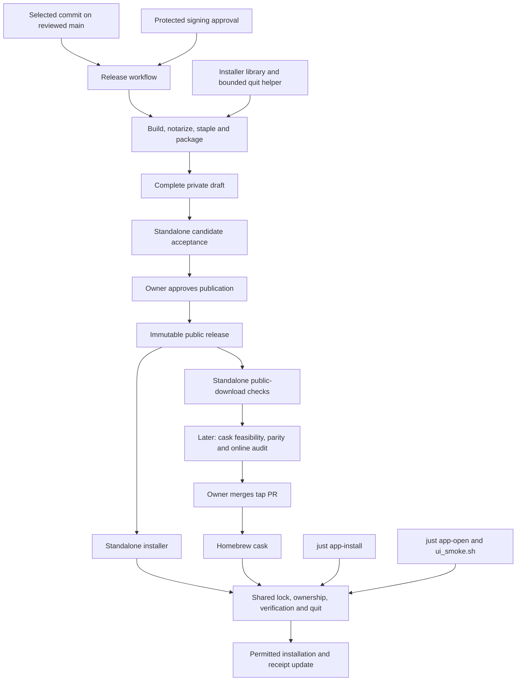

# Task: Ship standalone installation and updates, then add Homebrew

**Status**: Planned — revised after review run 20261117T190017; awaits re-review
**Component**: distribution
**Assigned to**: Varun Singh
**Priority**: Medium
**Branch**: `docs/app-distribution-plan` (planning); implementation on one `feature/app-distribution-*` branch per review gate, each cut from reviewed `main`
**Created**: 2026-11-17
**Review Gates**: full

## Objective

Publish one signed, notarized Apple-silicon app archive. Deliver the standalone
command-line installer and manual updates first. Add a Homebrew cask later,
consuming the same archive and checksum.
End users need neither a source checkout nor Xcode, uv, Python or just installed.
The standalone release requires neither a Homebrew tap nor a cask delivery. It does require the Homebrew-facing
contracts that published installers freeze: cask token, lock primitive and versioned state (see "Frozen contracts").

This updates the Homebrew plan from `docs/distribution-plans` at `a5a371d`.
Its scope now includes standalone installation; the retained
[App Store decision record](20261117-design-app-store-distribution.md) explains the excluded route.

## Context

Verified against the current checkout on 2026-11-17:

- `scripts/build_app.sh` signs nested uv and the app with hardened runtime, but uses
  `--timestamp=none`. Release signing needs a separate secure-timestamp mode.
  It also rewrites `CFBundleIdentifier` when `BUNDLE_ID` is set (documented in `docs/development.md`).
- `just app-install` builds locally, quits the running app, stages and verifies a
  copy, then replaces the bundle. It defaults to the self-signed `Code Signing` identity and writes no receipt,
  so every existing developer install, including the known baseline build 474, is receipt-less.
  Retain local builds, with ownership guards added before replacement; the new installer downloads a finished release.
- `just app-open` and `scripts/ui_smoke.sh` also quit and launch the same bundle id outside any lock today.
- `scripts/quit_app.sh` has a bounded quit protocol and treats refusal, timeout or
  unknown running state as failure. It must never be replaced with a force-kill shortcut.
  It is a standalone program with top-level EXIT/INT/TERM traps and `exit` calls, so it cannot be sourced.
- `scripts/fetch_uv.sh` bundles arm64 uv; `Package.swift` targets macOS 15+.
  Apple Speech still needs macOS 26+. Python and models download on demand.
- `app-version.json` is currently version `0.4.1`, build `474`; app versions remain
  independent of `artifacts/tts.json` and `ServiceCatalog.sttServerRequirement`.
- `.github/workflows/test.yml` is the test workflow. Its ubuntu job runs the full pytest suite; its `macos-app` job
  runs only `python_tests/test_app_recipes.py`. There is no release workflow or standalone app installer in this checkout.
- Bundle identity, AppPaths, cache precedence, preferences and environment
  fingerprints are compatibility invariants. Inspect the migration tests before changing packaging.

## Prerequisites and decisions

- Confirm the release owner, Apple Developer membership, Developer ID Application
  certificate, expected Team ID and notarytool API-key access. No credentials belong in this plan.
  Their availability is unverified. Reviewed mock implementation may proceed without credentials;
  real signing requires verified credentials, a protected environment and approved version/build metadata.
- Proposed tap: `pipecat-ai/homebrew-tap`, pending owner approval and repository/access checks.
  Tap provisioning is a phase 7 dependency only. The cask token is fixed now as `pipecat-service-toolbar`
  because the standalone installer detects Brew ownership by it. Use a project-owned tap initially;
  submission to Homebrew's main cask repository is separate work.
- Use a ZIP archive with a stapled app inside, built with `ditto -c -k --keepParent`.
  Distribution channels never re-sign, modify the signed bundle or rebuild the app.
- Standalone destination: `~/Applications`, with `--app-dir` for an existing writable directory.
  No sudo, privilege escalation or automatic app launch. Homebrew keeps its configured app directory.
- First standalone interface: `install.sh --version X.Y.Z [--app-dir PATH]` plus `--help`.
  `install.sh` is bound to its own release: it embeds its version and rejects any other `--version` value.
  The flag stays required as an explicit confirmation. The same command installs when absent and updates a
  verified standalone installation when present. An explicit stable version is required; automatic
  latest-version discovery, downgrades, an automated standalone uninstall command and an in-app updater
  are outside this increment. A documented manual bundle-and-receipt removal procedure is required for channel switching.
- Normal uninstall retains app data. Cask zap may remove only preferences and logs;
  never Application Support, model weights, Hugging Face or Moonshine shared caches.

## Requirements

### Review and merge gates

- Three review-then-merge gates, none after publication. Each gate runs `/code-review xhigh --fix`, then
  `review-gauntlet`, then a regular merge to `main`; fix all findings before the merge.
  Gate A follows phase 2 (before any live workflow run). Gate B follows phase 4 (before any candidate commit
  is selected). Gate C follows phase 7 (the cask).
- The release workflow reaches `main` at Gate A so that live dispatch checks can run from the default branch.
  It cannot sign without protected-environment approval and verified credentials.
- Phase 5 selects the candidate commit only from reviewed `main`.
- Phases that need external actions (credentials, owner approval, publication) are split at those actions:
  phase 3 holds live and credentialed work, phase 5 ends at candidate evidence, phase 6 starts only after
  approved publication, and phase 7 starts only after phase 6.

### Shared release contract

- Release mode requires the configured Developer ID Application identity and secure timestamp;
  development builds keep their current identity resolution and timestamp behaviour.
  Validate bundle id `ai.pipecat.ServiceToolbar`, version/build, Team ID, hardened runtime,
  nested executable signatures and notarization. Release mode also fails if the signed entitlements include
  `get-task-allow`. Never strip quarantine to make a check pass.
- Create a temporary upload ZIP, submit using `xcrun notarytool submit --wait` with a bounded timeout,
  require Accepted, staple the app, validate the ticket, then create the final ZIP and compute its SHA-256.
  Fetch and archive the notarytool log for every submission, and print it on any non-Accepted result.
  Only the final, post-stapling bytes become the shared download.
- Publish `Pipecat-Service-Toolbar-X.Y.Z-arm64.zip`, `SHA256SUMS`, versioned `install.sh`
  and a plain-text release manifest. The manifest records schema version, app version/build,
  bundle id, Team ID, architecture, minimum macOS version, filename and SHA-256.
  Parse an exact allowlist of keys; reject duplicates, missing keys, unknown keys and invalid values.
  `SHA256SUMS` and the manifest must agree. Never source or eval metadata. A checksum detects corruption;
  the pinned signing identity and Gatekeeper assessment authenticate the downloaded app.
- Release assets are immutable: refuse replacement under an existing published version. Two mechanisms enforce
  this together: the GitHub immutable-releases repository setting (live evidence in phase 1) and the workflow guard.
  The `vX.Y.Z` tag must match `app-version.json`; the build must exceed published builds
  and the known installed baseline of 474. Published build numbers come from the manifests of published releases
  (listed through the GitHub release list). Select the next version/build before a release;
  do not publish the existing 0.4.1/474 as a new build or use mismatched prerelease tags.
- A separate release workflow accepts version tags or manual dispatch at an explicitly
  selected commit. Both triggers prepare private drafts; neither publishes or updates the tap.
  A draft carries the full built commit SHA as `target_commitish`; after publication a check asserts that the tag
  resolves to the candidate commit (the draft-publish tag behaviour is verified once in a sandbox repository).
  Manual dry runs use the same intended version and a ZIP-only dry-run mode that uploads a workflow artifact and
  never creates a draft release. Public installer URLs resolve only published assets.
- Privileged jobs require a protected GitHub environment with human approval. Test jobs
  never receive signing secrets. Pin third-party actions by immutable commit; import the
  certificate into an ephemeral keychain, clean it and key files on every exit, and mask secrets.
  Scope write permission to release upload jobs; tap changes use a separate reviewed PR.
  Test static workflow policy and an isolated denied-approval run; repository settings need live evidence.
  The owner creates the protected environment and its reviewers (phase 1). The Team ID is injected at packaging
  time, and the packager fails closed on a placeholder value.
- Standalone candidate acceptance uses private staged assets. After it passes, the owner may approve publication
  of those exact bytes, recording each approval and its evidence hashes in the draft release notes and in
  `docs/release-evidence/X.Y.Z.md`. Public-download checks and online cask audit then gate the separate tap merge.
  The first standalone release does not wait for cask implementation, audit or tap provisioning.
  A failed public check blocks tap merge; never repair a published release by replacing its assets.
  This plan does not authorise certificate changes, tags or publication.
- The notary service has not seen this bundle layout (uv under `Contents/Resources/bin`, a server wheel under
  `Contents/Resources/wheels`). Treat acceptance as unverified until the first real submission, and confirm
  whether the bundled wheel contains native code.

### Frozen contracts

Published installers are immutable and old versions stay downloadable, so the first release freezes these.
They are fixed before phase 4 and may change only through a new installer release:

- Cask token `pipecat-service-toolbar`.
- Lock primitive (see "Installer state and removal"): a kernel advisory lock on `operation.lock`.
- A schema version on the receipt, lock record and recovery journal, and a protocol version file in the installer
  state directory. Every later installer must honour version-1 state. An installer that reads a newer version
  stops without recovery or mutation and reports it.
- If phase 7 proves cask hooks cannot hold the lock or honour quit refusal, phase 7 may force a new installer
  release. No cask hook spike runs before the first publication; Homebrew work stays after standalone delivery.

### Installation and upgrade contract

- Both routes install the same final ZIP, with the same pinned version and SHA-256.
  The standalone script is versioned with the release and embeds the expected Team ID and
  fixed repository. It uses only macOS-supplied Bash 3.2, curl, shasum, ditto, codesign,
  spctl, osascript, the plist tools, the lock tool and the ZIP lister named in "Installer state and removal";
  no Xcode-only tool is required on the user's Mac. Phase 1 confirms each tool exists on clean macOS 15 and 26
  without Command Line Tools.
- Reject unsupported OS/architecture, malformed version, unexpected URL origin, incomplete
  download, invalid manifest, checksum mismatch, unsafe archive entries and invalid signatures
  before requesting quit or changing an existing install. HTTPS only, bounded downloads,
  private temporary directories, no unquoted path expansion, no network response executed as code.
  Document downloading the versioned installer to a file before running it.
- Redirect policy: the initial URL must be `https://github.com/<fixed-repo>/releases/download/vX.Y.Z/<asset>`.
  The installer follows a small bounded number of redirects, restricts curl to HTTPS for both the request and
  redirects, and accepts only hops to hosts on an embedded allowlist recorded from a live release-asset redirect
  chain in phase 1. It rejects HTTP downgrades, unlisted hosts and over-long chains. A GitHub host change needs a new
  installer release. Trust rests on the signature, Team ID and Gatekeeper checks, not on the download host.
- Archive inspection: the installer lists ZIP entries with the lister named in "Installer state and removal" and
  rejects absolute paths, `..` components, symlink entries and entries outside the single expected `.app` root,
  before extracting with `ditto`.
- Check the extracted bundle's exact id, version/build and Team ID against validated metadata. The primary trust check
  is an explicit `codesign` requirement (Developer ID, the embedded Team ID, notarized), with `spctl` assessment as a
  secondary check. Phase 1 records `spctl` output and exit codes on clean macOS 15 and 26 for a notarized,
  non-quarantined bundle (curl sets no quarantine attribute) and fixes the exact pass rule. An installer must not
  accept any signed app merely because its checksum matches a manifest.
- All participating installers acquire the same per-user bundle-identity lock before ownership
  and duplicate checks, and hold it through replacement, receipt updates and recovery.
  Destination locks alone are insufficient. Recheck ownership under the lock; fail closed on contention,
  unsafe lock state or an unverified stale owner. Phase 7 must prove cask lock lifetime and cleanup
  before Homebrew delivery; standalone/developer locking is implemented and tested in phase 4.
  Refuse symlinked destinations and ambiguous ownership. Store standalone/developer ownership in the receipt
  specified below, outside the signed app; never alter the app's environment layout marker.
- Stage on the destination filesystem and verify the staged copy. Request graceful quit
  using the existing bounded semantics. Cancel, timeout, unknown state or a still-running
  process aborts without replacement; never kill the app or external servers to upgrade.
  The quit helper runs as a child process; the installer never sources it.
- Replace with a recoverable backup-and-rename transaction. Keep the old bundle and receipt
  until the new bundle passes verification. Roll back on errors; recover an interrupted
  transaction on the next invocation before accepting another install. A failed operation
  must leave the previous installation recoverable and report the recovery path.
- Version rules apply to the standalone channel only. Same-version standalone reruns are no-ops only after
  identity/integrity verification; the standalone installer refuses lower versions/builds, a same version with a
  different build, and receipts inconsistent with the installed bundle. The developer channel always replaces
  (after lock and ownership checks), because a developer rebuilds the same version and build repeatedly.
- Detect Homebrew ownership from documented `brew` commands where possible (reading Caskroom files only if phase 1
  shows no command exposes it), keyed by the cask token and resolved target, including standard native/Rosetta
  prefixes; unresolved ownership fails closed. A standalone installer refuses a Brew-managed app. The cask refuses an
  existing standalone/developer receipt, a receipt-less bundle or an unmanaged bundle. Channel switching is
  explicit removal of the old bundle through its owner, preserving data, followed by the other route;
  no force/adopt overwrite flags in this plan's own routes.
- `just app-install` participates in the same lock and ownership checks before building or quitting.
  Refuse standalone/Brew ownership, conflicting receipts and unknown identity; retain ordinary verified
  developer upgrades. There is no force-overwrite escape. Include `justfile` and its recipe tests in phase 4.
  `just app-open` and `scripts/ui_smoke.sh` quit the installed app by bundle id outside the shared lock today.
  Phase 4 makes both take the shared lock and refuse (not quit) when the installed copy is standalone- or
  Brew-owned. The duplicate probe ignores the repository's `build/` output bundle but still reports a registered
  running copy of that bundle id.
- Receipt-less developer installs: the standalone installer and the cask refuse a receipt-less bundle and point at the
  documented manual removal procedure. `just app-install` performs the migration itself, as an evidence-gated,
  logged, one-time step: it adopts a receipt-less bundle only if the bundle id matches, its designated requirement
  matches the identity from `scripts/resolve_sign_identity.sh`, and no Brew or standalone ownership exists. It then
  writes a `developer` receipt and prints that it adopted the bundle. Anything else is refused, with no force flag.
- `BUNDLE_ID` overrides: a developer build with a non-default bundle id skips the shared lock and receipt (it is not
  the identity the lock protects); one recipe test covers this.
- Probe both standard application directories, receipt-recorded paths, Brew targets and registered running copies to detect
  duplicate bundle IDs. Refuse a second installation until the user resolves the conflict.
  A development/self-signed installation requires an explicit migration procedure, not silent adoption: for the
  developer route that procedure is the evidence-gated adoption above.
- Changing from a self-signed build to Developer ID changes its designated requirement.
  Document and test permission re-authorisation; do not promise Microphone/Speech grants survive.
  The pass result is working Microphone and Speech access after the documented user step. Phase 5 records, on
  macOS 15 and 26, whether that step was a fresh prompt or a manual reset (for example `tccutil reset`), and writes
  the observed step into `docs/migration.md`. Launch-at-login after the signer or path change is tested the same way.
  Existing environments, model caches and preferences must survive the migration unchanged.
- App upgrades do not move server pins, refresh working environments or download models.
  Installation itself does not start services. Validate preserved readiness in isolated test state:
  "ready" means unchanged environment fingerprints plus no `uv sync` and no model download on first start.

### Homebrew contract — deferred to phase 7

- Declare arm64 and macOS 15+ support, the pinned version/checksum/URL, and the app artifact. Include `name`, `desc`
  and `homepage` stanzas and record a `livecheck` decision. Leave `auto_updates` unset.
  Document the fully qualified tap/cask install command.
- Prove the selected Homebrew lifecycle hooks can hold the shared lock, detect ownership and honour quit refusal
  before any destructive upgrade/uninstall step. Do not assume `uninstall quit:` alone does this.
  If the supported cask API cannot uphold the contract, stop that delivery phase and obtain
  a revised channel design, which may be a new installer release; do not weaken the invariant or patch Homebrew internals.
- Audit/style validation and tests use the same Homebrew version whose upgrade semantics
  were exercised. Record it with release evidence and recheck on supported-version changes.

## Review Focus

Release trust and secret boundaries; notarization and packaging order; exact artifact parity;
Bash 3.2 and no-build-tools bootstrap; Homebrew quit/upgrade behaviour; shared locking and ownership
across all three installers; crash recovery; signing migration; state preservation and release approval boundaries;
frozen-contract compatibility across published installers; review and merge ordering around publication.

## Implementation Checklist

### Phase 1: Validate standalone release prerequisites

**Impl files:** `docs/development.md`, this plan
**Test files:** none (isolated feasibility checks)
**Test command:** `uv run pytest python_tests/test_migration_contract.py python_tests/test_server_pins.py -q` (regression check only; phase 1 changes no tested code)
**Goal:** Record signing prerequisites and the facts the frozen contracts depend on, without blocking standalone work on Homebrew.

- Record signer ownership as verified or pending; inspect credentials by metadata only.
  Record the verified Team ID and protected-environment configuration for release tooling.
  The owner creates the protected GitHub environment and its reviewers; the Team ID reaches the packager as an
  injected value, never a committed placeholder.
- Record live repository evidence: the immutable-releases setting, environment protection and required reviewers.
- On clean macOS 15 and 26 without Command Line Tools, record: that the lock tool and ZIP lister exist; mutual exclusion
  between the lock tool and Ruby `File#flock`; `spctl` output and exit codes for a notarized, non-quarantined bundle;
  `plutil`/`PlistBuddy` duplicate-key behaviour (decides plist versus a line-based receipt).
- Record a live release-asset redirect chain (the host allowlist) and the Homebrew metadata and documented `brew`
  commands that expose cask ownership, using any real cask in a disposable user.
- Confirm the intended test host (VM or a physical Mac with a disposable user) can run one MLX backend, Apple Speech
  and a microphone permission prompt. If a VM cannot, specify the physical-Mac route.
- Mock work in phases 2 and 4 may proceed with pending credentials.
  Real signing waits for verified signing prerequisites. Tap ownership and cask feasibility belong to phase 7.
  Neither mock completion nor a signed ZIP alone authorises delivery. Never replace the user's installed toolbar.

### Phase 2: Build the shared release artifact (stub-tested)

**Impl files:** `scripts/build_app.sh`, new `scripts/package_release.sh`, new `.github/workflows/release.yml`, `.github/workflows/test.yml`
**Test files:** `python_tests/test_app_recipes.py`, new `python_tests/test_release_packaging.py`
**Test command:** `uv run pytest python_tests/test_app_recipes.py python_tests/test_release_packaging.py -q`
**Goal:** Only a verified, notarized, stapled bundle can produce publishable final bytes, proven with stubs and no credentials.

- Add explicit release mode (secure timestamp, `get-task-allow` check), packaging and manifest generation,
  version/build guards, the ZIP-only dry-run mode and the protected workflow. Run the new test files in the
  `macos-app` job of `test.yml`.
- Add stubbed packager tests: each non-Accepted notarization status, notarytool timeout, stapler failure and ticket
  validation failure; assert no final ZIP, manifest or checksum is emitted on failure, the recorded command order,
  that the hash is of the post-staple ZIP, and that the notary log is fetched.
- Add negative checks for action pins, job permissions, secret separation, approval gates, draft-only
  triggers, tag-to-commit resolution and published-asset overwrite refusal.
- The release workflow must reject incomplete asset sets; the complete set (including `install.sh`) is assembled in phase 5.
- Gate A: `/code-review xhigh --fix`, `review-gauntlet`, then regular merge to `main`.

### Phase 3: Validate release tooling live

**Impl files:** `app-version.json`, `CHANGELOG.md` (dry-run entry only), this plan
**Test files:** none (live checks run from `main`; evidence recorded in `docs/development.md`)
**Test command:** `uv run pytest python_tests/test_app_recipes.py python_tests/test_release_packaging.py -q`
**Goal:** Live workflow policy and a real signing dry run pass before any installer work depends on them.

- Starts only after Gate A and, for the real-signing items, verified credentials.
- Run the isolated denied-approval and cancellation checks and the draft-only/overwrite-refusal checks against the real
  repository settings (YAML alone cannot prove approval enforcement). Verify once, in a sandbox repository, how
  publishing a draft binds the tag.
- Before real signing, the release owner chooses the next app version and a build above published builds and 474.
  Update `app-version.json` and add a dry-run changelog entry in a focused commit. This is a dry-run commit, not the
  release candidate; phase 5 selects the only candidate and writes the final changelog entry.
- With verified credentials, run a ZIP-only dry run and validate it with codesign, spctl and stapler. Record the first
  real notary result for the bundle layout.

### Phase 4: Implement standalone installation and manual updates

**Impl files:** new `scripts/install.sh`, new `scripts/lib/install_app.sh`, `scripts/package_release.sh`, `justfile`, `scripts/ui_smoke.sh`, `docs/development.md`, `README.md`, `.github/workflows/test.yml`
**Test files:** new `python_tests/test_app_installer.py`, `python_tests/test_app_recipes.py`
**Test command:** `uv run pytest python_tests/test_app_installer.py python_tests/test_app_recipes.py -q`
**Goal:** Every rejection preserves the existing app and all user state.

- Share verification/transaction logic in `scripts/lib/install_app.sh`. `scripts/package_release.sh` builds the single
  release `install.sh` by embedding that library and `scripts/quit_app.sh` as a child-process payload; nothing is
  fetched from `main`. Test that the embedded `quit_app.sh` bytes equal the file at the release commit. Run the
  whole matrix below against the bundled file, not only against the sources.
- Add the common lock and ownership guard to `just app-install`, `just app-open` and `scripts/ui_smoke.sh` before
  build/quit; retain local signing and launch behaviour only for permitted developer installations. Implement the
  evidence-gated adoption of receipt-less developer bundles, the `BUNDLE_ID` rule and the duplicate-probe treatment
  of `build/`. Document all of it in `docs/development.md` and `README.md` and update the `justfile` comments here.
- Define and test receipt creation, rollback, interrupted install and removal, and the manual channel-switch procedure.
- Cover the input, trust, ownership, locking, interrupted-install and rollback matrices below, including the
  frozen-contract version checks.
- Exercise mock assets here; real staged-candidate acceptance belongs to phase 5.
- Gate B: `/code-review xhigh --fix`, `review-gauntlet`, then regular merge to `main`.

### Phase 5: Candidate release and acceptance

**Impl files:** `scripts/package_release.sh`, `.github/workflows/release.yml`, `README.md`, `docs/development.md`, `docs/migration.md`, `AGENTS.md`, `CHANGELOG.md`
**Test files:** new `python_tests/test_distribution_contract.py`, `python_tests/test_docs.py`
**Test command:** `uv run pytest python_tests/test_distribution_contract.py python_tests/test_docs.py -q`
**Goal:** Complete, exact-byte candidate evidence reaches the owner; nothing is published.

- Select one immutable commit from reviewed `main` containing all standalone release inputs, with the final changelog
  entry. Build/sign the app and assemble ZIP, manifest, checksum and bundled installer from that commit;
  produce the complete private draft. Invalidate earlier candidate evidence when source or bytes change.
- Candidate harness: in a disposable VM only, a local HTTPS server serves the exact candidate bytes at the fixed GitHub
  URLs and the allowlisted redirect hosts, using hosts-file entries and a test CA trusted only in that VM. The installer,
  its allowlist and its signature checks stay byte-identical to the release; there is no production URL override.
  Unproven until phase 6: the real GitHub TLS chain and redirect hosts, GitHub's asset serving and browser quarantine.
- Run standalone candidate acceptance in isolated state on macOS 15 and 26, including the real-codesign
  wrong-signature test, `spctl` reporting Notarized Developer ID with the expected Team ID, the permission and
  launch-at-login migration records, and the first-run quit cases below.
- Document installation, migration, channel switching, uninstall preservation and recovery.
- Run repository gates, manual removal preservation and negative workflow checks. Hand candidate evidence to the
  owner; publication remains a separate approved action.

### Phase 6: Publish standalone and verify publicly

**Impl files:** new `docs/release-evidence/X.Y.Z.md`, `README.md`, `CHANGELOG.md`
**Test files:** `python_tests/test_distribution_contract.py`
**Test command:** `uv run pytest python_tests/test_distribution_contract.py python_tests/test_docs.py -q`
**Goal:** Users can install and manually update the app without Homebrew or a source build.

- Starts only after the owner approves publication of the tested bytes.
- After approved publication, install and update through the public URLs; verify hashes, the tag-to-commit check,
  quarantine/Gatekeeper on the browser-downloaded ZIP (checked with `xattr -l`) and state preservation.
- Record approvals and evidence hashes in `docs/release-evidence/X.Y.Z.md`.
- This completes standalone delivery independently of phase 7.

### Phase 7: Add Homebrew after standalone delivery

**Impl files:** new `packaging/homebrew/pipecat-service-toolbar.rb`, `README.md`, `docs/development.md`, `docs/migration.md`, `AGENTS.md`, `CHANGELOG.md`, this plan
**Test files:** `python_tests/test_distribution_contract.py`, `python_tests/test_app_installer.py`, `python_tests/test_docs.py`
**Test command:** `uv run pytest python_tests/test_distribution_contract.py python_tests/test_app_installer.py python_tests/test_docs.py -q`
**Goal:** Add Homebrew without weakening standalone ownership, quit or data-preservation guarantees.

- Starts only after phase 6. Confirm the tap owner and repository access. In a disposable user/VM, prove cask
  install/upgrade/uninstall hooks hold the common lock, honour quit refusal and release the lock on every exit.
  Record the Brew version. Stop this phase if supported hooks cannot uphold the contract; standalone delivery
  remains available, and a revised design may require a new installer release.
- Keep the canonical cask template here. The cask's guard logic is generated from the selected released installer's
  library (a generator renders it from `scripts/lib/install_app.sh` at that source commit); the signed bundle carries
  no guard helper. Any incompatible guard change requires a new tested app distribution release before cask delivery.
- Test both routes against that release's exact ZIP/hash, cross-channel conflicts, races, successful uninstall
  and zap preservation. Run macOS 15/26 cask acceptance and verify parity with standalone acceptance.
  Also run `brew install --cask --force`, `--adopt`, `brew reinstall` and `brew upgrade --greedy` over a standalone
  and a developer install with quit refused; assert the guard refuses, or record the limit as a stop condition.
- Prepare the resolved tap cask in a separate PR. Run `brew audit --cask --strict --online` and `brew style`
  against public URLs; merge only after evidence and explicit owner approval. Update user-facing Homebrew instructions then.
- Gate C: `/code-review xhigh --fix`, `review-gauntlet`, then regular merge to `main`.

## Technical Specifications

Existing files to modify and new files are listed in each phase; every `new` path is proposed,
not an assertion that it exists. Keep app/server version authorities in their current files.
The protected GitHub environment gates standalone signing. The external tap gates only phase 7.

The shared manifest binds release metadata and artifact bytes. Consumers validate it, then
validate the signed bundle independently. Installer receipts describe installation ownership;
they are not cryptographic proof and never override bundle verification or Brew metadata.
No source build, package-manager dependency installation or cache migration belongs in either installer.

### Installer state and removal

Use a private, user-owned directory at `~/Library/Application Support/Pipecat Service Toolbar Installer/`
for `operation.lock`, `receipt.plist` (or its line-based equivalent, per phase 1), a recovery journal and a
`protocol` file holding the protocol version (`1`). This is separate from the app's existing AppPaths.
The fixed lock identifies `ai.pipecat.ServiceToolbar`, regardless of destination or installer channel.
All three routes use the same atomic lock protocol; the cask embeds its reviewed implementation
from the same source commit. Contract tests assert parity with the standalone and developer paths.

Lock primitive: a kernel advisory lock held on `operation.lock`, which the kernel releases when the holder exits or
dies. The candidate tool is `/usr/bin/lockf`; phase 1 confirms it exists on clean macOS 15 and 26 and excludes Ruby
`File#flock`, and records a substitute before phase 4 if it does not. The lock tool and the ZIP lister (candidate:
`/usr/bin/unzip -Z1`, to be confirmed in phase 1) are added to the installer's tool allowlist. The lock file holds a
diagnostic record (`schema_version`, `bundle_id`, `channel`, `operation`, `pid`, `started_at`); the record never
decides ownership. A lock is held exactly when the kernel lock cannot be acquired, so no PID or age heuristic breaks
it. Acquisition is bounded; on timeout the installer fails closed and reports that explicit recovery is required.

The receipt uses schema version 1 with exact keys: `schema_version`, `bundle_id`,
`version`, `build`, `path` (canonical absolute bundle path), and `channel` (`standalone` or `developer`).
Reject unknown/duplicate keys, unsafe paths and invalid values. The invoking user owns the receipt;
the owning standalone/developer route writes it after verified installation, with atomic update and rollback.
For the developer channel `version` and `build` record the installed bundle's values informationally; they never
drive refusal. Developer installs also record custom paths, so later lock holders can detect a copy even after it exits.
Homebrew ownership continues to use its cask metadata; no receipt may substitute for that metadata.
Check it against bundle identity and Brew metadata; it never grants authority to overwrite another channel.

Recovery journal: `schema_version`, `journal_id`, `operation` (`install`, `update` or `remove`), `state`, `bundle_id`,
`original_path`, `backup_path`, the old receipt contents and the target version/build. It is written atomically before
any rename. Install/update states and the action recovery takes from each (recovery runs under the lock, before any new install):

| State | Meaning | Recovery action |
|---|---|---|
| `started` | Nothing moved yet | Discard journal |
| `staged` | New bundle staged and verified beside the destination | Remove staged copy; discard journal |
| `backup_moved` | Old bundle moved to backup, new not yet in place | Restore backup to the original path; restore old receipt |
| `new_in_place` | New bundle renamed into place, receipt not updated | Verify new bundle; if valid write receipt and finish, else restore backup |
| `complete` | Receipt written | Remove backup; discard journal |

Phase 4 documents a manual standalone removal sequence, using the same lock and bounded quit semantics:
validate receipt/bundle identity and absence of Brew ownership; quit successfully; move the exact bundle
to a recoverable backup; confirm its original path is absent; remove only the matching receipt;
release the lock. Never remove app data or shared caches.
Before moving a bundle, atomically journal the operation, original/backup paths and old receipt;
validate the journal's paths and bundle identity before any recovery action.
The backup is renamed beside the destination to a non-`.app` name, `.<AppName>.bak-<journal-id>`, on the same
filesystem so the rename stays atomic, and is recorded in the journal. Removal journal states are `started`,
`backup_moved`, `receipt_removed`, `removal_complete` (backup retained) and `cleaned`. Duplicate probes, ownership
checks and recovery skip any path recorded in a journal in `removal_complete`; recovery acts only on the earlier states.
The backup is deleted only by an explicit, documented user step after the new channel works, which moves the journal
to `cleaned`.
For interrupted removal, require the receipt and recorded backup to identify the same verified bundle
before completing cleanup or restoring it. Missing/mismatched evidence stops for operator recovery;
an orphaned receipt alone must not authorise deletion. Automated uninstall remains out of scope.
Homebrew removal uses Brew; developer removal follows the same verified bundle/receipt procedure with its local signing identity.
Switching is two separate locked operations; the new installer rechecks ownership after acquiring its lock.

Reference requirements: [Homebrew Cask Cookbook](https://docs.brew.sh/Cask-Cookbook),
[Apple notarization workflow](https://developer.apple.com/documentation/security/customizing-the-notarization-workflow),
[notarization troubleshooting](https://developer.apple.com/documentation/security/resolving-common-notarization-issues).
Recheck the supported cask APIs in phase 7; do not copy an obsolete hook spelling into implementation.

### Integration Seams

| Producer | Consumer | Contract |
|---|---|---|
| Approved commit and signing environment | Release workflow and packager | Version/build authority, injected Team ID, ephemeral secrets; draft-only output |
| Packager | Standalone installer and cask | Identical final ZIP/hash, manifest and bundled installer from one commit |
| Packager | Standalone installer | `install.sh` embeds `scripts/lib/install_app.sh` and `scripts/quit_app.sh` (child-process payload) from the same commit |
| Installer library at the selected release commit | Cask | A generator renders the cask guard logic from the library; the signed bundle carries no helper |
| Ownership/lock logic and quit helper | Standalone, developer recipes (`app-install`, `app-open`, `ui_smoke.sh`) and cask | One lock protocol; verify ownership before quit/mutation; abort on uncertainty |
| Frozen contracts (token, lock primitive, versioned state) | Every published installer and the cask | Version-1 state honoured by later installers; newer state stops without recovery |
| Candidate acceptance | Release owner | Exact-byte evidence permits publication; public checks separately gate tap merge |

## Architecture & Call Flow



```mermaid
sequenceDiagram
    actor Owner
    participant Workflow
    participant Packager
    participant Acceptance
    participant Release
    participant Tap
    participant Installer
    participant State as Lock and ownership state
    Owner->>Workflow: Select commit from reviewed main and approve protected signing
    Workflow->>Packager: Build, sign, notarize, staple, assemble all assets
    Packager-->>Acceptance: Complete private draft and hashes
    Acceptance-->>Owner: Standalone candidate evidence
    Owner->>Release: Approve publication of tested bytes
    Acceptance->>Release: Fetch public assets and verify delivery
    Acceptance-->>Owner: Standalone public checks pass
    Installer->>Release: Fetch pinned version and validate download
    Installer->>State: Acquire common lock and recheck ownership
    Installer->>Installer: Verify staged app, request bounded graceful quit
    Installer->>State: Commit or recover bundle and receipt; release lock
    opt Later Homebrew phase
        Acceptance->>Tap: Prove hooks, artifact parity and online audit
        Acceptance-->>Owner: Homebrew acceptance evidence
        Owner->>Tap: Approve separate tap PR merge
    end
```

| Step | Trigger | Enters context | Cleared/persisted | Turn boundary |
|---|---|---|---|---|
| Build and package | Tag/manual selected commit plus signing approval | Source, version/build, temporary credentials | Credentials cleared on every exit; final assets and hashes retained | CI job |
| Candidate acceptance | Complete draft available | Exact standalone assets and isolated app state | Evidence tied to commit/hashes; test state discarded | Disposable test session |
| Publish and verify | Owner accepts standalone evidence | Tested bytes and approved metadata | Immutable release, public-check evidence and `docs/release-evidence/X.Y.Z.md` | Owner approval, then public test session |
| Homebrew delivery | Phase 6 complete and phase 7 prerequisites verified | Published ZIP, matching guard logic and cask template | Cask acceptance/audit evidence; separately approved tap PR | Later test session and owner approval |
| Install/upgrade | User invokes standalone or Brew | Verified artifact, receipt/Brew metadata, common lock | Bundle/receipt or recoverable backup persisted; lock released | Local process |
| Developer install | User invokes local recipe | Common lock, ownership, local source and signing identity | Verified developer bundle and receipt only; managed destinations refused | Local process |
| Developer open/smoke | User invokes `just app-open` or `scripts/ui_smoke.sh` | Common lock, ownership, installed bundle id | Nothing persisted; refuses to quit standalone/Brew copies | Local process |

The release installer embeds its library and bounded quit helper from the selected commit;
it fetches no executable helper from the main branch. The cask receives guard logic generated from the same library.
Credentials exist only in protected signing jobs; neither installers nor the tap receive signing secrets.

## Testing Notes

- Stub external commands and HTTPS responses in Python tests; exercise stock `/bin/bash` 3.2 by invoking it
  explicitly and asserting its version. The new test files run in the `macos-app` CI job with macOS-only skip markers
  on the ubuntu job. Manifest, receipt and archive tests run against real `plutil`/`PlistBuddy`, `shasum` and `ditto`
  with crafted inputs; stubs cover only network, `codesign`, `spctl`, `osascript` and the Brew commands.
  Assert every failure preserves old bundle bytes, receipt, preferences and cache sentinels. Assert stubbed
  `sudo`, `open` and launch commands record zero calls.
- Matrix: OS/CPU rejection; malformed version; unexpected origin; allowlisted redirect accepted; HTTP downgrade,
  unlisted host and too-many-redirects rejected; truncated and oversized body; bad/duplicate/missing manifest keys;
  `SHA256SUMS` and manifest disagreement; bad hash or signer; traversal/symlink archive; symlinked destination;
  disk full; unwritable or absent `--app-dir`; spaces/non-ASCII paths; concurrent installs; missing/stale receipt;
  old/current/new versions, same version with a different build and an `install.sh` run with a mismatched `--version`;
  newer-protocol state; cancelled quit; hanging Apple event; interruption before/after each rename and at each
  journal state; rollback failure; an installer started while a `removal_complete` journal exists.
- Channel outcome table (each cell is a test; the message names the owner and the manual removal procedure):

| Existing state | Standalone `install.sh` | `just app-install` | Cask (phase 7) |
|---|---|---|---|
| Absent | install | install | install |
| Standalone receipt | update (version rules) | refuse | refuse |
| Developer receipt | refuse | replace (always) | refuse |
| Brew-managed | refuse | refuse | upgrade |
| Receipt-less, matches local identity | refuse | adopt, then replace | refuse |
| Receipt-less, other signer or unknown owner | refuse | refuse | refuse |
| Duplicate path or registered running copy | refuse | refuse | refuse |

- Race tests run two standalone installs into different directories, standalone against Brew, and developer
  against each release channel. Assert at most one installation commits; losers cannot quit or mutate the app.
  Cover lock cleanup, uncertain stale owners and receipt-recorded custom destinations.
  Phase 4 tests standalone/developer races and mocked foreign Brew ownership; real cask races run in phase 7.
- Developer recipe tests also cover: receipt-less adoption and refusal, a same-build developer reinstall, the
  `BUNDLE_ID` override, `just app-open` and `ui_smoke.sh` refusing to quit managed copies, and the `build/` duplicate probe.
- Successful normal uninstall preserves app state, preferences and shared caches. Successful zap removes
  only this app's preferences/logs; assert Application Support, weights, shared caches and unrelated preferences survive.
  Test manual standalone removal and interrupted cleanup, then install through Brew without a stale receipt blocking it.
  Manual removal/recovery gates standalone delivery; successful Brew uninstall/zap and switching tests gate phase 7.
- Workflow tests reject missing environment protection, mutable action refs, broad write permissions and secrets in test jobs.
  Exercise denied approval and cancellation in an isolated environment: no signing, publication or leaked credentials.
  Assert manual/tag runs remain draft-only, incomplete assets fail, and existing published versions cannot be overwritten.
  Check actual repository environment settings as well as YAML; mocks cannot prove approval enforcement.
- `python_tests/test_distribution_contract.py` asserts, per phase: phase 5, that the candidate asset set, hashes, manifest
  and bundled installer correspond to one commit and that all three installers share one lock protocol; phase 6, that
  the published tag resolves to the candidate commit; phase 7, cask parity with the standalone ZIP/hash and guard logic.
  `python_tests/test_docs.py` covers the README and documentation edits from phase 4 onwards.
- Real tests run in a disposable user/VM with representative copied state, never the real installation.
  In phase 5, test standalone install/update, app startup and supported local TTS/STT on macOS 15. Repeat on macOS 26,
  including Apple Speech, and Microphone/Speech permission re-authorisation and launch-at-login after signer
  migration on both versions; record whether the user step was a prompt or a manual reset.
  Add first-run quit cases: a first-ever run from Terminal, an SSH session and the Homebrew process, plus the expected
  message when macOS blocks the Apple event. Exercise standalone installation without Brew or Xcode. In phase 7,
  repeat route parity and OS coverage for the cask, without a source checkout or app build tools.
  Candidate tests apply/retain quarantine and exercise Gatekeeper on staged bytes; after publication,
  download through a browser and recheck public delivery. Compare fingerprints/cache sentinels after upgrades.
- Before a PR: `uv run ruff format .`, `uv run ruff check .`, `uv run pytest`, `swift test`,
  `just app-build`. Before standalone publication: real Developer ID/notarization checks and standalone
  candidate installation/update/migration tests. Before tap merge: cask feasibility, route parity,
  public-download checks and online cask audit/style. Mock tests cannot replace these gates.

## Acceptance Criteria

### First delivery — standalone installation and manual updates

- One versioned command installs an absent app or updates a verified standalone copy without source/build dependencies;
  `install.sh` refuses any `--version` other than its own release.
- Same-version standalone reruns verify integrity and make no changes; lower versions/builds are refused. The developer
  channel always replaces after lock and ownership checks.
- Failed or cancelled upgrades preserve a recoverable previous installation and all app/model data.
- Standalone/developer installers refuse foreign-channel and unknown-owner replacement per the channel outcome table;
  cross-directory races cannot create duplicate installs. A receipt-less developer bundle is adopted only by `just app-install`,
  only under the evidence gate, and with a printed notice.
- Verified manual standalone removal clears its matching receipt without deleting app data, leaves any retained backup
  invisible to duplicate probes, and a later installer proceeds.
- Existing environments remain ready (unchanged fingerprints, no `uv sync`, no model download on first start); server pins and shared cache contents are unchanged.
- Standalone install/update passes macOS 15 and 26 acceptance. Microphone and Speech access work after the documented
  user step on both versions, with the observed step (prompt or manual reset) recorded in `docs/migration.md`; Apple Speech passes on macOS 26.
- Candidate gate: complete assets from one commit pass standalone acceptance, quarantine/Gatekeeper and state-preservation checks before publication.
- Public gate: the quarantined browser-downloaded ZIP matches candidate hashes and passes install/update checks after approved publication; the tag resolves to the candidate commit.
- Signing secrets remain outside PR CI/logs; negative approval/publication tests pass. Each owner approval follows its respective evidence gate and is recorded with its evidence hashes in the draft release notes and `docs/release-evidence/X.Y.Z.md`.
- Gates A and B (and later C) each passed review and a regular merge before the work they cover was relied on.

### Later delivery — Homebrew

- Both routes install the same ZIP/hash and pass macOS 15/26 acceptance.
- Proven cask hooks uphold the common lock and quit/ownership guarantees across all three installers, including under `--force`, `--adopt`, `reinstall` and `upgrade --greedy`, or the limit is recorded as a stop condition.
- Verified channel switching succeeds; successful uninstall/zap preserves everything outside its explicit removal scope.
- Cask audit/style and public-download checks pass before the separately approved tap merge.

<!-- reviewed: 2026-11-18 @ 75ec651fc57b0c696885347c51bc628ce19468f7 -->

## Progress

Planning only. Renamed and expanded from the original Homebrew plan; no installer or release code implemented.

## Findings

Review fixes accepted on 2026-11-17. The latest eight findings are addressed in the contract:
separate prerequisite and publication gates; explicit call flow; shared locking; developer ownership guards;
complete-release assembly after installer implementation; workflow policy tests; successful uninstall/zap tests.
Earlier review findings also add version/build preparation, receipt removal and macOS 15/26 acceptance.
Release credentials, protected-environment configuration, tap ownership and cask feasibility remain external gates, not verified facts.

Delivery sequence revised on 2026-11-18 at the user's request: standalone installation and manual updates first;
Homebrew feasibility, cask acceptance and tap setup move to phase 7. Signing prerequisites still gate real distribution.
The earlier review marker is invalidated by this contract change; review the revised sequence before implementation.

Review run 20261117T190017 (2026-11-17; 49 findings: 0 Critical, 34 Important, 15 Minor; 7 contradictions) applied.
Phases were renumbered 1–7 (old 2 became phases 2–3, old 3 became 4, old 4 became 5–6, old 5 became 7).
Decisions (grilled), all accepted as recommended: (1) cask token, lock primitive and versioned state are frozen before
phase 4, Homebrew delivery stays in phase 7, phase 7 may force a new installer release; (2) `just app-install` adopts
receipt-less developer bundles under an evidence gate, standalone and cask refuse them; (3) three review-then-merge
gates (A after phase 2, B after phase 4, C after phase 7) and phases split at external gates; (4) HTTPS-only redirect
allowlist recorded in phase 1; (5) removal backup is a non-`.app` sibling with journal states through `removal_complete`;
(6) candidate acceptance serves exact bytes from a VM-local HTTPS server with a VM-only test CA; (7) permission
migration passes on working access after the documented user step, recorded per macOS version.
Open items still resting on unverified external facts are listed in phase 1 as checks, not as settled facts.

## Issues & Solutions

The earlier plan assumed a simple cask upgrade respected quit confirmation. Phase 7 requires evidence before Homebrew delivery.

## Final Results

Not implemented. Distribution and release acceptance remain pending.
