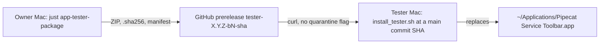
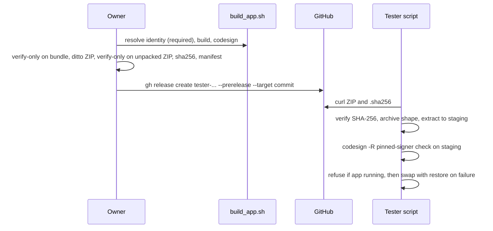

# Task: Ship an interim self-signed tester channel

**Status**: Planned — review fixes applied, awaiting acceptance
**Component**: distribution
**Assigned to**: Varun Singh
**Priority**: High
**Branch**: `docs/app-distribution-plan` (planning); implementation on a focused `feature/selfsigned-tester-channel` branch cut from `main` after the planning PR merges
**Created**: 2026-11-21
**Review Gates**: full

## Objective

Get a self-signed build of the app to known testers before Thanksgiving (2026-11-26), through a repeatable
owner-run process, while the Developer ID certificate that the Apple-signed alpha needs is still pending.
Testers install with one `curl` command and no Xcode. The channel is interim and for known testers only. It is
not the public distribution path and it does not replace the Apple-signed plan.

Dated critical path (the 2026-11-25 drop is a target, not a promise):

| Date | Milestone | Cut line |
|---|---|---|
| Sat 11-21 to Sun 11-22 | Planning PR reviewed and merged to `main` | Implementation cannot start before this merge |
| Mon 11-23 | Phases 1 to 4 implemented, `Review Gates: full` run, implementation PR merged | Pin, verifier and installer tests all green |
| Tue 11-24 | Phase 5 validation on a clean guest, recorded in `## Findings` | Every Phase 5 criterion passes |
| Wed 11-25 | First drop to known testers | If Phase 5 is not green by Tuesday evening, there is no drop; testers wait for the Apple-signed channel. The pin, the verifier and the guest validation are not traded for the date. |

## Context

- The Apple-signed alpha in `docs/plans/20261117-feature-app-distribution.md` needs a Developer ID certificate,
  notarization and a protected release workflow. It is accepted but not implemented, and the certificate is not
  expected until next week. Its contract text above its review marker is not edited by this plan.
- The existing developer flow already signs with the owner's self-signed `Code Signing` identity:
  `just app-install` calls `scripts/resolve_sign_identity.sh --require` (`justfile:35`), and `scripts/build_app.sh`
  signs `bin/uv` and the app with `SIGN_IDENTITY` (`build_app.sh:17`, `:64-69`). That identity's designated
  requirement (bundle ID plus certificate) is stable across rebuilds, so Microphone and Speech Recognition grants
  survive updates on the owner's Mac. The ad-hoc default of `just app-build` is cdhash-bound and resets them.
- A quarantined self-signed app is assessed and rejected by Gatekeeper on another Mac. `curl` does not set the
  quarantine flag, so a `curl`-fetched ZIP installed by a script is expected not to be assessed on first launch.
  That is the documented macOS behaviour, not something this repository has proven on macOS 15 or 26; Phase 5
  proves it on a clean guest before any tester relies on it. It bypasses Gatekeeper and is acceptable only for
  testers who know the owner. The tester guide says so plainly.
- Verified facts (2026-11-21): the keychain holds one `Code Signing` identity,
  `AAC7E2B994E42BED55FAD8E292CF3BA1A4629CEE`, listed as `CSSMERR_TP_NOT_TRUSTED` (self-signed, untrusted root).
  Signing with it from this Mac produced a designated requirement `certificate leaf = H"aac7e2b9…ca1a4629cee"`,
  so the pin is that SHA-1. A signature check that reads the designated-requirement text is forgeable: an
  ad-hoc bundle signed with `-r 'designated => … certificate leaf = H"<pin>"'` prints a requirement naming the pin.
  `codesign --verify --strict -R "=certificate leaf = H\"<pin>\""` returned 0 for the real signature and 3 for both
  the ad-hoc and the forged bundle.
- Verified facts (Explore, 2026-11-21): the build is host-architecture, Apple silicon only
  (`scripts/fetch_uv.sh` pins `uv-aarch64-apple-darwin`; `README.md:13`); `LSMinimumSystemVersion` is 15.0
  (`scripts/Info.plist:27-28`; `Package.swift` `.macOS(.v15)`); the bundle ID is `ai.pipecat.ServiceToolbar`; the
  version comes only from `app-version.json` (currently 0.4.1, build 474); no zip or package recipe exists
  (`ditto` appears only in `app-install` staging); `docs/usage.md` has no install section;
  `.github/workflows/test.yml` has an Ubuntu job and a `macos-15` job whose step "Shell lifecycle tests under
  macOS Bash 3.2" runs `python_tests/test_app_recipes.py`; the UTM guest smoke in the Apple plan's Findings
  (arm64 macOS 26.6.2) already ran ad-hoc ZIPs built with `ditto -c -k --keepParent`; the app can register
  launch at login (`SMAppService.mainApp`, `AppModel.swift:368`).
- Where the pieces sit: Homebrew stays in the Apple-signed plan (Phase 8), because a cask delivers a notarized
  archive. A self-signed app cannot ship through it.

## Requirements

- **Signer check.** One function decides whether a bundle is the owner's: `codesign --verify --deep --strict -R
  "=identifier \"ai.pipecat.ServiceToolbar\" and certificate leaf = H\"$TESTER_CERT_SHA1\"" <app>`. It never parses
  `codesign -dr` output. It lives in `scripts/install_tester.sh`, which also exposes it as
  `install_tester.sh --verify-only <app>` (no network, no install). The packager, the installer and the tests all
  call this one path.
- **The pin.** `TESTER_CERT_SHA1` is one committed constant in `scripts/install_tester.sh`, set to the keychain SHA-1
  recorded in Findings. The installer is a single file fetched by `curl`, so the pin lives in it and nowhere else;
  the packager reads the verdict from `--verify-only`, never a second copy of the hash.
- **Packaging** is a single owner command, `just app-tester-package`. It fails before building when the self-signed
  identity is absent (`resolve_sign_identity.sh --require`) or the working tree is dirty or HEAD is not pushed,
  builds with it, runs `--verify-only` on the built bundle, writes the ZIP (`ditto -c -k --keepParent`), unpacks the
  ZIP into a temporary directory and runs `--verify-only` on that copy, then writes the `.sha256` file and the
  manifest into `dist/tester/`. It refuses a drop whose tag already exists. The manifest records version, build,
  full git commit, whether that commit is reachable from `origin/main`, the certificate SHA-1, the ZIP name and
  SHA-256, and the UTC time.
- **Drops** are GitHub prereleases published by the owner with `gh release create <tag> --prerelease --target
  <full commit>`, tagged `tester-<version>-b<build>-<shortsha>`. A drop is a (version, build, commit); a second drop
  needs a new commit, so a new tag. Published assets are never edited; a bad drop is deleted and superseded.
- **Interaction with the Apple plan.** `tester-` tags are not `v*`, so they never meet that plan's tag ruleset,
  evidence check or signing ledger. They are published builds, though: the Apple plan's Phase 1 inventory reads the
  GitHub release list and will see them. Tester drops do not bump `app-version.json`, and the Apple alpha's build is
  at least as high as any tester build because builds only increase. The Apple plan's Findings carry a pointer that
  tells it to record `tester-*` releases as legacy self-signed builds, counted for the maximum build, excluded from
  the ledger.
- **Installer.** `scripts/install_tester.sh <tag>` is committed and reviewed. The one-liner fetches it from a full
  40-hex commit SHA on `main` at `raw.githubusercontent.com`, never from release assets and never from a branch name.
  Given the tag it:
  - validates the tag against `^tester-[0-9]+\.[0-9]+\.[0-9]+-b[0-9]+-[0-9a-f]{7,12}$`, the architecture with
    `sysctl -n hw.optional.arm64` (not `uname -m`, which reports x86_64 under Rosetta) and the macOS version with
    `sw_vers -productVersion` (15 or newer), refusing otherwise with a clear message;
  - downloads the ZIP and `.sha256` from `https://github.com/pipecat-ai/pipecat-service-toolbar/releases/download/<tag>/`
    with `curl --fail --proto =https --proto-redir =https --max-redirs 5 --max-filesize <cap> --max-time <cap>` (no
    quarantine flag). Redirects to GitHub's release CDN are allowed over HTTPS; trust comes from the pin, not the host;
  - verifies the SHA-256 (corruption check only), lists the archive and refuses any entry outside
    `Pipecat Service Toolbar.app/`, then extracts with `ditto -x -k` into a private staging directory beside the
    target, never executing anything from it;
  - runs `--deep --strict` verification and the pinned-signer check on the staged copy; any other signer is refused;
  - refuses to replace the app while it is running, probing with `osascript -e 'application id
    "ai.pipecat.ServiceToolbar" is running'` (the same probe `scripts/quit_app.sh` uses), and tells the tester to
    quit it;
  - installs to `${APP_INSTALL_DIR:-$HOME/Applications}/Pipecat Service Toolbar.app` by two renames: the old copy to
    a `.tester-previous` sibling, the new copy into place, then verifies the new copy and removes the previous one.
    A failure restores the previous copy. A later run finds a leftover `.tester-previous` with no app and restores
    it, or removes it if the app is present. A hard kill mid-swap can leave the previous copy beside the target; it
    never deletes the previous copy before the new one verifies. It touches nothing outside the app bundle and its
    own staging directories (no state, caches, models or preferences), and never uses `sudo`;
  - prints the tag and the installed version and build, and prints the version and build it is replacing.
- **Not supported.** Browser download of the ZIP and the System Settings > Privacy & Security > Open Anyway bypass:
  both skip the certificate pin. The guide tells a tester whose install fails to stop and ask the owner.
- **Audience.** The guide is in a public repository, so the limit to known testers rests on how the one-liner is
  shared (a direct message, never a public post) and on the guide's first section saying so. The root `README.md`
  does not link it; `docs/README.md` does.
- **Moving to the Apple-signed build** changes the signing identity, so Microphone and Speech grants reset once.
  The Apple plan's verified removal needs a receipt, which a tester install does not have; that plan refuses
  receipt-less copies and documents manual removal for them. So the tester guide has the tester quit the app,
  turn off launch at login in the app, remove the app by hand and then run the Apple installer. The Apple plan's
  Findings carry a pointer asking its Phase 5 and 8 tests to cover a tester-signed receipt-less copy: refused with
  removal instructions, and installed after manual removal.
- **Retirement.** The channel is interim. When the Apple-signed alpha ships, the owner records every `tester-*` tag
  and build in this plan's Findings, deletes the prereleases and tags, and points the tester guide at the Apple
  install.
- Never reset a real installation or replace an installed app as a validation shortcut. Validation installs go to
  a UTM guest or to a temporary `APP_INSTALL_DIR`.
- Keep the bundle ID, AppPaths layout, preference keys, cache precedence and environment fingerprints unchanged.
  This plan adds no runtime app code.

## Review Focus

- Trust: the cert-hash pin is only as strong as where the script comes from and how the check reads the signature.
  Confirm the one-liner's source is a full commit SHA on `main`, no step fetches code from the release assets, and
  the signer check is a `codesign -R` verification, not a text parse.
- Gatekeeper bypass is deliberate. Check the tester guide states it and limits the audience.
- Identity continuity: every tester build must be signed by the same certificate or grants reset on update.
- Interaction with the Apple plan: tag prefix, build numbering, release inventory, ledger, evidence check and
  `docs/migration.md` `app-version.json` rules must not be triggered or violated.
- Installer safety: no `sudo`, no writes outside the app bundle and staging, previous copy restored on a failed
  replace, running app refused.

## Implementation Checklist

### Phase 1: Signer pin and verifier

**Impl files:** `scripts/install_tester.sh`, `.github/workflows/test.yml`
**Test files:** `python_tests/test_tester_channel.py`
**Test command:** `uv run pytest python_tests/test_tester_channel.py -q`
**Goal:** One committed pin and one verification path that a forged bundle cannot pass.

- Create `scripts/install_tester.sh` with `TESTER_CERT_SHA1` set to `AAC7E2B994E42BED55FAD8E292CF3BA1A4629CEE`
  (confirm against `security find-identity -p codesigning` first) and the `--verify-only <app>` mode that runs the
  `codesign -R` check above. The script must run under macOS Bash 3.2.
- Add `python_tests/test_tester_channel.py` to the `macos-app` job's Bash 3.2 step in `.github/workflows/test.yml`.
  Tests that need real `codesign` are darwin-only and run there; every other test is hermetic (stub tools on `PATH`,
  `/bin/bash`, disposable `HOME`) and must also pass on the Ubuntu job.
- Real-tool tests (darwin only, in `macos-app`): generate a throwaway self-signed code-signing identity in a
  temporary keychain, run the script with its pin replaced by that identity's SHA-1 in a temporary copy, and assert
  `--verify-only` accepts a bundle signed by it, rejects an ad-hoc bundle, rejects a bundle signed by another
  identity, and rejects a forged bundle whose ad-hoc `-r` requirement names the pin.
- Stub fidelity: record real `codesign`, `sw_vers` and `sysctl` output as fixtures, and a darwin-only test checks
  each stub's output shape against the real tool's.
- Static tests: the script has no `eval`, no `sudo`, no `codesign -dr` or `-d -r` text parse, and no unquoted
  expansion of downloaded values.

### Phase 2: Package a tester build

**Impl files:** `scripts/package_tester.sh`, `justfile`, `docs/development.md`, `.gitignore`
**Test files:** `python_tests/test_tester_channel.py`, `python_tests/test_app_recipes.py`
**Test command:** `uv run pytest python_tests/test_tester_channel.py python_tests/test_app_recipes.py -q`
**Goal:** One command produces a verified, uniquely named ZIP signed by the same certificate every time.

- Add `scripts/package_tester.sh` and the `app-tester-package` recipe as specified in Requirements. The recipe
  resolves the identity with `--require` before building, as `app-install` does, and adds `dist/` to `.gitignore`.
- Test hook: the script accepts `TESTER_APP_BUNDLE` to package a prebuilt bundle, used only by tests. Document it as
  test-only.
- Tests (hermetic, stubs on `PATH`): static recipe-order assertions; the missing-identity refusal; a dirty-tree and
  unpushed-HEAD refusal; an existing-tag refusal; a rejection from `--verify-only` aborting before the ZIP is
  published; the manifest fields; and consistency as defined below.
- Consistency means: the ZIP's SHA-256 equals the `.sha256` file equals the manifest's recorded hash; the manifest
  commit equals the tag's short SHA and `git rev-parse HEAD`; version and build equal `app-version.json` and the
  bundle's `Info.plist` inside the ZIP.
- Document in `docs/development.md` the recipe, `TESTER_APP_BUNDLE` (test-only), and the release checklist:
  package; check `on_main` is true for a tester drop; `gh release create <tag> --prerelease --target <commit>
  dist/tester/*`; verify with `gh release view` that the target commit and the uploaded ZIP hash match the manifest;
  fill the guide's placeholders with the tag and the installer commit SHA into the message to testers; share the
  message directly, never publicly.
- Isolation tests: assert the tag format never matches `^v`, and that `package_tester.sh` and the recipe never
  write `app-version.json`, never call `gh api` for rulesets or settings, and never touch `docs/release-evidence/`.

### Phase 3: Install path

**Impl files:** `scripts/install_tester.sh`
**Test files:** `python_tests/test_tester_channel.py`
**Test command:** `uv run pytest python_tests/test_tester_channel.py -q`
**Goal:** An installer that refuses anything not signed by the pinned certificate and restores the old app on a failed replace.

- Add the install path to `scripts/install_tester.sh` per Requirements.
- Tests with stub `curl`, `codesign`, `sw_vers`, `sysctl`, `osascript`, `ditto`, `unzip` and a disposable
  `HOME`/`APP_INSTALL_DIR` (the running-app probe is stubbed, so tests never read the developer machine's process
  state): bad tag, wrong architecture, Rosetta shell on Apple silicon (not refused), macOS 14, interrupted download
  (curl fails), oversize download, redirect flags present, SHA-256 mismatch, archive entry outside the app
  directory, wrong signer, running app refused, success leaves exactly one app and no staging directory,
  update replaces and reports old and new version, and `APP_INSTALL_DIR` is honoured.
- Failure injection: a stub `ditto` that fails (staging copy fails, old app untouched); a stub `mv` that fails on its
  second call (previous restored); a post-swap verification that fails (previous restored); a leftover
  `.tester-previous` with no app is restored, with an app is removed. After every case, assert by a before/after
  file listing of the whole disposable `HOME` that nothing changed outside the app bundle, the previous copy and
  the staging directory.
- Static test: the script fetches only from `github.com` release URLs and carries the `--proto =https`,
  `--proto-redir =https`, `--max-redirs`, `--max-filesize` and `--max-time` flags.

### Phase 4: Tester guide and docs index

**Impl files:** `docs/tester-install.md`, `docs/README.md`
**Test files:** `python_tests/test_tester_channel.py`
**Test command:** `uv run pytest python_tests/test_tester_channel.py python_tests/test_migration_contract.py -q`
**Goal:** A known tester who has never seen the repo can install, update and remove the app from the guide alone.

- Write `docs/tester-install.md`: audience and the Gatekeeper statement, requirements (Apple silicon, macOS 15+),
  the one-liner with the placeholders `<INSTALLER_COMMIT_SHA>` and `<TAG>` (the release checklist fills them in the
  message, not in the committed guide), what the installer does and does not touch, update (run the one-liner again),
  uninstall (quit, turn off launch at login in the app, remove the app; data stays), feedback (a GitHub issue whose
  title carries the tag and the version and build the installer printed), why Open Anyway and browser download are
  not supported, and the move to the Apple-signed channel with the one-time permission reset and the manual removal
  step.
- Link it from `docs/README.md` only; the root `README.md` is not edited.
- Tests: the guide names `scripts/install_tester.sh`, the `<INSTALLER_COMMIT_SHA>` placeholder form, the Gatekeeper
  statement, the known-tester audience limit, the launch-at-login step, the manual-removal switch step and the
  permission-reset note, names Open Anyway only as unsupported, and `docs/README.md` links it while `README.md`
  does not.

### Phase 5: Owner validation and first drop (owner-run)

**Impl files:** this plan
**Test files:** none (manual validation on a clean guest and a second Mac if one is available)
**Test command:** `uv run pytest -q`
**Goal:** Prove install, update and removal on a clean guest before any tester sees it.

- Owner runs `just app-tester-package` on the merged commit and publishes the first drop per the release checklist.
  Then makes a trivial commit on `main`, packages and publishes a second drop (a new tag), for the update test.
- In a clean arm64 UTM guest (macOS 26.6.2, plus macOS 15 if a guest or Mac is available; otherwise record macOS 15
  as untested and ask the first macOS 15 tester to report), record each result in `## Findings` as pass or fail:

| Check | Pass |
|---|---|
| Install | The one-liner exits 0, prints tag, version and build; the app is at `~/Applications/Pipecat Service Toolbar.app` |
| No quarantine | `xattr -l` on the installed app shows no `com.apple.quarantine`; `spctl -a -vv` output recorded |
| Launch | The app opens from Finder without a Gatekeeper block |
| Microphone | The first action that uses the microphone asks for permission; grant it; it works |
| Speech Recognition | If the first speech action asks for it, grant it; record whether it asked |
| Update | The second drop's one-liner replaces the app, reports the old and new build, and neither Microphone nor Speech prompts again; if a macOS App Management prompt appears for Terminal, record it |
| Wrong signer | `install_tester.sh --verify-only` on a bundle signed with a different identity exits non-zero |
| Wrong signer, install path | A one-liner for a drop published with a different identity is refused and the installed app is unchanged (do this only in the guest, against a throwaway prerelease deleted afterwards) |
| Uninstall | Quit, turn off launch at login, remove the app; only the app bundle is gone; the app's data directory is unchanged |

- A failed row blocks the drop. Then invite testers with the message from the release checklist.

### Phase 6: Retire the channel (owner-run, after the Apple-signed alpha ships)

**Impl files:** this plan, `docs/tester-install.md`, `docs/README.md`
**Test files:** none
**Test command:** `uv run pytest -q`
**Goal:** The interim channel ends and nothing keeps pointing testers at a self-signed build.

- Record every `tester-*` tag and build in `## Findings`, delete the prereleases and tags
  (`gh release delete <tag> --cleanup-tag`), and replace the guide's one-liner with a pointer to the Apple install.
- Confirm the Apple plan's Phase 1 inventory recorded the tester builds as legacy self-signed, counted for the
  maximum build and excluded from the ledger.

## Technical Specifications

### Files to Modify

- `justfile`: add `app-tester-package`.
- `docs/development.md`: document the recipe, `TESTER_APP_BUNDLE` (test-only) and the release checklist.
- `docs/README.md`: link the tester guide.
- `.github/workflows/test.yml`: add the new test file to the `macos-app` Bash 3.2 step.
- `.gitignore`: add `dist/` if absent.
- `docs/plans/20261117-feature-app-distribution.md`: a pointer in `## Findings` below its marker, written in the
  planning PR, not by an implementation phase.

### New Files to Create

- `scripts/package_tester.sh`, `scripts/install_tester.sh`
- `docs/tester-install.md`
- `python_tests/test_tester_channel.py`

### Architecture Decisions

- Trust root is the reviewed repository: the installer script and its pin come from a commit on `main`, fetched by
  full SHA. The release holds only the ZIP, checksum and manifest.
- The signer check is a `codesign -R` verification of the exact requirement, in one function shared by packager,
  installer and tests. A designated-requirement text parse is forgeable and is not used.
- The `.sha256` guards against corruption only. Authenticity comes from the certificate pin.
- No `app-version.json` bump per tester drop; identity of a drop is version, build and commit in the tag and
  manifest. A real code change that needs a new build goes through a normal reviewed PR under the single-source rule.
- The installer cannot record which drop is installed (adding a file inside the signed bundle would break the seal),
  so it prints the tag, version and build, and testers quote them in feedback.
- The installer is deliberately smaller than the Apple plan's installer (no journal, lock or receipt) because it
  is interim, replaces only the app bundle and is for known testers. Its recovery covers process death, not power loss.
- Not in this plan: Developer ID signing, notarization, the protected release workflow, Homebrew, automatic update.

### Dependencies

- The owner's self-signed `Code Signing` certificate in the login keychain, `gh` for publishing, and the existing
  `scripts/build_app.sh` and `scripts/resolve_sign_identity.sh`. No new runtime dependencies.

### Integration Seams

| Seam | Producer | Consumer | Contract |
|---|---|---|---|
| Certificate pin | `TESTER_CERT_SHA1` in `install_tester.sh` | Packager (via `--verify-only`), installer, tests | Equals the keychain SHA-1; one copy |
| Package manifest | `package_tester.sh` | Owner, release checklist | version, build, full commit, `on_main`, cert SHA-1, ZIP name and SHA-256, UTC time |
| Release assets | Owner via `gh release create --target` | `install_tester.sh` | ZIP, `.sha256`, tag `tester-<version>-b<build>-<shortsha>` targeting the manifest commit |
| Installer source | Owner message | Tester | `https://raw.githubusercontent.com/pipecat-ai/pipecat-service-toolbar/<40-hex main commit>/scripts/install_tester.sh` |
| Apple plan | This plan | Apple plan Phases 1, 5 and 8 | `tester-` tags are legacy self-signed builds in the inventory, never in the ledger; a receipt-less tester copy needs manual removal before the Apple install; `build_app.sh` has a second caller (the packager) whose behaviour its running-build guard must keep working |

## Architecture & Call Flow

| Step | Trigger | Enters context | Cleared/persisted | Turn boundary |
|---|---|---|---|---|
| Package | Owner runs the recipe | Local certificate, `app-version.json`, git commit | ZIP, checksum, manifest in `dist/tester/` | Owner reviews the output |
| Publish | `gh release create` | ZIP, checksum, manifest | Prerelease persists on GitHub | Owner posts the one-liner to testers directly |
| Install | Tester pastes the one-liner | Downloaded ZIP, pinned certificate hash | Installed app persists; staging directory removed | Tester launches and grants permissions |

## Testing Notes

### Test Approach

- Python tests in `python_tests/test_tester_channel.py` with stubbed `security`, `codesign`, `ditto`, `curl`,
  `sw_vers`, `sysctl`, `osascript` and `unzip` on `PATH`, `/bin/bash` and a disposable `HOME`, as in
  `python_tests/test_app_recipes.py`. They are hermetic and run on both CI jobs. Real-`codesign` tests (throwaway
  identity in a temporary keychain, forged requirement) and stub-fidelity tests are darwin-only and run in the
  `macos-app` job, under macOS Bash 3.2. No test touches a real installation or the login keychain.
- Manual validation in Phase 5. Swift tests are unaffected (no app code changes) but still run in the full gate.
- Full local gate, identical to the acceptance criteria: `uv run ruff format .`, `uv run ruff check .`,
  `uv run pytest`, `swift test` and `just app-build`.

### Edge Cases

- Ad-hoc build offered for packaging; a forged bundle naming the pin; certificate rotated between drops (pin
  mismatch); app running during install; interrupted or oversize download; disk full or a failed move during
  replace; process killed mid-swap; Intel Mac; Rosetta shell on Apple silicon; macOS 14; a second drop at the same
  version and build; a tag that already exists.

## Acceptance Criteria

- `just app-tester-package` refuses without the self-signed identity, a dirty tree, an unpushed HEAD or an existing
  tag, and refuses an ad-hoc, wrong-signer or forged bundle; its ZIP, checksum and manifest are consistent as
  defined in Phase 2.
- The installer installs only a ZIP whose bundle passes the `codesign -R` pinned-signer check, never replaces a
  running app, restores the previous copy on failure, writes nothing outside the app bundle and its staging
  directory, and uses no `sudo`.
- On a clean arm64 guest every Phase 5 row passes; a second drop updates the app without a new Microphone prompt.
- The tester guide states the Gatekeeper bypass and audience limit, does not offer Open Anyway, and documents the
  manual removal and the one-time permission reset when moving to the Apple-signed build.
- The Apple plan's contract text above its marker is unchanged (its marker hash still verifies), and the isolation
  tests in Phase 2 pass: tester tags never match `v*` and no tester script touches `app-version.json`, rulesets or
  release evidence.
- Docs updated; `uv run ruff format .`, `uv run ruff check .`, `uv run pytest`, `swift test` and `just app-build`
  pass; code reviewed with `Review Gates: full`.

<!-- reviewed: 2026-11-22 @ 0ce29c43539aa162d9a8af38228327fe1dd9d6d2 -->

## Progress

- [x] Phase 1: Signer pin and verifier
- [x] Phase 2: Package a tester build
- [x] Phase 3: Install path
- [x] Phase 4: Tester guide and docs index
- [ ] Phase 5: Owner validation and first drop
- [ ] Phase 6: Retire the channel

## Findings

Planning only. Target: first tester drop by 2026-11-25.

Review run 20261121T231656 (63 findings: 1 Critical, 37 Important, 25 Minor; 13 contradictions) applied on
2026-11-21. Decisions taken at the recommended resolution, open to override before acceptance: (1) the signer check
is `codesign --verify -R` with the full requirement, one function exposed as `--verify-only`, one committed pin;
(2) the one-liner fetches the installer by full `main` commit SHA, the guide carries placeholders and the owner's
message carries the real values; (3) Open Anyway and browser download are unsupported, not a fallback; (4) the
planning PR merges first, implementation is cut from `main`, and the packager requires a pushed HEAD and records
`on_main`; (5) tester prereleases are legacy self-signed builds in the Apple inventory, removed by hand before the
Apple install, and retired by Phase 6; (6) the new tests join the `macos-app` Bash 3.2 step; (7) the guide is linked
from `docs/README.md` only; (8) `Review Gates` is `full`; (9) the feedback route is an issue titled with the tag,
no label; (10) the Phase 5 table defines pass and fail. Facts corrected: the keychain holds one `Code Signing`
identity, and the `--require` call is at `justfile:35`.

## Issues & Solutions

- Review gauntlet round 1 (2026-11-21), installer recovery and archive trust. This amends the Architecture
  Decisions line "no journal, lock or receipt": the installer now takes a lock, `.tester-install.lock` (an
  atomic `mkdir` beside the app, removed on exit, never removed automatically when stale), because two
  overlapping runs shared `.tester-previous` and could delete the previous app. Still no journal or receipt.
  Start-up recovery with both the app and `.tester-previous` present now verifies the app against the pin and
  clears `.tester-previous` only if it passes; otherwise it changes nothing and names the kept copy. A rejected
  copy that cannot be moved aside is a loud failure. After `ditto` the installer checks the extracted tree (no
  symlink, device, FIFO or socket; only the app at the top), because `unzip` and `ditto` read different ZIP
  fields, and it refuses a ZIP whose listed unpacked size exceeds 1 GiB. New modes `--check-archive`,
  `--check-tag` and `--print-pin`; the packager calls them instead of reading the installer's source.
- Review gauntlet round 2 (2026-11-22), three mechanisms redesigned rather than patched. (1) Swap and cleanup
  ownership: a run deletes only what it created, and the copies it replaced only once its own copy is verified in
  place and is still its own (checked by inode); every app move goes through one primitive that refuses an
  occupied destination and detects and undoes `mv` nesting a copy inside a directory another program created; a
  failed swap is undone in reverse order, and a copy that cannot go back is kept in a named `.tester-leftover.*`
  folder, never deleted; a stale `.tester-previous` is cleared inside the swap, not before the download. HUP, INT
  and TERM end a run only after the running command exits (Bash 3.2 otherwise ran the EXIT trap, and released
  the lock, while `mv` still ran) and are ignored during the swap. Every run names the `.tester-install.*` and
  `.tester-leftover.*` folders it finds and never removes them. (2) One acceptance gate: `--check-drop <zip>
  <tag>` replaces `--check-archive` and runs the installer's whole offline acceptance (250 MiB download cap,
  central directory incl. a 10,000-entry cap and listed parent folders, 1 GiB unpacked, extraction, extracted
  tree, removal of group/other write, setuid and ACLs that the ZIP can carry and codesign does not seal, pinned
  signer, version and build against the tag); the install and the packager call the same function. (3) The
  packager refuses when `git ls-remote` fails for any reason other than "no such tag" (exit 2).

## Final Results

Phases 1-4 are implemented on `feature/selfsigned-tester-channel` (signer pin and verifier, packager, install
path, tester guide and docs index), with review-gauntlet rounds 1 and 2 applied (Issues & Solutions). Phase 5
(owner validation and first drop) and Phase 6 (retire the channel) are pending.
