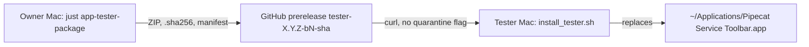
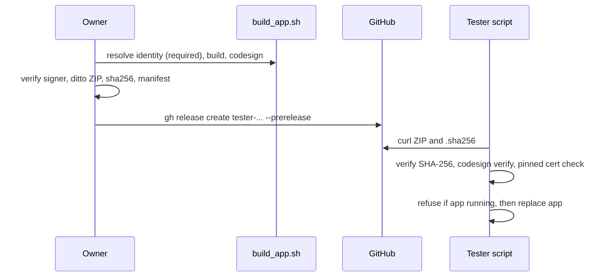

# Task: Ship an interim self-signed tester channel

**Status**: Planned — review pending
**Component**: distribution
**Assigned to**: Varun Singh
**Priority**: High
**Branch**: `docs/app-distribution-plan` (planning); implementation on a focused `feature/selfsigned-tester-*` branch cut from `main`
**Created**: 2026-11-21
**Review Gates**: none

## Objective

Get a self-signed build of the app to known testers before Thanksgiving (2026-11-26), through a repeatable
owner-run process, while the Developer ID certificate that the Apple-signed alpha needs is still pending.
Testers install with one `curl` command and no Xcode. The channel is interim and for known testers only. It is
not the public distribution path and it does not replace the Apple-signed plan.

## Context

- The Apple-signed alpha in `docs/plans/20261117-feature-app-distribution.md` needs a Developer ID certificate,
  notarization and a protected release workflow. It is accepted but not implemented, and the certificate is not
  expected until next week. That plan stays untouched above its review marker.
- The existing developer flow already signs with the owner's self-signed `Code Signing` identity:
  `just app-install` calls `scripts/resolve_sign_identity.sh --require` (`justfile:30`), and `scripts/build_app.sh`
  signs `bin/uv` and the app with `SIGN_IDENTITY` (`build_app.sh:17`, `:64-69`). That identity's designated
  requirement (bundle ID plus certificate) is stable across rebuilds, so Microphone and Speech Recognition grants
  survive updates. The ad-hoc default of `just app-build` is cdhash-bound and resets them.
- A self-signed app is rejected by Gatekeeper on another Mac if its ZIP carries the quarantine flag (any browser
  download). `curl` does not set that flag, so a `curl`-fetched ZIP installed by a script is not assessed. This
  bypasses Gatekeeper and is acceptable only for testers who know the owner. The plan must say so plainly.
- Verified facts (Explore, 2026-11-21): the build is host-architecture, Apple silicon only
  (`scripts/fetch_uv.sh` pins `uv-aarch64-apple-darwin`; `README.md:13`); `LSMinimumSystemVersion` is 15.0
  (`scripts/Info.plist:27-28`; `Package.swift` `.macOS(.v15)`); the bundle ID is `ai.pipecat.ServiceToolbar`; the
  version comes only from `app-version.json` (currently 0.4.1, build 474); no zip or package recipe exists
  (`ditto` appears only in `app-install` staging, `justfile:50`); `docs/usage.md` has no install section;
  `.github/workflows/` holds only `test.yml`; the UTM guest smoke in the Apple plan's Findings (arm64 macOS 26.6.2)
  already ran ad-hoc ZIPs built with `ditto -c -k --keepParent`.
- Where the pieces sit: Homebrew stays in the Apple-signed plan (Phase 8), because a cask delivers a notarized
  archive. A self-signed app cannot ship through it.

## Requirements

- Packaging is a single owner command, `just app-tester-package`, that fails before building when the self-signed
  identity is absent (`resolve_sign_identity.sh --require`), builds with it, verifies the result is signed by that
  certificate and not ad hoc, and writes a ZIP (`ditto -c -k --keepParent`), a `.sha256` file and a manifest into
  `dist/tester/`. The manifest records version, build, git commit, the certificate SHA-1 and the UTC time.
- Releases are GitHub prereleases published by the owner with `gh release create`, tagged
  `tester-<version>-b<build>-<shortsha>`. The `tester-` prefix keeps them clear of the Apple plan's `v*` tag
  ruleset, evidence check and signing ledger. The Apple plan's build rule still holds: builds come only from
  `app-version.json` and only increase. Tester drops do not bump it by themselves.
- The tester installer is `scripts/install_tester.sh`, committed and reviewed. It carries a committed constant
  `TESTER_CERT_SHA1`, the SHA-1 of the owner's self-signed certificate. The one-liner fetches the script from a
  reviewed commit, not from the release assets. The script:
  - downloads the named release's ZIP and `.sha256` with `curl` (no quarantine flag, HTTPS only, fixed host);
  - verifies the SHA-256 (corruption check only) and unpacks into a private temporary directory;
  - runs `codesign --verify --deep --strict` and requires the designated requirement to name
    `TESTER_CERT_SHA1`; any other signer is refused;
  - refuses to replace the app while it is running and tells the tester to quit it;
  - installs to `~/Applications/Pipecat Service Toolbar.app`, keeps the previous copy until the new one verifies,
    touches nothing outside the app bundle (no state, caches, models or preferences), and never uses `sudo`.
- Testers need Apple silicon and macOS 15 or newer; the script refuses otherwise with a clear message.
- A tester guide gives the one-liner, the manual fallback (System Settings > Privacy & Security > Open Anyway),
  update, uninstall (remove the app only; data stays), feedback, the honest Gatekeeper statement, and the move to
  the Apple-signed channel.
- Moving to the Apple-signed build changes the signing identity, so Microphone and Speech grants reset once. The
  Apple plan's verified-removal channel switch (its Phase 5 and Phase 8 text) covers the removal. The tester guide
  says so and the Apple plan's Findings gain a pointer to this plan; its contract text is not edited.
- Never reset a real installation or replace an installed app as a validation shortcut. Validation installs go to
  a UTM guest or to a temporary `APP_INSTALL_DIR`.
- Keep the bundle ID, AppPaths layout, preference keys, cache precedence and environment fingerprints unchanged.
  This plan adds no runtime app code.

## Review Focus

- Trust: the cert-hash pin is only as strong as where the script comes from. Confirm the one-liner's source and
  that no step fetches code from the release assets.
- Gatekeeper bypass is deliberate. Check the tester guide states it and limits the audience.
- Identity continuity: every tester build must be signed by the same certificate or grants reset on update.
- Interaction with the Apple plan: tag prefix, build numbering, ledger, evidence check and `docs/migration.md`
  `app-version.json` rules must not be triggered or violated.
- Installer safety: no `sudo`, no writes outside the app bundle, previous copy restored on a failed replace.

## Implementation Checklist

### Phase 1: Package a tester build

**Impl files:** `scripts/package_tester.sh`, `justfile`, `docs/development.md`
**Test files:** `python_tests/test_tester_channel.py`
**Test command:** `uv run pytest python_tests/test_tester_channel.py python_tests/test_app_recipes.py -q`
**Goal:** One command produces a verified, reproducibly named ZIP signed by the same certificate every time.

- Record the owner's certificate SHA-1 from the keychain (`security find-identity -p codesigning`) in
  `## Findings`. Note that the keychain currently lists two `Code Signing` entries; confirm they are one
  certificate before pinning.
- Add `scripts/package_tester.sh` and the `app-tester-package` recipe: resolve with `--require`, build, read
  `codesign -dr -` and fail unless it names the certificate leaf (not `cdhash`), `ditto -c -k --keepParent`, write
  the `.sha256` and manifest into `dist/tester/`, and add `dist/` to `.gitignore` if absent.
- Test hook: the script accepts `TESTER_APP_BUNDLE` to package a prebuilt bundle, used only by tests. Document it
  as test-only.
- Tests, following `test_app_recipes.py`: static recipe-order assertions; the script run with stub `security`,
  `codesign` and `ditto` on `PATH` for the missing-identity refusal, the ad-hoc refusal and the manifest fields.

### Phase 2: Tester installer

**Impl files:** `scripts/install_tester.sh`
**Test files:** `python_tests/test_tester_channel.py`
**Test command:** `uv run pytest python_tests/test_tester_channel.py -q`
**Goal:** An installer that refuses anything not signed by the pinned certificate and cannot damage an existing install.

- Write `scripts/install_tester.sh` per the Requirements, with `TESTER_CERT_SHA1` set from Phase 1's finding.
- Tests with stub `curl`, `codesign`, `sw_vers`, `uname` and a disposable `HOME`/`APP_INSTALL_DIR`: wrong
  architecture, macOS below 15, SHA-256 mismatch, wrong signer, running app refused, failed replace restores the
  previous copy, success leaves exactly one app and no temporary directory, and no `sudo` anywhere in the file.
- Static test: the script contains no `eval`, no unquoted expansion of downloaded values, and fetches only
  from the fixed GitHub release host.

### Phase 3: Tester guide and docs index

**Impl files:** `docs/tester-install.md`, `docs/README.md`, `README.md`, `docs/development.md`
**Test files:** `python_tests/test_tester_channel.py`
**Test command:** `uv run pytest python_tests/test_tester_channel.py python_tests/test_migration_contract.py -q`
**Goal:** A tester who has never seen the repo can install, update and remove the app from the guide alone.

- Write `docs/tester-install.md`: audience and the Gatekeeper statement, requirements, the one-liner with a
  placeholder tag that the release checklist fills, the Open Anyway fallback, update, uninstall, feedback (GitHub
  Issues with a `tester` label), and the Apple-signed switch with the one-time permission reset.
- Link it from `docs/README.md` and the root `README.md`. Add a one-line pointer in the Apple plan's `## Findings`
  below its marker; do not edit its contract.
- Test: the guide names `scripts/install_tester.sh`, the Open Anyway fallback and the permission-reset note, and
  `docs/README.md` links it.

### Phase 4: Owner validation and first drop (owner-run)

**Impl files:** this plan
**Test files:** none (manual validation in a UTM guest)
**Test command:** `uv run pytest -q`
**Goal:** Prove install, update and removal on a clean guest before any tester sees it.

- Owner runs `just app-tester-package` and publishes `tester-<version>-b<build>-<shortsha>` as a prerelease with
  the ZIP, `.sha256` and manifest.
- In a clean arm64 macOS 15 or newer UTM guest, run the one-liner and confirm it installs, launches, and asks for
  Microphone permission. Grant it. Publish a second build signed by the same certificate, run the one-liner again
  and confirm the app updates without a new permission prompt. Run the uninstall steps and confirm only the app
  bundle is removed.
- Check a ZIP signed by a different local identity is refused by the installer.
- Record each result in `## Findings`. Then invite testers with the one-liner and the guide.

## Technical Specifications

### Files to Modify

- `justfile`: add `app-tester-package`.
- `docs/development.md`: document the recipe, `TESTER_APP_BUNDLE` (test-only) and the release checklist.
- `docs/README.md`, `README.md`: link the tester guide.
- `.gitignore`: add `dist/` if absent.

### New Files to Create

- `scripts/package_tester.sh`, `scripts/install_tester.sh`
- `docs/tester-install.md`
- `python_tests/test_tester_channel.py`

### Architecture Decisions

- Trust root is the reviewed repository: the installer script and its pinned certificate hash come from a reviewed
  commit. The release holds only the ZIP, checksum and manifest.
- The `.sha256` guards against corruption only. Authenticity comes from the certificate pin.
- No `app-version.json` bump per tester drop; identity of a drop is version, build and commit in the tag and
  manifest. A real code change that needs a new build goes through a normal reviewed PR under the single-source rule.
- The installer is deliberately smaller than the Apple plan's installer (no journal, recovery or receipt) because
  it is interim, replaces only the app bundle and is for known testers.
- Not in this plan: Developer ID signing, notarization, the protected release workflow, Homebrew, automatic update.

### Dependencies

- The owner's self-signed `Code Signing` certificate in the login keychain, `gh` for publishing, and the existing
  `scripts/build_app.sh` and `scripts/resolve_sign_identity.sh`. No new runtime dependencies.

### Integration Seams

| Seam | Producer | Consumer | Contract |
|---|---|---|---|
| Package manifest | `package_tester.sh` | Owner, release notes | version, build, commit, cert SHA-1, UTC time |
| Release assets | Owner via `gh release create` | `install_tester.sh` | ZIP, `.sha256`, tag `tester-<version>-b<build>-<shortsha>` |
| Certificate pin | Owner keychain, Phase 1 finding | `install_tester.sh` | `TESTER_CERT_SHA1` equals the leaf hash in the app's designated requirement |
| Apple plan | This plan | Apple plan Phases 5 and 8 | Channel switch by verified removal; `tester-` tags and builds never enter the signing ledger |

## Architecture & Call Flow

| Step | Trigger | Enters context | Cleared/persisted | Turn boundary |
|---|---|---|---|---|
| Package | Owner runs the recipe | Local certificate, `app-version.json`, git commit | ZIP, checksum, manifest in `dist/tester/` | Owner reviews the output |
| Publish | `gh release create` | ZIP, checksum, manifest | Prerelease persists on GitHub | Owner posts the one-liner to testers |
| Install | Tester pastes the one-liner | Downloaded ZIP, pinned certificate hash | Installed app persists; temporary directory removed | Tester launches and grants permissions |

## Testing Notes

### Test Approach

- Python tests with stubbed `security`, `codesign`, `ditto`, `curl`, `sw_vers` and `uname` on `PATH` and a
  disposable `HOME`, as in `python_tests/test_app_recipes.py`. No test touches a real installation or keychain.
- Manual UTM guest validation in Phase 4; Swift tests are unaffected (no app code changes).
- Full local gate: `uv run ruff format .`, `uv run ruff check .`, `uv run pytest`; `swift test` and
  `just app-build` once the packaging recipe lands.

### Edge Cases

- Two `Code Signing` entries in the keychain; ad-hoc build offered for packaging; certificate rotated between drops
  (pin mismatch); app running during install; interrupted download; disk full during replace; Intel Mac; macOS 14.

## Acceptance Criteria

- `just app-tester-package` refuses without the self-signed identity and refuses an ad-hoc or wrong-signer bundle,
  and its ZIP, checksum and manifest are consistent.
- The installer installs only a ZIP signed by the pinned certificate, never replaces a running app, restores the
  previous copy on failure, writes nothing outside the app bundle and uses no `sudo`.
- On a clean arm64 guest the one-liner installs and launches the app; a second build from the same certificate
  updates it without a new Microphone prompt; uninstall removes only the app.
- The tester guide states the Gatekeeper bypass and audience limit, documents the Open Anyway fallback and the
  one-time permission reset when moving to the Apple-signed build.
- The Apple plan's contract text, ledger, tag ruleset and evidence rules are unchanged and not triggered.
- Docs updated; `uv run ruff format .`, `uv run ruff check .` and `uv run pytest` pass; code reviewed.

<!-- review marker: pending /review-plan -->

## Progress

- [ ] Phase 1: Package a tester build
- [ ] Phase 2: Tester installer
- [ ] Phase 3: Tester guide and docs index
- [ ] Phase 4: Owner validation and first drop

## Findings

Planning only. Target: first tester drop by 2026-11-25.

## Issues & Solutions

## Final Results

Not implemented.
