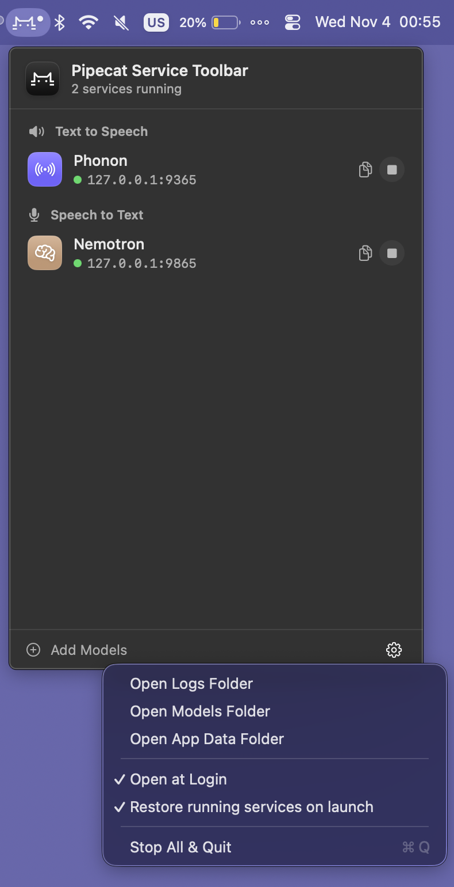

# Using the toolbar

[Documentation](README.md) · [Quickstart](../README.md#quickstart) · [Services and models](services.md)

Click the cat in the menu bar, open **Add Models**, click **Get** on a model,
then **Start**. Right-click a running service to copy its URL or Pipecat snippet.

## Menu bar

- **Running**: the main menu lists the services the app started and the External
  ones it adopted, grouped into Text to Speech and Speech to Text, each with its
  address and a copy button; Stop only on the app's own (External rows show
  `External · <agent label or address>`).
  When one category has an active service and the other has nothing active,
  installing, being removed or being checked, the idle category shows one suggestion row with a
  Start button: the model you last started there, else the category default, else
  the first installed model whose cache check does not refuse it (never `tone`). It is
  shown only once the launch restore has run and the app is ready (not while it is checking services,
  resetting, quitting or showing a failed setup), and not when both categories are active.
  If Start has to refresh that model's packages first, its row stays and shows the install
  progress (with Cancel) until the model is starting, while nothing else in that category is
  active (an exception to the rule above).
- **Add Models**: every model, by type, with Get, Start and download progress.
  Python and model weights are fetched on first Get; nothing is bundled.
- **Right-click** any service: **Copy URL**, **Copy Pipecat Service**,
  **Copy Environment Variables**, Start/Stop, **Delete Model…** (an External
  service gets the Copy items, Test and Show Details only). Deleting
  removes the model's Python environment and, unless another installed variant
  still uses them, its weights from the Hugging Face cache. Those weights live
  in the shared cache, so a command-line or launchd server using the same model
  downloads them again after a delete. Which **Delete…** buttons the detail
  page offers follows [Model source](architecture.md#model-source).
- **Try it**: type text and hear a TTS model. For STT, record from the
  microphone or transcribe a fixed spoken test clip (`STTSampleClip`, no
  microphone) and see whether the transcript matches its sentence. An External
  STT server gets the clip only: the app never sends it live microphone audio.
  Right-click a running service for **Test Voice** (speaks a line naming the
  model) or **Test Transcription** (the clip); both open the details view,
  which shows the result.
- **Problems** show inline: a busy port names the process (and the launchd
  agent) holding it; a crashed server keeps its log and a Restart button.
- **Try Again**: if the app can't find its tools at launch (`uv`, the server
  wheel), the main menu shows why with a Try Again button, which re-runs the
  check. It is disabled while a check runs.
- **Reset**: when environments from an incompatible app version are found, a
  banner offers Reset, which deletes every Python environment (not model
  weights) and checks the services again. It is refused while a server the app
  started runs, or a service installs or is being deleted; an External server
  does not block it (Reset deletes only the app's own environments and never
  touches that server). Reset also clears the saved set of services to restore,
  so the next launch restores none, and the last-used models. While Reset or the launch check runs, the
  Python services' Get, Start and Delete are disabled.

## Servers you didn't start

- **Adopt first.** The app probes each Python service's catalog port
  (loopback TCP only; Apple Speech is not adopted) with a
  `server.hello`. A running server whose backend and model match a catalog entry
  is adopted and shown as **External**; the app starts its own only when
  nothing answers. Discovery runs at launch, whenever the panel opens, and every
  15 s while it stays open.
- **Ownership.** The app only signals, stops or deletes processes it started.
  An External service has no per-service Stop, Delete, Get or Install; it offers
  Try it (for STT, the test clip only, never the microphone) and the Copy items.
  Reset is app-wide: it deletes only the app's own `envs` directory and layout
  file and clears the saved set of services to restore (`restore.wanted`) and the
  last-used models behind the Running suggestion (`lastUsed.tts`, `lastUsed.stt`), never
  signals or stops an External server, and is not blocked by one.
  **Quit leaves it running**
  (the Quit item reads "Quit" when the app owns nothing, "Stop All & Quit" when it does).
- **Beside launchd agents.** The server repositories' `just tts-install` and `just stt-*`
  agents use the same ports, so a running agent whose hello matches shows as External. If
  whatever holds the port does not identify as that service (a different
  backend or model, no hello, or a token), Start reports the port busy, naming
  the holder when `launchctl` confirms it (the agent's label).
- **Not discovered:** Unix sockets, servers on other ports, LAN endpoints. A
  server that needs a bearer token is not adopted (Start then reports the port busy
  because it wants a token); the app stores no token.
- **STT pin.** The current pin is `pipecat-local-stt-server==0.6.0`: the app starts STT through
  its own CLI (`python -m stt_server serve --supervised`). An STT agent on another version
  is still adopted by its hello; the app only starts the pinned version.

## Restore and Quit

- **Restore on launch**: the app remembers which services you had running and starts
  them again at the next launch, after the launch check finishes, once per process.
  The **Restore running services on launch** preference (`restoreOnLaunch`) is on by default; the toggle is in the panel's gear menu beside Open at Login.
  A service whose port is stale or busy ends Failed and is not retried. A service you
  stopped, deleted, or that failed is not restored. Quitting does not change the set (a
  server that becomes ready, or fails, during Quit's shutdown keeps its entry; a Stop during
  shutdown still clears that service), and Reset clears it.
- **Quit confirmation**: Quit asks first when a client is connected to a server the app started.
  The choices are "Quit anyway" or "Cancel". A count that cannot be read also asks.
  So does any quit that is not system-initiated, including the one `just app-open` and
  `app-install` send via `quit_app.sh`.
  Logout, Restart and Shut Down are not asked (provisional codes; see Known limits).
- **Connection counts** exclude the app's own probes and Try it sessions. Loopback
  tunnels count as clients. A half-open connection can count until server keepalive
  expires (about 140 s with the TTS defaults; STT timing is unverified).
  See [Restore and quit guard](architecture.md#restore-and-quit-guard) for the
  counting rules and how unreadable counts trigger confirmation.
- **Updating with no dropped clients**: the app's Quit stops its servers. For a
  zero-drop update run the TTS server as a LaunchAgent (`just tts-install <backend>` in the
  pipecat-local-tts-server checkout);
  the app then shows it as External and leaves it running. TTS servers only.

### Known limits / unverified

- The quit-reason codes that identify a system-initiated quit are provisional
  (the standard four-character codes). A manual check on a real Log Out, Restart and
  Shut Down has not been run yet.
- What happens when a second terminate arrives while the confirmation is showing is
  unverified; the code answers it with cancel.

## Where things live

| Path | Contents |
|---|---|
| `~/Library/Application Support/Pipecat Service Toolbar/` | managed Python, one venv per model family |
| `~/Library/Caches/Pipecat Service Toolbar/uv/` | package cache |
| `~/.cache/huggingface/hub/` | model weights, shared with CLI use (`HF_HOME` honoured) |
| `~/Library/Caches/moonshine_voice/` | Moonshine's weights, shared with CLI use (`MOONSHINE_VOICE_CACHE` honoured) |
| `~/Library/Logs/Pipecat Service Toolbar/` | one log per service |
| `~/Library/Caches/pipecat-tts-build/uv/<version>/` | the pinned `uv` the build bundles (build time only; `PIPECAT_TTS_BUILD_CACHE` moves the root) |

App diagnostics: `log stream --predicate 'subsystem == "ai.pipecat.ServiceToolbar"'`.
